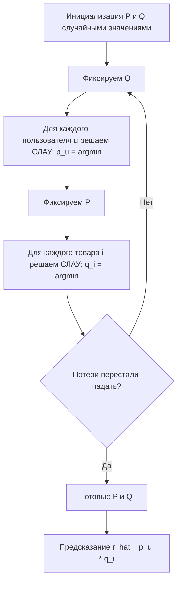

# ALS (Alternating Least Squares)

**ALS** (Alternating Least Squares, метод наименьших квадратов с чередованием) — итерационный алгоритм матричной факторизации, который решает задачу приближения разреженной матрицы «пользователи × товары» произведением двух низкоразмерных матриц, поочерёдно фиксируя одну из них и решая задачу наименьших квадратов для второй. Благодаря замкнутому аналитическому решению на каждом шаге и параллелизации ALS стал стандартом для больших разреженных матриц (Apache Spark MLlib, implicit).

## Подробное описание

**Постановка задачи:**
Дана разреженная матрица оценок $R$ ($m \times n$), известны только элементы из $\Omega$. Найти латентные матрицы $P$ ($m \times k$) и $Q$ ($n \times k$), минимизируя функцию потерь с регуляризацией. В отличие от SGD-подхода (FunkSVD), обновление каждого вектора считается аналитически.

**Входные данные:**

- Разреженная матрица взаимодействий $R$
- Размерность латентных факторов $k$
- Коэффициент регуляризации $\lambda$

**Выходные данные:**

- Матрицы пользовательских факторов $P$ и товарных факторов $Q$
- Предсказания $\hat{r}_{ui} = p_u^T q_i$

**Ключевая идея:**
Задача одновременно по $P$ и $Q$ не является выпуклой, но при фиксации одной из матриц становится набором независимых выпуклых задач наименьших квадратов — по одной на каждого пользователя или товар. Каждая такая задача решается точно за $O(k^3 + k^2 n_u)$ через систему $k \times k$. Пары $(P, Q)$ чередуются до сходимости, причём шаги по разным пользователям/товарам полностью независимы и легко параллелизуются.

**Исторический контекст:**
Метод описан в работе Ху, Кабер и Воллес (Hu, Koren, Volinsky, 2008) «Collaborative Filtering for Implicit Feedback Datasets» — там же предложен вариант Implicit ALS (iALS) для неявных взаимодействий (покупки, просмотры без оценок). Apache Spark MLlib реализует ALS как дефолтный алгоритм рекомендаций, что сделало его промышленным стандартом для разреженных данных.

## Основные принципы

### Математическая формулировка

Целевая функция (как в FunkSVD):

$$
L(P, Q) = \sum_{(u,i) \in \Omega} (r_{ui} - p_u^T q_i)^2 + \lambda \left( \sum_u \|p_u\|^2 + \sum_i \|q_i\|^2 \right)
$$

**Шаг 1 — фиксируем $Q$, решаем для каждого пользователя $u$:**

$$
p_u = \left( Q_u^T Q_u + \lambda I \right)^{-1} Q_u^T r_u
$$

Где:

- $Q_u$ — подматрица $Q$, строки которой соответствуют товарам, оценённым пользователем $u$
- $r_u$ — вектор его оценок
- $I$ — единичная матрица $k \times k$

**Шаг 2 — фиксируем $P$, решаем для каждого товара $i$:**

$$
q_i = \left( P_i^T P_i + \lambda I \right)^{-1} P_i^T r_i
$$

Где:

- $P_i$ — подматрица $P$, строки которой соответствуют пользователям, оценившим товар $i$

Шаги 1 и 2 чередуются до сходимости (изменение функции потерь меньше порога или фиксированное число итераций, типично 10–20).

**Вариант Implicit ALS:**
Для неявных сигналов $c_{ui} > 0$ (уверенность: чем больше взаимодействий, тем выше) и бинарных $p_{ui} \in \{0, 1\}$:

$$
\min_{P,Q} \sum_{u,i} c_{ui} (p_{ui} - p_u^T q_i)^2 + \lambda (\|p_u\|^2 + \|q_i\|^2)
$$

Решение получает диагональным «пре-умножением» уверенности $C^u = \mathrm{diag}(c_{u,:})$:

$$
p_u = \left( Q^T C^u Q + \lambda I \right)^{-1} Q^T C^u p_{u,:}
$$

### Схема итерации ALS



## Пример реализации на Python

Самодостаточная реализация явного ALS на `numpy`: на каждом шаге для каждого пользователя/товара решается регуляризованная задача наименьших квадратов через систему $k \times k$ (`np.linalg.solve`).

```python
import numpy as np
from typing import Tuple


class ALS:
    """Alternating Least Squares для матричной факторизации разреженной матрицы оценок."""

    def __init__(self, k: int = 3, reg: float = 0.1, epochs: int = 15, seed: int = 42):
        self.k = k
        self.reg = reg
        self.epochs = epochs
        self.seed = seed
        self.P: np.ndarray | None = None
        self.Q: np.ndarray | None = None

    def fit(self, R: np.ndarray) -> "ALS":
        """Обучение: поочерёдное решение задач наименьших квадратов для P и Q."""
        rng = np.random.default_rng(self.seed)
        m, n = R.shape
        # Инициализация латентных факторов небольшими случайными значениями
        self.P = rng.normal(0, 0.1, (m, self.k))
        self.Q = rng.normal(0, 0.1, (n, self.k))
        reg_I = self.reg * np.eye(self.k)

        # Предвычисляем индексы оценённых товаров по каждому пользователю и наоборот
        user_items = [np.nonzero(R[u] != 0)[0] for u in range(m)]
        item_users = [np.nonzero(R[:, i] != 0)[0] for i in range(n)]

        for epoch in range(self.epochs):
            # --- Шаг 1: фиксируем Q, решаем для всех пользователей ---
            for u in range(m):
                items = user_items[u]
                if len(items) == 0:
                    continue  # нет ни одной оценки — оставляем как есть
                Q_u = self.Q[items]          # (n_u, k)
                r_u = R[u, items]            # (n_u,)
                # p_u = (Q_u^T Q_u + reg*I)^-1 Q_u^T r_u
                A = Q_u.T @ Q_u + reg_I
                b = Q_u.T @ r_u
                self.P[u] = np.linalg.solve(A, b)

            # --- Шаг 2: фиксируем P, решаем для всех товаров ---
            for i in range(n):
                users = item_users[i]
                if len(users) == 0:
                    continue  # товар без оценок — оставляем как есть
                P_i = self.P[users]
                r_i = R[users, i]
                A = P_i.T @ P_i + reg_I
                b = P_i.T @ r_i
                self.Q[i] = np.linalg.solve(A, b)

            # Отслеживание качества
            if (epoch + 1) % 5 == 0:
                mask = R != 0
                residuals = (self.reconstruct()[mask] - R[mask]) ** 2
                print(f"    итерация {epoch + 1}: RMSE на известных оценках = {np.sqrt(residuals.mean()):.4f}")

        return self

    def predict(self, u: int, i: int) -> float:
        """Предсказание оценки пользователя u товару i."""
        return float(self.P[u] @ self.Q[i])

    def reconstruct(self) -> np.ndarray:
        """Полная аппроксимированная матрица оценок P @ Q^T."""
        return self.P @ self.Q.T


if __name__ == "__main__":
    # Разреженная матрица оценок: 7 пользователей x 10 товаров
    R = np.array([
        [5, 4, 0, 0, 1, 0, 0, 0, 0, 0],
        [4, 5, 0, 0, 1, 0, 0, 0, 0, 0],
        [0, 0, 5, 4, 0, 0, 1, 0, 0, 0],
        [0, 0, 4, 5, 0, 0, 1, 0, 0, 0],
        [1, 0, 0, 0, 5, 4, 0, 0, 0, 0],
        [0, 0, 0, 1, 4, 5, 0, 4, 0, 0],
        [0, 0, 0, 0, 0, 0, 0, 5, 4, 5],
    ], dtype=float)

    print("Матрица оценок (0 = нет оценки):")
    print(R.astype(int))
    print(f"Заполнено: {(R != 0).sum()} из {R.size} ({(R != 0).mean():.0%}) — крайне разреженная\n")

    print("Обучение ALS (k=3, lambda=0.1):")
    model = ALS(k=3, reg=0.1, epochs=15).fit(R)

    print("\nАппроксимированная матрица P @ Q^T:")
    print(np.round(model.reconstruct(), 2))

    print("\nПредсказания для отсутствующих оценок:")
    # предсказания не ограничены шкалой оценок — на практике их обрезают границами [min, max]
    for u, i in [(0, 2), (0, 3), (2, 0), (4, 2), (6, 0), (6, 1)]:
        print(f"  r[{u}, {i}]: предсказание = {model.predict(u, i):.2f}")

    # Рекомендации: топ-3 непросмотренных товара
    for u in (0, 6):
        unseen = np.where(R[u] == 0)[0]
        scores = sorted(((i, model.predict(u, i)) for i in unseen), key=lambda x: -x[1])
        recs = ", ".join(f"товар {i} ({s:.2f})" for i, s in scores[:3])
        print(f"\nТоп-3 рекомендации для пользователя {u}: {recs}")

    # Сравнение с SGD-подходом на том же примере
    mask = R != 0
    print(f"\nИтоговый RMSE ALS на известных оценках: "
          f"{np.sqrt(((model.reconstruct()[mask] - R[mask]) ** 2).mean()):.4f}")
```

## Достоинства и недостатки

**Достоинства:**

1. **Аналитический шаг вместо SGD** — нет необходимости подбирать learning rate, сходимость более предсказуема
2. **Параллелизм по построению** — обновления для разных пользователей (или товаров) независимы и масштабируются на кластер: именно поэтому ALS стал дефолтом Apache Spark MLlib
3. **Устойчивость к разреженности** — каждый шаг решает маленькую задачу $k \times k$ только по фактически оценённым элементам, нули в матрице не обрабатываются
4. **Простота реализации** — достаточно `np.linalg.solve` на системе размера $k$; всего 10–20 итераций обычно достаточно

**Недостатки:**

1. **Память на больших данных** — полная реализация может материализовать разреженные подматрицы $Q_u$, поэтому в кластерных версиях требуется аккуратная работа с распределёнными структурами
2. **Проблема холодного старта** — как и у всей матричной факторизации, новые пользователи/товары без оценок не получают латентных векторов
3. **Явная обратная связь** — базовый ALS работает с рейтингами; для неявных сигналов нужен взвешенный вариант iALS, где нули заменяются весами уверенности
4. **Приближённая сходимость** — нет гарантии глобального минимума (функция невыпукла совместно по $P$ и $Q$), результат зависит от инициализации

## Области применения

1. Машинное обучение и рекомендательные системы (построение латентных факторов для персонализации на миллиардах взаимодействий, библиотеки Spark MLlib и implicit)
2. Аналитика данных и базы данных (факторизация разреженных матриц «пользователи × признаки», сжатие больших таблиц взаимодействий, ETL-пайплайны на Spark)
3. Торговля и коммерция (подбор товаров для маркетплейсов с неявными сигналами — покупки, просмотры, время на карточке)
