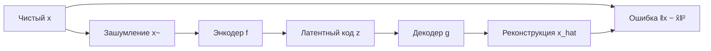

# Автоэнкодеры (Autoencoders)

Автоэнкодер (Autoencoder) — нейросеть без учителя, обучаемая копировать вход на выход через узкое «бутылочное горлышко» (bottleneck): энкодер сжимает данные в латентное представление, декодер восстанавливает их из него.

## Подробное описание

**Постановка задачи:**  
Найти компактное представление данных, сохраняющее их информативные свойства, без размеченных меток.

**Входные данные:**

- Неразмеченные объекты $x_1, ..., x_n$ (изображения, векторы признаков, токены)
- Как правило, нормализованные: $x \in [0, 1]^d$ или $x \in [-1, 1]^d$

**Выходные данные:**

- Латентный код $z = f_{\text{enc}}(x) \in \mathbb{R}^{m}$, где $m \ll d$
- Реконструкция $\hat{x} = f_{\text{dec}}(z)$, близкая к исходному $x$

**Ключевая идея:**  
Если восстановление из сжатого кода почти идеально, значит, код уловил основные закономерности данных. Обучение идёт минимизацией ошибки реконструкции — это собственный «мета-признак» качества, не требующий разметки.

**Исторический контекст:**  
Идея автоэнкодеров восходит к линейным методам вроде PCA (который эквивалентен линейному автоэнкодеру с MSE). Нелинейные автоэнкодеры распространились с развитием глубокого обучения; шумоподавляющие (denoising) автоэнкодеры предложены Винсентом и коллегами в 2008 году.

## Основные принципы

### Математическая формулировка

Энкодер $f$ и декодер $g$ обучаются совместно:

$$
z = f(x) = \sigma(W_e x + b_e), \qquad
\hat{x} = g(z) = \sigma(W_d z + b_d)
$$

Целевая функция — ошибка реконструкции:

$$
\mathcal{L} = \frac{1}{n} \sum_{i=1}^{n} \| x_i - g(f(x_i)) \|^2
$$

Где:

- $W_e \in \mathbb{R}^{m \times d}$, $W_d \in \mathbb{R}^{d \times m}$ — веса энкодера и декодера, $m \ll d$
- $\sigma$ — нелинейная активация (ReLU, sigmoid в зависимости от данных)
- $\| \cdot \|^2$ — квадрат евклидова расстояния; для данных на вероятностном пространстве применяется кросс-энтропия

**Варианты:**

1. **Shallow / deep autoencoder** — обычная минимизация реконструкции; опасность — вырождение в тождественное преобразование (identity mapping), если горлышко не сжато.
2. **Denoising autoencoder (DAE)** — на вход подаётся зашумлённый $\tilde{x} = x + \epsilon$ (или маскированный), цель — восстановить чистый $x$; это заставляет модель учитывать структуру, а не шум.
3. **Sparse autoencoder** — дополнительный штраф на разреженность латентного кода (L1-регуляризация).
4. **Variational autoencoder (VAE)** — латентное распределение параметризуется гауссианой; обучение вариационным выводом (описан отдельной статьёй).

### Схема обучения DAE



## Пример реализации на Python

Глубокий автоэнкодер и его шумоподавляющая версия на `numpy` для восстановления двумерных «полумесяцев»; латентный код визуально сжимает облако точек.

```python
import numpy as np
from typing import Tuple


class DenseLayer:
    """Полносвязный слой с сохранением кэшей для обратного прохода."""

    def __init__(self, in_dim: int, out_dim: int, rng, activation: str = "relu"):
        self.W = rng.normal(0, np.sqrt(2.0 / in_dim), (in_dim, out_dim))
        self.b = np.zeros(out_dim)
        self.activation = activation

    def forward(self, x: np.ndarray) -> np.ndarray:
        self.x = x
        z = x @ self.W + self.b
        if self.activation == "relu":
            self.a = np.maximum(0, z)
        elif self.activation == "sigmoid":
            self.a = 1.0 / (1.0 + np.exp(-np.clip(z, -30, 30)))
        else:  # линейный выход
            self.a = z
        return self.a

    def backward(self, d_out: np.ndarray, lr: float) -> np.ndarray:
        if self.activation == "relu":
            d_out = d_out * (self.a > 0)
        elif self.activation == "sigmoid":
            d_out = d_out * self.a * (1 - self.a)
        dW = self.x.T @ d_out
        db = d_out.sum(axis=0)
        d_x = d_out @ self.W.T
        self.W -= lr * dW
        self.b -= lr * db
        return d_x


class Autoencoder:
    """Автоэнкодер input_dim -> 16 -> latent_dim -> 16 -> input_dim."""

    def __init__(self, input_dim: int = 2, latent_dim: int = 1, seed: int = 0):
        rng = np.random.default_rng(seed)
        self.enc = [
            DenseLayer(input_dim, 16, rng, "relu"),
            DenseLayer(16, latent_dim, rng, "linear"),
        ]
        self.dec = [
            DenseLayer(latent_dim, 16, rng, "relu"),
            DenseLayer(16, input_dim, rng, "sigmoid"),
        ]

    def encode(self, x):
        for layer in self.enc:
            x = layer.forward(x)
        return x

    def decode(self, z):
        for layer in self.dec:
            z = layer.forward(z)
        return z

    def forward(self, x):
        return self.decode(self.encode(x))

    def train_step(self, x: np.ndarray, lr: float = 0.05) -> float:
        """Один шаг градиентного спуска по MSE реконструкции."""
        out = self.forward(x)
        loss = np.mean((out - x) ** 2)
        # Градиент MSE по выходу
        d = 2.0 * (out - x) / x.size
        for layer in reversed(self.dec):
            d = layer.backward(d, lr)
        for layer in reversed(self.enc):
            d = layer.backward(d, lr)
        return float(loss)


def make_moons(n: int = 200, noise: float = 0.08, seed: int = 0) -> np.ndarray:
    """Датасет двух полумесяцев (как в sklearn, но на чистом numpy)."""
    rng = np.random.default_rng(seed)
    n1 = n // 2
    t = np.linspace(0, np.pi, n1)
    moon1 = np.stack([np.cos(t), np.sin(t)], axis=1)
    moon2 = np.stack([1 - np.cos(t), 0.5 - np.sin(t)], axis=1)
    data = np.vstack([moon1, moon2])
    data += rng.normal(0, noise, data.shape)
    # Нормализация в [0, 1] под сигмоиду на выходе
    data = (data - data.min(0)) / (data.max(0) - data.min(0))
    return data


if __name__ == "__main__":
    data = make_moons(n=400, seed=1)
    ae = Autoencoder(input_dim=2, latent_dim=1, seed=42)

    print("Обучение автоэнкодера (реконструкция полумесяцев):")
    for epoch in range(301):
        loss = ae.train_step(data, lr=0.1)
        if epoch % 100 == 0:
            print(f"  эпоха {epoch:3d}, MSE = {loss:.6f}")

    # Сравнение: реальные точки vs реконструкции
    recon = ae.forward(data)
    print(f"\nИтоговая ошибка реконструкции: {np.mean((recon - data) ** 2):.6f}")

    # Латентное представление «сжимает» облако: 2 признака -> 1 число
    z = ae.encode(data)
    print(f"Размерность до сжатия: {data.shape[1]}, после: {z.shape[1]}")
    print(f"Разброс исходных признаков (std): {data.std(axis=0).round(4)}")
    print(f"Разброс латентного кода (std):    {z.std(axis=0).round(4)}")

    # Denoising-режим: добавляем шум на вход, цель — чистые данные
    ae_dae = Autoencoder(input_dim=2, latent_dim=1, seed=7)
    rng = np.random.default_rng(3)
    print("\nОбучение denoising-автоэнкодера:")
    for epoch in range(301):
        noisy = np.clip(data + rng.normal(0, 0.15, data.shape), 0, 1)
        # В DAE вход зашумлённый, но градиент считаем к чистым данным:
        # простая реализация — учим на (noisy -> data) через прямой проход
        out = ae_dae.forward(noisy)
        loss = np.mean((out - data) ** 2)
        d = 2.0 * (out - data) / data.size
        for layer in reversed(ae_dae.dec):
            d = layer.backward(d, 0.1)
        for layer in reversed(ae_dae.enc):
            d = layer.backward(d, 0.1)
        if epoch % 100 == 0:
            print(f"  эпоха {epoch:3d}, MSE до чистых данных = {loss:.6f}")

    recon_dae = ae_dae.forward(np.clip(data + rng.normal(0, 0.15, data.shape), 0, 1))
    print(f"Качество очистки шума (MSE): {np.mean((recon_dae - data) ** 2):.6f}")
```

## Достоинства и недостатки

**Достоинства:**

1. **Обучение без учителя** — разметка данных не нужна: цель (реконструкция) задаётся самими данными.
2. **Нелинейное снижение размерности** — в отличие от PCA, автоэнкодер умеет отображать изогнутые и разделимые нелинейные структуры.
3. **Универсальность задач** — шумоподавление, сжатие, детекция аномалий (аномалии реконструируются плохо), извлечение признаков для downstream-задач.
4. **Стабильное обучение** — обычная MSE-оптимизация без соревновательной динамики GAN и вариационного вывода VAE.

**Недостатки:**

1. **Локальные минимумы** — грубая сжатая модель может выучить тривиальное приближение, теряя структуру данных.
2. **Нет вероятностной модели** — латентный код — точка, а не распределение; нельзя напрямую семплировать новые данные (в отличие от VAE).
3. **Аномалия не всегда = большая ошибка** — на практике автоэнкодер иногда неплохо реконструирует и аномалии, если они похожи на обучающую выборку.

## Области применения

1. Машинное обучение и рекомендательные системы (сжатие признаков пользователей, предобучение эмбеддингов, детекция аномалий в платежах)
2. Обработка естественного языка (плотные документные представления для кластеризации и поиска, автоэнкодеры последовательностей)
3. Биотехнологии и медицинская информатика (шумоподавление в изображениях МРТ/КТ, сжатие телеметрии ЭКГ-датчиков)
