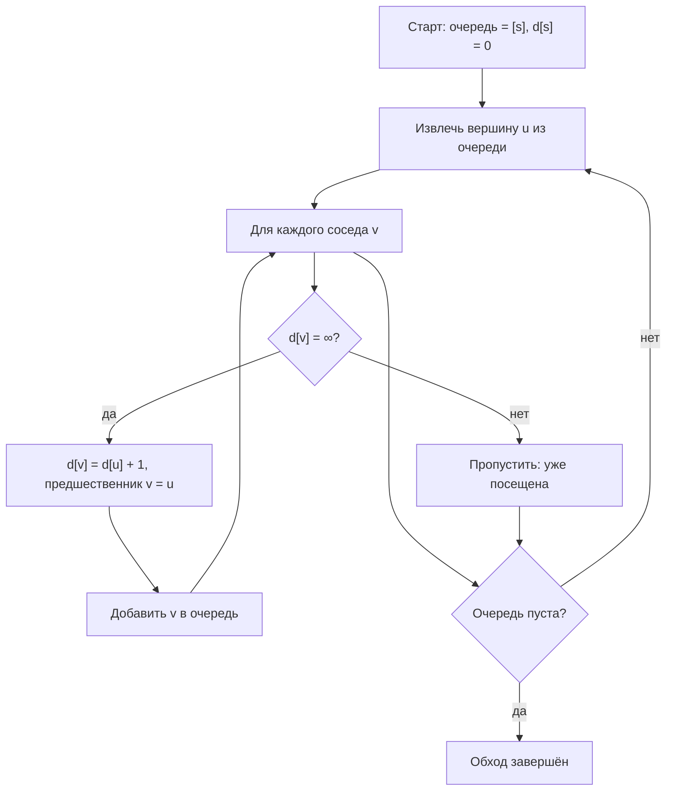

# Поиск в ширину (BFS, Breadth-First Search)

Поиск в ширину (Breadth-First Search, BFS) — алгоритм обхода графа, который исследует вершины слоями: сначала все вершины на расстоянии 1 от источника, затем на расстоянии 2, и так далее, гарантируя кратчайший путь в невзвешенном графе.

## Подробное описание

**Постановка задачи:**

Дан граф $G = (V, E)$ и стартовая вершина $s$. Найти все достижимые из $s$ вершины, расстояния до них, кратчайший путь до выбранной вершины или проверить, связан ли граф.

**Входные данные:**

- Граф: список смежности (или матрица смежности) и число вершин
- Стартовая вершина $s$; для поиска пути — целевая вершина $t$

**Выходные данные:**

- Порядок обхода вершин
- Расстояния $d[v]$ (число рёбер) от $s$ до каждой достижимой вершины
- Кратчайший путь $s \to t$ (восстановление по предшественникам) или заключение о недостижимости

**Ключевая идея:**

Очередь (FIFO) хранит «границу» обхода. Пока очередь не пуста, извлекается первая вершина, и все её ещё не посещённые соседи добавляются в конец очереди. За счёт порядка FIFO все вершины уровня $k$ обрабатываются раньше вершин уровня $k+1$, поэтому первое посещение вершины происходит по кратчайшему пути.

**Исторический контекст:**

BFS описан ещё в трудах по теории графов XX века и стал стандартным алгоритмом обхода; его вариация — двунаправленный BFS (bidirectional search) — сокращает область поиска вдвое и реализована в статье про двунаправленный A*.

## Основные принципы

### Математическая формулировка

Инициализация:

$$
d[s] = 0, \qquad d[v] = \infty \;\; \forall v \ne s
$$

Правило релаксации при обработке вершины $u$:

$$
\text{если } d[v] = \infty \text{ для соседа } v, \text{ то } d[v] = d[u] + 1, \; \pi[v] = u
$$

Инвариант: при извлечении вершины из очереди её $d$-значение минимально среди находящихся в очереди, поэтому первое посещение оптимально. Сложность:

$$
T = O(|V| + |E|), \qquad S = O(|V|)
$$

Где:

- $d[v]$ — кратчайшее расстояние (в рёбрах) от $s$ до $v$
- $\pi[v]$ — предшественник $v$ на кратчайшем пути (для восстановления пути)
- $V$ — множество вершин, $E$ — множество рёбер
- $O(|V| + |E|)$ — каждая вершина заходит в очередь не более одного раза, каждое ребро осматривается один раз (для списков смежности)

### Схема обхода очередью



## Пример реализации на Python

```python
from collections import deque
from typing import Dict, List, Optional


def bfs(graph: Dict[int, List[int]], start: int) -> tuple:
    """Обход в ширину: возвращает порядок обхода и расстояния."""
    order: List[int] = []
    dist: Dict[int, int] = {start: 0}
    queue = deque([start])
    while queue:
        u = queue.popleft()          # извлекаем самую раннюю вершину
        order.append(u)
        for v in graph.get(u, []):
            if v not in dist:        # первое посещение => кратчайший путь
                dist[v] = dist[u] + 1
                queue.append(v)
    return order, dist


def shortest_path(graph: Dict[int, List[int]], start: int, target: int) -> Optional[List[int]]:
    """Кратчайший путь из start в target (или None, если недостижима)."""
    prev: Dict[int, int] = {}
    dist = {start: 0}
    queue = deque([start])
    while queue:
        u = queue.popleft()
        if u == target:
            break
        for v in graph.get(u, []):
            if v not in dist:
                dist[v] = dist[u] + 1
                prev[v] = u
                queue.append(v)
    if target not in dist:
        return None
    # восстановление пути от цели к началу
    path = [target]
    while path[-1] != start:
        path.append(prev[path[-1]])
    return path[::-1]


def is_connected(graph: Dict[int, List[int]], start: int) -> bool:
    """Проверка: достижимы ли все вершины из start."""
    order, _ = bfs(graph, start)
    return len(order) == len(graph)


if __name__ == "__main__":
    # Неориентированный граф: визуальная «лестница» с перекрёстной связью
    graph = {
        0: [1, 2],
        1: [0, 3],
        2: [0, 3, 4],
        3: [1, 2, 5],
        4: [2, 5],
        5: [3, 4],
        6: [6],  # изолированная петля: недостижима из 0
    }
    # убираем петлю для чистоты демонстрации связности
    graph[6] = []

    order, dist = bfs(graph, 0)
    print("Порядок обхода из 0:", order)
    print("Расстояния:", dict(sorted(dist.items())))
    print("Все вершины достижимы:", is_connected(graph, 0))

    path = shortest_path(graph, 0, 5)
    print("Кратчайший путь 0 -> 5:", path, f"(длина {len(path) - 1})")
    print("Недостижима 6 ->", shortest_path(graph, 0, 6))

    # Уровни графа: слои по расстоянию от источника
    levels: Dict[int, List[int]] = {}
    for v, d in dist.items():
        levels.setdefault(d, []).append(v)
    print("Уровни:", {d: vs for d, vs in sorted(levels.items())})

    # Проверка на графе-сетке: BFS гарантирует минимальное число шагов
    grid = [[0, 0, 0, 0],
            [1, 0, 1, 0],
            [1, 0, 0, 0]]
    # 0 — проходимая клетка, 1 — стена; 4-связность
    H, W = len(grid), len(grid[0])
    cells = {(i, j) for i in range(H) for j in range(W) if grid[i][j] == 0}
    gg = {(i, j): [(i + di, j + dj)
                   for di, dj in ((1, 0), (-1, 0), (0, 1), (0, -1))
                   if (i + di, j + dj) in cells]
          for i, j in cells}
    g_order, g_dist = bfs(gg, (0, 0))
    print(f"\nКлетка (2, 3) достижима за {g_dist.get((2, 3))} шагов по сетке")
```

## Достоинства и недостатки

**Достоинства:**

1. **Кратчайшие пути** — в невзвешенном (или единичного веса) графе расстояния от источника оптимальны по числу рёбер
2. **Простота и предсказуемость** — алгоритм использует только очередь и словарь посещённых вершин
3. **Линейная сложность** — $O(|V| + |E|)$ при списке смежности: каждая вершина и каждое ребро обрабатываются один раз
4. **Проверка связности и достижимости** — за один обход определяется компонента связности, содержащая источник

**Недостатки:**

1. **Память под «фронт»** — в широком графе очередь может достичь $O(|V|)$, что критично для графов с миллионами вершин
2. **Не учитывает веса** — при положительных разных весах рёбер кратчайший путь считается алгоритмами Дейкстры или Беллмана — Форда
3. **Неприменим к отрицательным весам** — как и Дейкстра, BFS корректен только для невзвешенных графов
4. **Локальный вид** — BFS не даёт эвристического приближения к цели; в лабиринтах с гигантским числом вершин его область роста превышает двунаправленный поиск

## Области применения

1. Графовые модели и социальные сети (degrees of separation, поиск «шести рукопожатий», кратчайшее расстояние в социальном графе)
2. Оптимизация и планирование (проверка достижимости в графах зависимостей, построение уровней и слоёв)
3. Игровая разработка (поиск пути для NPC в невзвешенных сетках, распространение эффектов по карте, затопление карты волнами)
