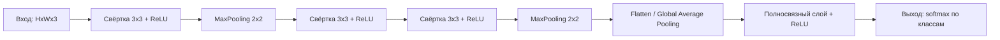

# Свёрточные нейронные сети (CNN)

Свёрточная нейронная сеть (Convolutional Neural Network, CNN) — это архитектура глубокого обучения, которая обрабатывает данные с топологической структурой (изображения, спектрограммы, карты признаков) с помощью операции свёртки и кибернетического принципа «weights sharing»: одни и те же фильтры применяются ко всему входу.

## Подробное описание

**Постановка задачи:**  
Классифицировать, сегментировать или сжать данные, обладающие локальной пространственной структурой — прежде всего изображения.

**Входные данные:**

- Тензор изображения $X$ размером $H \times W \times C$ (высота, ширина, число каналов; для RGB $C = 3$)
- Для обучения — метка класса $y$ (классификация) или маска сегментации

**Выходные данные:**

- Вектор логитов (классификация) или карта признаков того же или меньшего размера (сегментация, детекция)

**Ключевая идея:**  
Локальные паттерны (рёбра, текстуры, пятна) одинаковы в любой точке изображения. Поэтому один свёрточный фильтр $k \times k$ можно прокрутить по всему изображению, используя одни и те же веса. Это резко снижает число параметров по сравнению с полносвязной сетью и делает модель инвариантной к смещению объекта.

**Исторический контекст:**  
Архитектура Neocognitron (Фукусима, 1980) предложила иерархию «фильтр — рецептивное поле», а современный CNN заложил Янн Лекун в 1998 году (LeNet-5) для распознавания рукописных цифр. Прорыв произошёл в 2012 году с AlexNet на ImageNet.

## Основные принципы

### Математическая формулировка

Свёртка (точнее, кросс-корреляция) одноканального изображения $X$ с фильтром $K$ размером $k \times k$:

$$
(Y)_{i,j} = \sum_{u=0}^{k-1} \sum_{v=0}^{k-1} K_{u,v} \cdot X_{i+u,\, j+v} + b
$$

Где:

- $Y$ — результирующая карта признаков (feature map)
- $K_{u,v}$ — веса фильтра (ядра свёртки), обучаемые параметры
- $b$ — смещение (bias)
- $i, j$ — координаты верхнего левого угла окна свёртки

Для многоканального входа свёртка суммируется по всем каналам:

$$
(Y)_{i,j,c_{\text{out}}} = \sum_{c_{\text{in}}} \sum_{u,v} K_{u,v,c_{\text{in}},c_{\text{out}}} \cdot X_{i+u,\,j+v,\,c_{\text{in}}} + b_{c_{\text{out}}}
$$

После свёртки применяется нелинейная активация, как правило ReLU:

$$
\text{ReLU}(z) = \max(0, z)
$$

Пулинг (subsample) уменьшает пространственный размер, выбирая максимум в окне:

$$
(Y)_{i,j} = \max_{0 \le u,v < p} X_{2i+u,\, 2j+v}
$$

Где $p$ — размер окна пулинга (обычно $2 \times 2$).

Размер выходной карты признаков при stride $s$, padding $p$:

$$
H_{\text{out}} = \left\lfloor \frac{H - k + 2p}{s} \right\rfloor + 1
$$

### Архитектура классической CNN



Ключевые механизмы:

1. **Sharing weights** — фильтр обучается распознавать один паттерн и ищет его во всех частях изображения.
2. **Receptive field** — рецептивное поле верхних слоёв покрывает всё изображение, нижние слои видят только локальные окна.
3. **Пулинг** — даёт грубую инвариантность к небольшим сдвигам и уменьшает вычисления.

## Пример реализации на Python

Свёрточный слой, max-pooling и мини-CNN на `numpy` с ручным обратным проходом — без фреймворков глубокого обучения.

```python
import numpy as np
from typing import Tuple


def conv2d(x: np.ndarray, kernel: np.ndarray, bias: float = 0.0) -> np.ndarray:
    """Свёртка (valid) одноканального изображения x (H, W) с ядром kernel (k, k)."""
    h, w = x.shape
    k = kernel.shape[0]
    out_h, out_w = h - k + 1, w - k + 1
    out = np.zeros((out_h, out_w))
    # Прокрутка ядра по всем положениям окна
    for i in range(out_h):
        for j in range(out_w):
            window = x[i : i + k, j : j + k]
            out[i, j] = np.sum(window * kernel) + bias
    return out


def relu(z: np.ndarray) -> np.ndarray:
    """Активация ReLU."""
    return np.maximum(0, z)


def max_pool(x: np.ndarray, size: int = 2) -> np.ndarray:
    """Max-pooling окном size x size со stride = size."""
    h, w = x.shape
    out = np.zeros((h // size, w // size))
    for i in range(out.shape[0]):
        for j in range(out.shape[1]):
            window = x[i * size : (i + 1) * size, j * size : (j + 1) * size]
            out[i, j] = np.max(window)
    return out


class TinyCNN:
    """Мини-CNN: свёртка -> ReLU -> пулинг -> полносвязный слой на 2 класса."""

    def __init__(self, seed: int = 42):
        rng = np.random.default_rng(seed)
        # Ядро детектора вертикальных рёбер (инициализация с шумом)
        self.kernel = np.array([[-1, 0, 1], [-2, 0, 2], [-1, 0, 1]], dtype=float)
        self.kernel += rng.normal(0, 0.1, self.kernel.shape)
        self.bias_conv = 0.0
        # Полносвязный слой: после пулинга 6x6 -> 36 признаков, 2 класса
        self.W_fc = rng.normal(0, 0.1, (36, 2))
        self.b_fc = np.zeros(2)

    def forward(self, x: np.ndarray) -> Tuple[np.ndarray, np.ndarray]:
        """Прямой проход: возвращает логиты и промежуточную карту признаков."""
        # Свёртка 8x8 -> 6x6
        c = conv2d(x, self.kernel, self.bias_conv)
        a = relu(c)
        # Пулинг 6x6 -> 3x3... но для FC-слоя пулуем до фиксированного размера
        # Здесь используем выход свёртки 6x6 = 36 признаков
        features = a.flatten()
        logits = features @ self.W_fc + self.b_fc
        return logits, a

    def predict(self, x: np.ndarray) -> int:
        logits, _ = self.forward(x)
        return int(np.argmax(logits))


def softmax(z: np.ndarray) -> np.ndarray:
    """Мягкий максимум для перевода логитов в вероятности."""
    e = np.exp(z - np.max(z))
    return e / e.sum()


if __name__ == "__main__":
    # Пример: два 8x8 изображения — вертикальный и горизонтальный градиент
    vertical = np.tile(np.linspace(0, 1, 8), (8, 1))      # градиент слева направо
    horizontal = vertical.T                                # градиент сверху вниз

    cnn = TinyCNN()

    for name, img in [("Вертикальный градиент", vertical), ("Горизонтальный градиент", horizontal)]:
        logits, fmap = cnn.forward(img)
        probs = softmax(logits)
        print(f"{name}:")
        print(f"  Карта признаков (свёртка + ReLU), сумма = {fmap.sum():.3f}")
        print(f"  Логиты = {logits.round(3)}, вероятности = {probs.round(3)}")
        print(f"  Предсказанный класс = {cnn.predict(img)}\n")

    # Детектор рёбер реагирует сильнее на вертикальный градиент
    edge_response_v = conv2d(vertical, cnn.kernel).sum()
    edge_response_h = conv2d(horizontal, cnn.kernel).sum()
    print(f"Суммарный отклик детектора рёбер:")
    print(f"  вертикальное ребро: {edge_response_v:.3f}")
    print(f"  горизонтальное ребро: {edge_response_h:.3f}")
```

## Достоинства и недостатки

**Достоинства:**

1. **Эффективное использование параметров** — веса фильтра разделяются между всеми позициями, что на порядки сокращает число обучаемых весов относительно полносвязных сетей.
2. **Иерархия признаков** — нижние слои учатся рёбрам и текстурам, верхние — объектам и их частям, что соответствует структуре визуальных данных.
3. **Инвариантность к сдвигам** — благодаря пулингу и локальным receptive fields небольшое смещение объекта не меняет предсказание.
4. **Параллелизм** — свёртки легко векторизуются на GPU, что делает обучение на больших датасетах практичным.

**Недостатки:**

1. **Аппаратная затратность** — глубокие CNN (ResNet, EfficientNet) требуют значительных вычислительных ресурсов для обучения.
2. **Нет естественной моделирования дальних зависимостей** — без специальных механизмов свёртка видит только локальные окна.
3. **Чувствительность к домену данных** — модель, обученная на одном типе изображений, плохо переносится на другой без дообучения.

## Области применения

1. Машинное обучение и рекомендательные системы (классификация изображений товаров, визуальный поиск на маркетплейсах)
2. Биотехнологии и медицинская информатика (сегментация опухолей на КТ/МРТ, анализ гистологических срезов, расшифровка рентгеновских снимков)
3. Торговля и коммерция (распознавание чеков и штрихкодов, контроль качества товара на конвейере, визуальный поиск по фото)
