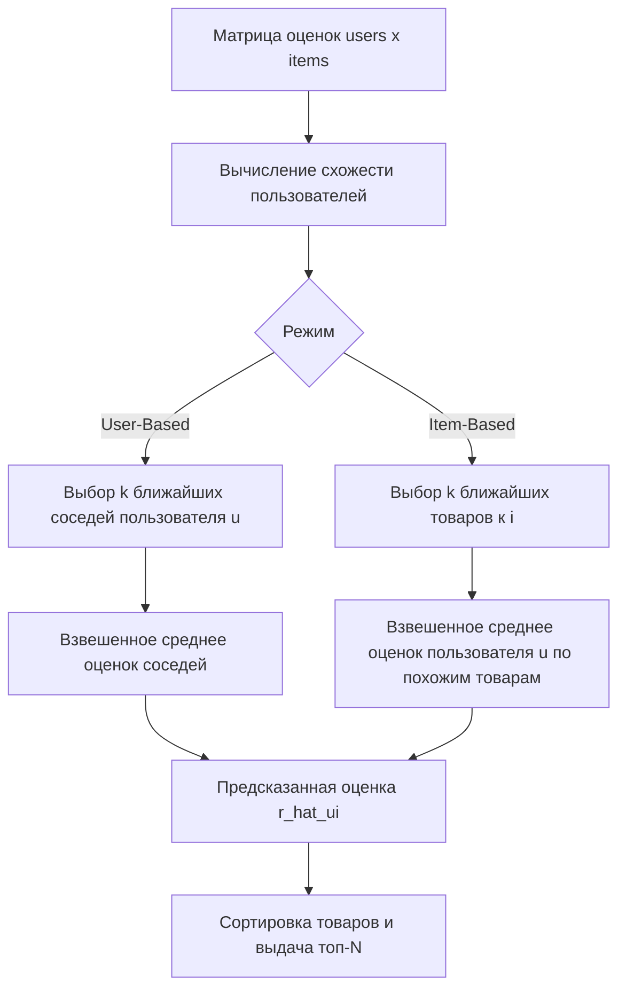

# Коллаборативная фильтрация (Collaborative Filtering)

**Коллаборативная фильтрация** (Collaborative Filtering, CF) — семейство методов рекомендательных систем, которые строят рекомендации, анализируя матрицу «пользователи × товары»: рейтинговые оценки, покупки, просмотры. Ключевой принцип — «похожие пользователи интересуются похожими вещами», при этом содержимое товаров (текст, изображения) не анализируется.

## Подробное описание

**Постановка задачи:**
Дана разреженная матрица оценок $R$ размером $m \times n$ ($m$ пользователей, $n$ товаров), где часть элементов неизвестна (пользователь ещё не оценил товар). Для заданного пользователя $u$ и товара $i$ нужно предсказать недостающую оценку $\hat{r}_{ui}$ и составить список рекомендаций — товаров с наибольшей предсказанной оценкой, которые пользователь ещё не видел.

**Входные данные:**

- Матрица взаимодействий $R$ (рейтинги, неявные признаки вида «купил / не купил»)
- Параметр $k$ — количество ближайших соседей

**Выходные данные:**

- Предсказанные оценки $\hat{r}_{ui}$ и топ-N рекомендаций для пользователя

**Ключевая идея:**
Схожесть (similarity) между пользователями или товарами вычисляется по столбцам и строкам матрицы оценок. Рекомендация строится как взвешенное среднее оценок ближайших соседей. Матрица оценок заполняется плотно, даже если исходные данные крайне разрежены.

**Исторический контекст:**
Термин «collaborative filtering» ввёл Дэвид Голдберг в 1992 году в контексте системы рекомендаций почты Xerox. Первые промышленные реализации — GroupLens (1994) и Ringo для музыкальных рекомендаций. В 2006 году Netflix разместила приз в $1 млн за улучшение точности рекомендаций, что дало мощный толчок развитию методов матричной факторизации (см. статью [SVD](svd.md)).

## Основные принципы

### Математическая формулировка

Два базовых варианта CF:

**User-Based CF** — предсказание оценки пользователя $u$ товару $i$ как взвешенное среднее оценок похожих пользователей:

$$
\hat{r}_{ui} = \bar{r}_u + \frac{\sum_{v \in N_k(u)} sim(u, v) \cdot (r_{vi} - \bar{r}_v)}{\sum_{v \in N_k(u)} |sim(u, v)|}
$$

**Item-Based CF** — предсказание через похожие товары, которые пользователь уже оценивал:

$$
\hat{r}_{ui} = \frac{\sum_{j \in N_k(i)} sim(i, j) \cdot r_{uj}}{\sum_{j \in N_k(i)} |sim(i, j)|}
$$

Где:

- $\bar{r}_u$ — средняя оценка пользователя $u$ (центрирование уменьшает смещение «строгих» и «щедрых» оценщиков)
- $N_k(u)$ — множество $k$ наиболее похожих пользователей (для User-Based) или товаров (для Item-Based)
- $sim(u, v)$ — мера схожести пользователей $u$ и $v$

Наиболее распространённые меры схожести:

**Косинусное сходство** (векторы оценок $r_u$ и $r_v$):

$$
sim(u, v) = \frac{r_u \cdot r_v}{\|r_u\| \cdot \|r_v\|} = \frac{\sum_i r_{ui} r_{vi}}{\sqrt{\sum_i r_{ui}^2} \sqrt{\sum_i r_{vi}^2}}
$$

**Корреляция Пирсона** (только по общим оценённым товарам):

$$
sim(u, v) = \frac{\sum_{i \in I_{uv}} (r_{ui} - \bar{r}_u)(r_{vi} - \bar{r}_v)}{\sqrt{\sum_{i \in I_{uv}} (r_{ui} - \bar{r}_u)^2} \sqrt{\sum_{i \in I_{uv}} (r_{vi} - \bar{r}_v)^2}}
$$

Где:

- $I_{uv}$ — множество товаров, оценённых обоими пользователями

Корреляция Пирсона устойчивее к различиям в средних оценках, косинусное сходство проще и быстрее считается по разреженным данным.

### Схема работы User-Based CF



### Выбор User-Based или Item-Based

| Критерий | User-Based CF | Item-Based CF |
|---|---|---|
| Размерность данных | эффективен при меньшем числе пользователей | эффективен при большом числе пользователей (товаров стабильно меньше) |
| Стабильность | схожести пользователей меняются часто | схожести товаров меняются медленно |
| Скорость инференса | пересчёт схожести при каждом взаимодействии | схожести можно кэшировать надолго |
| Интерпретация | «похожие на вас люди купили...» | «люди, купившие это, также покупали...» |

Индустриальный стандарт для маркетплейсов — Item-Based CF (его широко использовала Amazon).

## Пример реализации на Python

Ниже — самодостаточная реализация User-Based и Item-Based CF на `numpy` с косинусным сходством и корреляцией Пирсона, плюс оценка качества по метрике RMSE на скрытых оценках.

```python
import numpy as np
from typing import List, Optional, Tuple


def cosine_similarity(X: np.ndarray) -> np.ndarray:
    """Косинусное сходство между строками матрицы (с защитой от деления на 0)."""
    norms = np.linalg.norm(X, axis=1, keepdims=True)
    norms[norms == 0] = 1.0
    Xn = X / norms
    return Xn @ Xn.T


def pearson_similarity(X: np.ndarray) -> np.ndarray:
    """Корреляция Пирсона по общим (ненулевым) элементам строк матрицы."""
    m = X.shape[0]
    sim = np.zeros((m, m))
    for u in range(m):
        for v in range(m):
            common = (X[u] != 0) & (X[v] != 0)
            if common.sum() < 2:
                sim[u, v] = 0.0
                continue
            ru, rv = X[u, common], X[v, common]
            cu, cv = ru - ru.mean(), rv - rv.mean()
            denom = np.sqrt((cu ** 2).sum()) * np.sqrt((cv ** 2).sum())
            sim[u, v] = (cu @ cv) / denom if denom > 0 else 0.0
    return sim


class CollaborativeFiltering:
    """Коллаборативная фильтрация: User-Based и Item-Based, k ближайших соседей."""

    def __init__(self, k: int = 3, mode: str = "user", metric: str = "pearson"):
        assert mode in ("user", "item")
        assert metric in ("cosine", "pearson")
        self.k = k
        self.mode = mode
        self.metric = metric
        self.R: Optional[np.ndarray] = None
        self.sim: Optional[np.ndarray] = None

    def fit(self, R: np.ndarray) -> "CollaborativeFiltering":
        """Обучение: хранит матрицу оценок и предвычисляет матрицу схожести."""
        self.R = R.astype(float)
        sim_fn = cosine_similarity if self.metric == "cosine" else pearson_similarity
        if self.mode == "user":
            self.sim = sim_fn(self.R)
        else:
            self.sim = sim_fn(self.R.T)  # схожесть между товарами = по строкам R^T
        return self

    def predict(self, u: int, i: int) -> float:
        """Предсказание оценки пользователя u товару i по k ближайшим соседям."""
        assert self.R is not None and self.sim is not None
        if self.mode == "user":
            # соседи — пользователи, оценившие товар i
            rated = np.where(self.R[:, i] != 0)[0]
            rated = rated[rated != u]
            if len(rated) == 0:
                return self.R[self.R != 0].mean()
            sims = self.sim[u, rated]
            order = np.argsort(-np.abs(sims))[: self.k]
            neighbors = rated[order]
            sims = sims[order]
            denom = np.abs(sims).sum()
            if denom == 0:
                # нет похожих оценщиков — возвращаем среднюю оценку товара
                return self.R[rated, i].mean()
            base = self.R[u][self.R[u] != 0].mean()
            # средние оценки каждого из соседей
            nbr_matrix = self.R[neighbors]
            nbr_mask = nbr_matrix != 0
            nbr_means = nbr_matrix.sum(1) / np.maximum(nbr_mask.sum(1), 1)
            # отрицательная схожесть учитывается со знаком (противоположные вкусы)
            return base + (sims * (self.R[neighbors, i] - nbr_means)).sum() / denom
        else:
            # соседи — товары, оценённые пользователем u
            rated = np.where(self.R[u] != 0)[0]
            rated = rated[rated != i]
            if len(rated) == 0:
                return self.R[self.R != 0].mean()
            sims = self.sim[i, rated]
            order = np.argsort(-np.abs(sims))[: self.k]
            neighbors = rated[order]
            sims = sims[order]
            denom = np.abs(sims).sum()
            if denom == 0:
                return self.R[u, rated].mean()
            return float((sims * self.R[u, neighbors]).sum() / denom)

    def recommend(self, u: int, n: int = 3, exclude_rated: bool = True) -> List[Tuple[int, float]]:
        """Топ-n товаров с наибольшей предсказанной оценкой для пользователя u."""
        assert self.R is not None
        scores = [(i, self.predict(u, i)) for i in range(self.R.shape[1])]
        if exclude_rated:
            scores = [(i, s) for i, s in scores if self.R[u, i] == 0]
        scores.sort(key=lambda x: -x[1])
        return scores[:n]


def rmse_on_heldout(R: np.ndarray, model_cls, **kwargs) -> float:
    """Leave-one-out: скрываем одну оценку, предсказываем, считаем RMSE."""
    errors = []
    for u, i in zip(*np.nonzero(R)):
        R_train = R.copy()
        hidden = R_train[u, i]
        R_train[u, i] = 0.0
        pred = model_cls(**kwargs).fit(R_train).predict(u, i)
        errors.append((pred - hidden) ** 2)
    return float(np.sqrt(np.mean(errors)))


if __name__ == "__main__":
    # Матрица оценок 6 пользователей x 8 товаров (0 — оценки нет).
    # У каждой пары пользователей достаточно общих оценок для вычисления схожести
    R = np.array([
        [5, 4, 1, 1, 1, 0, 0, 0],
        [4, 5, 1, 0, 1, 0, 0, 0],
        [1, 0, 5, 4, 0, 1, 1, 0],
        [0, 1, 4, 5, 0, 1, 1, 0],
        [1, 1, 1, 0, 5, 4, 0, 4],
        [1, 0, 0, 1, 4, 5, 0, 4],
    ], dtype=float)

    print("Матрица оценок (0 = нет оценки):")
    print(R.astype(int))

    # --- User-Based CF ---
    ub = CollaborativeFiltering(k=2, mode="user", metric="pearson").fit(R)
    print("\nUser-Based CF (k=2, Пирсон):")
    for u in range(R.shape[0]):
        recs = ub.recommend(u, n=2)
        formatted = ", ".join(f"товар {i} ({s:.2f})" for i, s in recs)
        print(f"  пользователь {u}: {formatted}")

    # Предсказания для пар, где оценки нет
    print(f"\nПредсказание r[0, 7] (User-Based): {ub.predict(0, 7):.2f}")
    print(f"Предсказание r[2, 4] (User-Based): {ub.predict(2, 4):.2f}")

    # --- Item-Based CF ---
    ib = CollaborativeFiltering(k=2, mode="item", metric="cosine").fit(R)
    print(f"\nItem-Based CF (k=2, косинус):")
    print(f"Предсказание r[0, 7] (Item-Based): {ib.predict(0, 7):.2f}")
    print(f"Рекомендации для пользователя 0: "
          + ", ".join(f"товар {i} ({s:.2f})" for i, s in ib.recommend(0, n=2)))

    # --- Качество: RMSE на скрытых оценках ---
    print("\nLeave-one-out RMSE (меньше — лучше):")
    for metric in ("cosine", "pearson"):
        for mode in ("user", "item"):
            err = rmse_on_heldout(R, CollaborativeFiltering, k=2, mode=mode, metric=metric)
            print(f"  {mode}-based, {metric}: {err:.3f}")
```

## Достоинства и недостатки

**Достоинства:**

1. **Не нужны метаданные товаров** — работает только по матрице взаимодействий, поэтому одинаково применяется к фильмам, товарам и новостям
2. **Открытие неожиданных связей** — рекомендует то, что содержательно не похоже на прошлое поведение, но нравится похожим людям («случайные открытия»)
3. **Item-Based CF масштабируется** — схожести товаров стабильны, их можно кэшировать и обновлять офлайн, что держит инференс быстрым
4. **Простота интерпретации** — «люди с похожим вкусом оценили это на 4.5» понятно пользователю и бизнесу

**Недостатки:**

1. **Проблема холодного старта** — новый пользователь или товар без оценок не имеет соседей; для них требуются контентные методы или эвристики
2. **Разреженность матрицы** — в реальных системах заполнено <1% ячеек, косинусное сходство по немногим общим оценкам неустойчиво
3. **Проблема «оверлапа»** — пользователи с редкими, но похожими вкусами не найдут друг друга из-за малого числа общих оценок
4. **Масштабирование User-Based** — вычисление попарной схожести всех пользователей квадратично по числу пользователей и на больших каталогах неприемлемо без приближений (LSH, аннотированный векторный поиск)

## Области применения

1. Машинное обучение и рекомендательные системы (персонализация ленты новостей и главной страницы, подбор «похожих пользователей» для сообществ)
2. Торговля и коммерция (рекомендации товаров на маркетплейсах, перекрёстные продажи «покупали вместе», email-рассылки с подборками)
3. Экономика и финансы (подбор финансовых продуктов по поведению сегмента клиентов, рекомендации тарифов и страховых планов)
