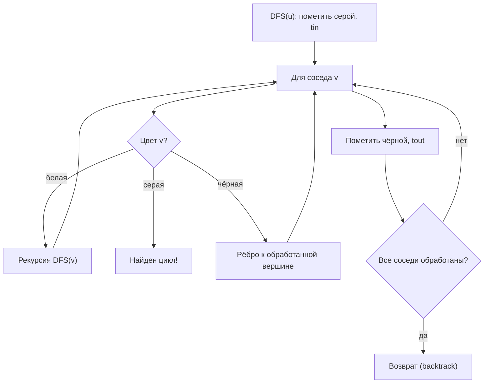

# Поиск в глубину (DFS, Depth-First Search)

Поиск в глубину (Depth-First Search, DFS) — алгоритм обхода графа, который идёт от стартовой вершины как можно глубже по ещё не посещённым рёбрам, возвращаясь (делая backtrack) при достижении тупика.

## Подробное описание

**Постановка задачи:**

Дан граф $G = (V, E)$ и стартовая вершина $s$. Проверить наличие пути до целевой вершины, найти все циклы (или хотя бы один), построить топологический порядок ациклического графа, найти компоненты связности.

**Входные данные:**

- Граф: список смежности (ориентированный или неориентированный)
- Стартовая вершина; для задач — целевая вершина или условие

**Выходные данные:**

- Порядок обхода (preorder) и/или порядок выхода (postorder)
- Наличие пути $s \to t$
- Наличие цикла и, при необходимости, сам цикл
- Топологический порядок вершин (для DAG)
- Тайминги $tin/tout$ (времена входа и выхода)

**Ключевая идея:**

Рекурсия (или явный стек) поддерживает путь от источника до текущей вершины. Цветовая разметка вершин — белые (не посещены), серые (в стеке рекурсии), чёрные (обработаны полностью) — позволяет отличать «возврат по необработанному ребру» от ребра к уже законченной вершине: ребро к серой вершине свидетельствует о цикле.

**Исторический контекст:**

DFS — один из фундаментальных алгоритмов теории графов, формализованный в работах Тарьяна по сильной связности (1972) и ставший основой алгоритмов разбиения графа, топологической сортировки и поиска мостов.

## Основные принципы

### Математическая формулировка

Рекурсивное определение:

$$
\text{DFS}(u): \quad tin[u] \leftarrow \text{текущее время}; \quad
\forall v \in Adj(u): \; \text{если } v \text{ белая, то } \text{DFS}(v);
\quad tout[u] \leftarrow \text{время}
$$

Условие обнаружения цикла в ориентированном графе:

$$
\exists\, (u \to v): \; color[v] = \text{серая} \;\Longrightarrow\; \text{граф содержит цикл}
$$

Топологический порядок строится как обратный порядок выхода вершин (postorder):

$$
\text{topo} = [v_k, v_{k-1}, ..., v_1], \quad tout[v_i] < tout[v_j] \Rightarrow v_j \text{ раньше в топопорядке}
$$

Сложность (рекурсия или явный стек, списки смежности):

$$
T = O(|V| + |E|), \qquad S = O(|V|)
$$

Где:

- $tin[u]$ — момент входа в вершину $u$ при обходе
- $tout[u]$ — момент полной обработки всех потомков $u$
- Цвета: белая — не посещена; серая — в текущем стеке (на пути обхода); чёрная — обработана
- Интервал $[tin, tout]$ потомков содержится в интервале предка — это свойство лежит в основе предков/поддеревьев (subtree queries)

### Рекурсивная схема с разметкой цветами



## Пример реализации на Python

```python
from typing import Dict, List, Optional

WHITE, GRAY, BLACK = 0, 1, 2


class DFSResult:
    """Результаты обхода: порядки, цвета, тайминги, находки."""

    def __init__(self):
        self.order: List[int] = []       # preorder
        self.postorder: List[int] = []
        self.tin: Dict[int, int] = {}
        self.tout: Dict[int, int] = {}
        self.color: Dict[int, int] = {}
        self.parent: Dict[int, Optional[int]] = {}
        self.cycle: Optional[List[int]] = None
        self.time = 0


def dfs(graph: Dict[int, List[int]], start: int, res: Optional[DFSResult] = None) -> DFSResult:
    """Итеративный DFS (явный стек) — без переполнения рекурсии."""
    res = res or DFSResult()
    # стек элементов: (вершина, индекс следующего соседа, флаг «входа»)
    stack = [(start, 0, False)]
    res.color[start] = GRAY
    while stack:
        u, idx, leaving = stack.pop()
        if leaving:
            res.color[u] = BLACK
            res.tout[u] = res.time
            res.time += 1
            res.postorder.append(u)
            continue
        res.tin[u] = res.time
        res.time += 1
        res.order.append(u)
        stack.append((u, 0, True))          # «выход» из u после соседей
        neighbors = graph.get(u, [])
        for v in reversed(neighbors):       # reversed — сохранить порядок
            if v not in res.color:
                res.color[v] = GRAY
                res.parent[v] = u
                stack.append((v, 0, False))
            elif res.color[v] == GRAY:
                # ребро к серой вершине => цикл через v..u
                res.cycle = [v] + res.order[res.order.index(v):][::-1] \
                    if v in res.order else [v, u]
    return res


def has_path(graph: Dict[int, List[int]], start: int, target: int) -> bool:
    """Есть ли путь start -> target (DFS, ранний выход)."""
    seen = {start}
    stack = [start]
    while stack:
        u = stack.pop()
        if u == target:
            return True
        for v in graph.get(u, []):
            if v not in seen:
                seen.add(v)
                stack.append(v)
    return False


def topological_sort(graph: Dict[int, List[int]]) -> Optional[List[int]]:
    """Топологический порядок DAG; при цикле — None."""
    color: Dict[int, int] = {}
    order: List[int] = []

    def visit(u: int) -> bool:
        color[u] = GRAY
        for v in graph.get(u, []):
            if color.get(v, WHITE) == GRAY:
                return False               # цикл
            if color.get(v, WHITE) == WHITE and not visit(v):
                return False
        color[u] = BLACK
        order.append(u)
        return True

    for u in graph:
        if color.get(u, WHITE) == WHITE:
            if not visit(u):
                return None
    return order[::-1]


def find_cycle(graph: Dict[int, List[int]]) -> Optional[List[int]]:
    """Находит один цикл в ориентированном графе (или None)."""
    res = dfs(graph, next(iter(graph)))
    return res.cycle


if __name__ == "__main__":
    # Ориентированный граф: ветвление + цикл 3 -> 4 -> 3
    graph = {
        1: [2, 5],
        2: [3],
        3: [4],
        4: [3, 5],   # ребро 4 -> 3 замыкает цикл
        5: [],
    }

    res = dfs(graph, 1)
    print("Preorder :", res.order)
    print("Postorder:", res.postorder)
    print("Тайминги tin/tout:",
          {v: (res.tin[v], res.tout[v]) for v in sorted(res.tin)})
    print("Цикл найден:", res.cycle is not None, res.cycle)
    print("Путь 1 -> 5 есть:", has_path(graph, 1, 5))
    print("Путь 5 -> 1 есть:", has_path(graph, 5, 1))

    # Топологическая сортировка на DAG (цикл удалён)
    dag = {1: [2, 5], 2: [3], 3: [4], 4: [5], 5: []}
    topo = topological_sort(dag)
    print("\nТопопорядок:", topo)
    print("Проверка: все рёбра смотрят вперёд:",
          all(topo.index(u) < topo.index(v)
              for u, vs in dag.items() for v in vs))

    # Неориентированный граф: компоненты связности через многократный DFS
    forest = {0: [1], 1: [0], 2: [3], 3: [2], 4: []}
    seen: set = set()
    components = []
    for v in forest:
        if v not in seen:
            r = dfs(forest, v)
            components.append(sorted(r.order))
            seen.update(r.order)
    print("\nКомпоненты связности:", components)
```

## Достоинства и недостатки

**Достоинства:**

1. **Универсальность задач** — один обход решает проверку пути, поиск циклов, топологическую сортировку, нахождение компонент и мостов
2. **Линейная сложность** — $O(|V| + |E|)$ при списках смежности, как и у BFS
3. **Тайминги и поддеревья** — интервалы $[tin, tout]$ дают O(1)-проверку «является ли вершина потомком другой»
4. **Явный стек** — итеративная реализация обходит ограничение глубины рекурсии и работает на графах с $10^6+$ вершин

**Недостатки:**

1. **Не кратчайший путь** — найденный путь зависит от порядка соседей и может быть сильно длиннее оптимального
2. **Глубокая рекурсия** — рекурсивный DFS переполняет стек вызовов на длинных цепях; требуется итеративная версия
3. **Нет естественной «границы уровней»** — unlike BFS, DFS неявно не даёт расстояний, для них нужен отдельный обход
4. **Хрупкость к порядку соседей** — результаты (видимость цикла, порядок топосортировки) меняются при изменении порядка в списках смежности

## Области применения

1. Графовые модели и социальные сети (поиск циклов в графах зависимостей, определение компонент связности сообществ)
2. Оптимизация и планирование (топологическая сортировка задач и этапов, обнаружение взаимозависимостей в планах проектов)
3. Логистика и управление цепочками (упорядочивание этапов сборки и поставки, проверка ацикличности цепочек преобразований)
