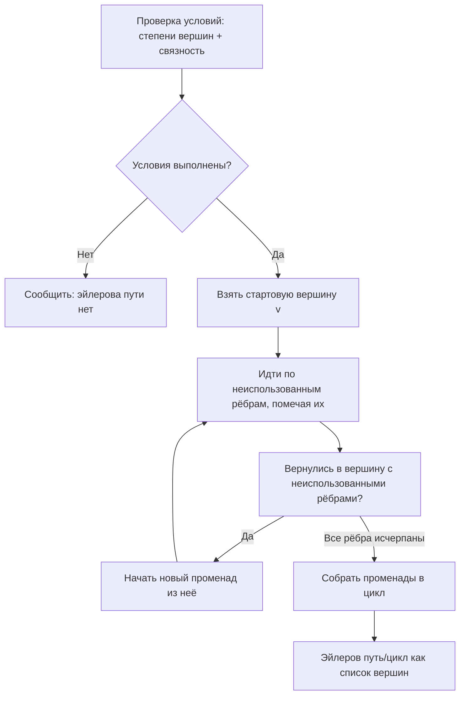
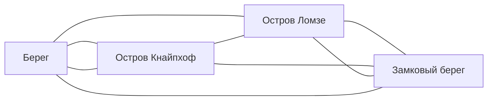

# Эйлеров путь и цикл (Eulerian Path/Circuit)

**Эйлеров путь** (Eulerian Path) — путь в графе, проходящий через каждое ребро ровно один раз; **эйлеров цикл** (Eulerian Circuit) — такой путь, замыкающийся в начальную вершину. Алгоритм Иерхолера (Hierholzer) находит их за $O(|E|)$ — линейно по числу рёбер.

## Подробное описание

**Постановка задачи:**
Дан граф $G = (V, E)$ (неориентированный или ориентированный). Построить путь/цикл, включающий каждое ровно один раз, либо доказать их несуществование.

**Входные данные:**

- Список рёбер графа (возможны множественные рёбра и петли)
- Тип графа: неориентированный или ориентированный

**Выходные данные:**

- Последовательность вершин эйлерова пути/цикла или заключение об их отсутствии

**Ключевая идея:**
Существование определяется степенями вершин и связностью. Для построения — алгоритм Иерхолера: из текущей вершины строится «променад» до возврата, затем он встраивается в уже построенный цикл, пока все рёбра не будут исчерпаны.

**Исторический контекст:**
Задача родилась в 1736 году, когда Леонард Эйлер решил «Кёнигсбергский мостовой вопрос» — доказал, что в городе с семью мостами невозможно пройти, перейдя каждый мост ровно один раз. Это считается началом теории графов. Условия существования эйлерова цикла доказаны Эйлером, полный классификация путей — Хирадо (1873) и для ориентированных графов — Гуд и Гейер (1960).

## Основные принципы

### Математическая формулировка

**Неориентированный граф.** Пусть $\deg(v)$ — степень вершины $v$.

- Эйлеров **цикл** существует ⟺ все вершины имеют чётную степень **и** все рёбра принадлежат одной компоненте связности (все рёберно-связные компоненты, кроме изолированных вершин, — одна)
- Эйлеров **путь** существует ⟺ ровно **две** вершины имеют нечётную степень (начало и конец пути), либо ни одной (тогда путь — цикл), и компонента одна

**Ориентированный граф.** Пусть $\deg^+(v), \deg^-(v)$ — входная и выходная степени.

- Эйлеров **цикл** ⟺ для каждой вершины $\deg^+(v) = \deg^-(v)$ и граф слабо связен
- Эйлеров **путь** ⟺ для ровно одной вершины $\deg^+ = \deg^- + 1$ (конец), для ровно одной $\deg^- = \deg^+ + 1$ (начало), для остальных равенство, и слабая связность выполняется

**Алгоритм Иерхолера** (рекурсивная идея):

$$
\text{tour}(v):\ \text{пока у } v \text{ есть неиспользованное ребро } (v, u):\ \text{удалить ребро};\ \text{tour}(u);\ \text{добавить } v \text{ в начало списка}
$$

Финальный список вершин (в обратном порядке добавления) — эйлеров цикл. Сложность $O(|E|)$: каждое ребро рассматривается ровно один раз.

### Схема алгоритма Иерхолера



### Историческая справка: Кёнигсбергские мосты



Четыре участка суши — вершины, семь мостов — рёбра. У всех четырёх вершин нечётные степени (3, 3, 3, 3), поэтому ни цикла, ни пути не существует.

## Пример реализации на Python

Самодостаточная реализация на стандартной библиотеке: проверка условий для обоих типов графов и линейный алгоритм Иерхолера.

```python
from collections import defaultdict
from typing import Dict, List, Optional, Tuple


# ---------- Неориентированный граф ----------

def undirected_conditions(adj: Dict[int, List[int]]) -> Tuple[bool, bool, int]:
    """Проверка условий: (есть цикл, есть путь, стартовая вершина: -1 = цикл)."""
    degree = {v: len(neis) for v, neis in adj.items()}
    odd = [v for v, d in degree.items() if d % 2 == 1]
    # компоненты связности по рёбрам
    visited = set()
    start = next((v for v, d in degree.items() if d > 0), None)
    if start is None:
        return True, True, -1
    stack = [start]
    while stack:
        v = stack.pop()
        if v in visited:
            continue
        visited.add(v)
        stack.extend(adj[v])
    edge_vertices = {v for v, d in degree.items() if d > 0}
    connected = edge_vertices <= visited
    has_circuit = connected and len(odd) == 0
    has_path = connected and len(odd) in (0, 2)
    path_start = odd[0] if len(odd) == 2 else start
    return has_circuit, has_path, path_start if has_path else -1


def hierholzer_undirected(edges: List[Tuple[int, int]]) -> Optional[List[int]]:
    """Эйлеров путь/цикл неориентированного графа (алгоритм Иерхолера)."""
    adj: Dict[int, List[int]] = defaultdict(list)
    for u, v in edges:
        adj[u].append(v)
        adj[v].append(u)
    has_circuit, has_path, start = undirected_conditions(dict(adj))
    if not has_path:
        return None

    # копия списков смежности (будем вынимать рёбра)
    trail = {v: list(neis) for v, neis in adj.items()}
    stack = [start if start != -1 else next(iter(trail))]
    path: List[int] = []
    while stack:
        v = stack[-1]
        if trail[v]:
            u = trail[v].pop()
            trail[u].remove(v)  # рёбра неориентированы: убираем из обоих концов
            stack.append(u)
        else:
            path.append(stack.pop())
    path.reverse()
    # длина пройденных рёбер должна совпасть с числом рёбер
    if len(path) - 1 != len(edges):
        return None
    return path


# ---------- Ориентированный граф ----------

def hierholzer_directed(n: int, edges: List[Tuple[int, int]]) -> Optional[List[int]]:
    """Эйлеров путь/цикл ориентированного графа или None."""
    out_deg = [0] * n
    in_deg = [0] * n
    adj: Dict[int, List[int]] = defaultdict(list)
    for u, v in edges:
        adj[u].append(v)
        out_deg[u] += 1
        in_deg[v] += 1

    # условия существования
    plus = [v for v in range(n) if out_deg[v] - in_deg[v] == 1]
    minus = [v for v in range(n) if in_deg[v] - out_deg[v] == 1]
    balanced = all(out_deg[v] == in_deg[v] for v in range(n))
    if not ((balanced and len(plus) == 0 and len(minus) == 0)
            or (len(plus) == 1 and len(minus) == 1)):
        return None

    # проверка слабой связности по рёбрам
    used_verts = {v for e in edges for v in e}
    if not used_verts:
        return []
    und = defaultdict(list)
    for u, v in edges:
        und[u].append(v)
        und[v].append(u)
    seen, st = set(), [next(iter(used_verts))]
    while st:
        v = st.pop()
        if v in seen:
            continue
        seen.add(v)
        st.extend(und[v])
    if not used_verts <= seen:
        return None

    start = plus[0] if plus else (next(iter(used_verts)) if used_verts else 0)

    # Иерхолер
    trail = {v: list(neis) for v, neis in adj.items()}
    stack = [start]
    path: List[int] = []
    while stack:
        v = stack[-1]
        if trail.get(v):
            stack.append(trail[v].pop())
        else:
            path.append(stack.pop())
    path.reverse()
    if len(path) - 1 != len(edges):
        return None
    return path


if __name__ == "__main__":
    # 1) Неориентированный граф: маршрут курьера — склад 0 и два квартала-«треугольника»
    #    рёбра — улицы, которые нужно пройти по разу (все степени чётные)
    streets = [
        (0, 1), (1, 2), (2, 0),  # квартал А
        (0, 3), (3, 4), (4, 0),  # квартал Б
    ]
    print("Улицы (два квартала):", streets)
    circuit = hierholzer_undirected(streets)
    print(f"Эйлеров цикл: {' -> '.join(map(str, circuit)) if circuit else 'НЕТ'}")
    assert circuit is not None and len(circuit) - 1 == len(streets)
    print(f"Пройдено рёбер: {len(circuit) - 1} из {len(streets)}\n")

    # 2) Граф без эйлерова пути: три нечётные степени
    bad = [(0, 1), (1, 2), (1, 3), (3, 4)]
    res = hierholzer_undirected(bad)
    print(f"Граф {bad}: эйлеров путь -> {'найден' if res else 'отсутствует (нечётных степеней: 4)'}")
    assert res is None

    # 3) Ориентированный граф: конвейер этапов обработки
    #    два «дисбалансных» конца: 0 — начало (out = in + 1), 4 — конец (in = out + 1)
    pipeline = [
        (0, 1),
        (1, 2), (1, 3),
        (2, 4), (3, 4),
        (4, 1),  # возврат в обработку
    ]
    print(f"\nКонвейер (ориентированный): {pipeline}")
    dpath = hierholzer_directed(5, pipeline)
    print(f"Эйлеров путь: {' -> '.join(map(str, dpath)) if dpath else 'НЕТ'}")
    assert dpath is not None and dpath[0] == 0 and dpath[-1] == 4
    print(f"Пройдено рёбер: {len(dpath) - 1} из {len(pipeline)}")
```

## Достоинства и недостатки

**Достоинства:**

1. **Линейная сложность** — $O(|E|)$: лучший возможный порядок, каждое ребро посещается ровно один раз
2. **Простые и надёжные условия** — достаточно посчитать степени вершин и проверить связность, не запуская тяжёлые вычисления
3. **Гарантия полного покрытия** — маршрут по определению не пропускает ни одного ребра и не проходит дважды
4. **Конструктивный результат** — алгоритм сразу выдаёт последовательность, а не только подтверждение существования

**Недостатки:**

1. **Строгие требования** — одно ребро «повисшей» компоненты или лишняя нечётная степень ломает существование; для реальных графов нужны постобработки
2. **Только покрытие рёбер** — вершины могут повторяться; если нужно посетить каждую вершину, это уже задача Гамильтона/TSP (NP-трудная)
3. **Не учитывает веса и время** — все рёбра равнозначны; для взвешенных графов нужен китайский «задача о почтальоне» (минимальный цикл с повторами)
4. **Уязмчив к связности** — на несвязных графах условия по степеням ложноположительны без отдельной проверки компонент

## Области применения

1. Графовые модели и социальные сети (поиск полных обходов в библиотечных каталогах, анализ структуры суперссылок, проверка дублирования связей)
2. Логистика и управление цепочками (маршрут почтальона и курьера, обход всех улиц квартала, чистка путей уборочной техники, инвентаризация всех участков склада)
3. Игровая разработка (генерация процедурных уровней с гарантированным обходом, построение закольцованных маршрутов NPC и транспорта, головоломки «пройти каждое ребро»)
