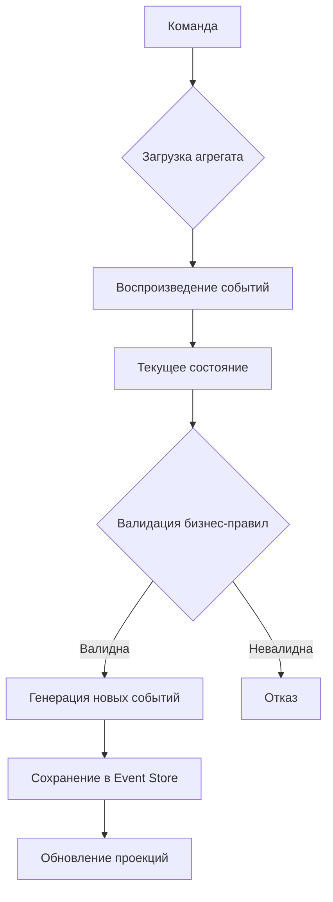

# Хранение событий (Event Sourcing)

Хранение событий (англ. Event Sourcing, произносится как «ивент-сорсинг») — это архитектурный шаблон, при котором все изменения состояния приложения сохраняются в виде неизменяемой последовательности событий, а текущее состояние не хранится напрямую, а вычисляется путём воспроизведения (replay) этих событий.

**Постановка задачи:** в традиционных системах с CRUD-операциями база данных хранит только актуальное состояние объекта: при каждом обновлении предыдущие данные перезаписываются, и история изменений безвозвратно теряется. Нужен подход, который сохраняет полную историю изменения данных, допускает аудит и позволяет восстановить состояние на любой момент времени.

**Входные данные:** идентификатор агрегата (например, номера счёта) и команда — намерение изменить его состояние («пополнить на 1000», «снять 200»).

**Выходные данные:** новое событие, добавляемое в конец потока агрегата; текущее состояние и производные от него проекции вычисляются из потока событий.

**Ключевая идея:** сохраняется не состояние, а факты — события, которые уже произошли и не могут быть изменены или удалены. Хранилище событий работает только в режиме добавления (append-only). Если необходимо «отменить» операцию, в поток добавляется компенсирующее событие, а исходное не удаляется. Например, банковский счёт не хранит поле «баланс = 1300»: в потоке записаны события «Пополнение на 1000», «Снятие 200», «Пополнение 500», а баланс вычисляется как сумма всех операций.

**Исторический контекст:** идея журналирования изменений для восстановления состояния используется в СУБД с 1980-х годов (журнальное восстановление, версионирование строк), а сам термин Event Sourcing популяризован Грегором Янком (Greg Young) в 2010-х годах в контексте паттерна CQRS.

## Основные принципы

### Математическая формулировка

Состояние агрегата в момент времени $n$ представляет собой результат последовательного применения всех событий потока:

$$
S_n = f(e_1, e_2, \ldots, e_n)
$$

Где:
- $S_n$ — состояние агрегата после обработки $n$ событий
- $e_i$ — $i$-е событие в потоке
- $f$ — функция применения события к состоянию (редьюсер)

Фактически это свёртка (fold) последовательности событий в аккумулятор состояния.

### Блок-схема обработки команды



## Пример реализации на Python

Ниже представлена минимальная реализация концепции Event Sourcing для банковского счёта с использованием только стандартной библиотеки.

```python
from dataclasses import dataclass
from typing import List, Union
from datetime import datetime


# --- Определение событий ---
@dataclass(frozen=True)
class MoneyDeposited:
    """Событие: на счёт поступили деньги."""
    amount: float
    timestamp: str


@dataclass(frozen=True)
class MoneyWithdrawn:
    """Событие: со счёта сняты деньги."""
    amount: float
    timestamp: str


# --- Хранилище событий (в памяти для примера) ---
class EventStore:
    """Простое append-only хранилище событий, сгруппированных по ID агрегата."""
    def __init__(self):
        # Словарь: account_id -> список событий
        self._streams: dict[str, List[Union[MoneyDeposited, MoneyWithdrawn]]] = {}

    def append(self, account_id: str, event: Union[MoneyDeposited, MoneyWithdrawn]) -> None:
        # События только добавляются, никогда не изменяются и не удаляются
        if account_id not in self._streams:
            self._streams[account_id] = []
        self._streams[account_id].append(event)

    def get_events(self, account_id: str) -> List[Union[MoneyDeposited, MoneyWithdrawn]]:
        return list(self._streams.get(account_id, []))


# --- Агрегат (сущность) ---
class BankAccount:
    """Банковский счёт, состояние которого восстанавливается из событий."""
    def __init__(self, account_id: str, event_store: EventStore):
        self.account_id = account_id
        self.event_store = event_store
        self.balance = 0.0  # Начальное состояние

    def _apply(self, event: Union[MoneyDeposited, MoneyWithdrawn]) -> None:
        """Применение события к текущему состоянию (редьюсер)."""
        if isinstance(event, MoneyDeposited):
            self.balance += event.amount
        elif isinstance(event, MoneyWithdrawn):
            self.balance -= event.amount

    def replay(self) -> None:
        """Восстановление текущего состояния путём воспроизведения всех событий."""
        self.balance = 0.0
        for event in self.event_store.get_events(self.account_id):
            self._apply(event)

    def deposit(self, amount: float) -> None:
        """Команда: пополнить счёт."""
        if amount <= 0:
            raise ValueError("Сумма пополнения должна быть положительной")
        event = MoneyDeposited(amount=amount, timestamp=datetime.now().isoformat())
        self.event_store.append(self.account_id, event)
        self._apply(event)  # Обновляем in-memory состояние

    def withdraw(self, amount: float) -> None:
        """Команда: снять деньги со счёта."""
        if amount <= 0:
            raise ValueError("Сумма снятия должна быть положительной")
        if amount > self.balance:
            raise ValueError("Недостаточно средств")
        event = MoneyWithdrawn(amount=amount, timestamp=datetime.now().isoformat())
        self.event_store.append(self.account_id, event)
        self._apply(event)

    def get_balance(self) -> float:
        return self.balance


if __name__ == "__main__":
    # Создаём хранилище событий
    store = EventStore()

    # Создаём счёт и выполняем операции
    account = BankAccount("acc-001", store)
    account.deposit(1000)
    account.withdraw(200)
    account.deposit(500)

    print(f"Баланс после операций: {account.get_balance()}")  # 1300.0

    # Симулируем «перезапуск системы»: создаём новый объект и восстанавливаем состояние
    restored = BankAccount("acc-001", store)
    restored.replay()
    print(f"Баланс после восстановления из событий: {restored.get_balance()}")  # 1300.0
```

## Достоинства и недостатки

**Достоинства:**

1. **Полный аудит и история** — каждое изменение зафиксировано навсегда, что упрощает соответствие регуляторным требованиям и отладку.
2. **Восстановление состояния на любой момент времени** — можно «отмотать» систему назад, воспроизведя события до определённой точки.
3. **Устранение конфликтов обновлений** — события только добавляются, что исключает блокировки на уровне строк и конфликты параллельных записей.
4. **Гибкость проекций** — одни и те же события можно использовать для построения разных моделей чтения без изменения источника.

**Недостатки:**

1. **Сложность реализации и сопровождения** — требуется инфраструктура для хранения событий, управления версиями схем и обработки идемпотентности.
2. **Итоговая согласованность** — проекции обновляются асинхронно, что создаёт задержку между записью события и его отражением в моделях чтения.
3. **Сложность удаления данных** — требование неизменяемости конфликтует с правом на забвение; приходится применять криптоуничтожение или выносить персональные данные за пределы хранилища событий.
4. **Рост потока событий** — длинные потоки замедляют восстановление состояния, требуя стратегии снимков (snapshots).

## Области применения

1. Паттерны проектирования (слабая связанность микросервисов через поток событий, построение моделей чтения поверх единого источника фактов в связке с CQRS)
2. Аналитика данных и базы данных (append-only хранилище событий как источник данных, пересчёт проекций, восстановление состояния после сбоя)
3. Экономика и финансы (неизменяемый аудит банковских операций, разбор спорных транзакций, соответствие регуляторным требованиям)
