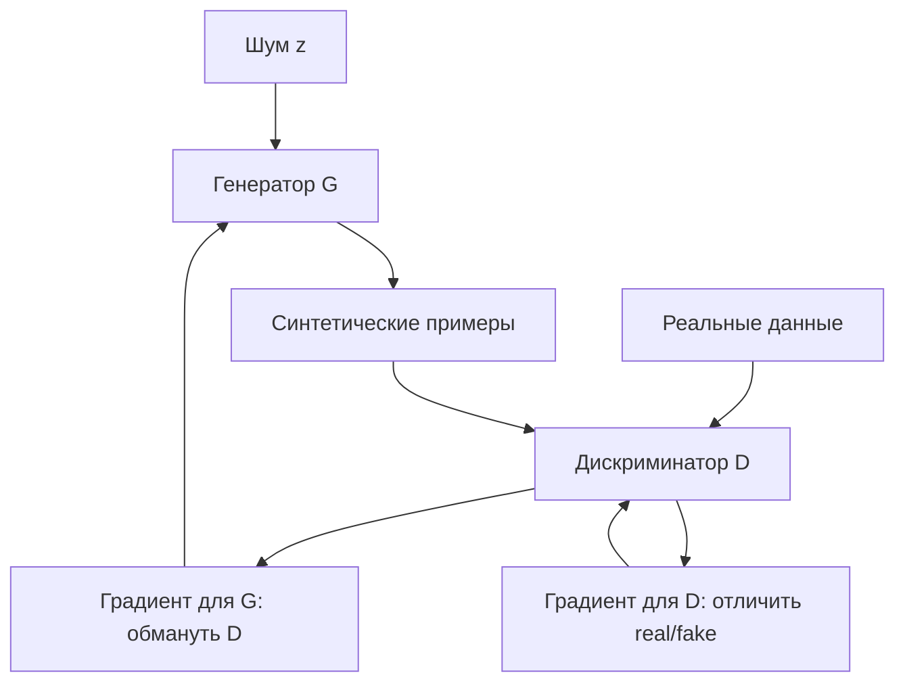

# Генеративно-состязательные сети (GANs)

Генеративно-состязательная сеть (Generative Adversarial Network, GAN) — генеративная модель глубокого обучения, состоящая из двух конкурирующих сетей: **генератора**, создающего фейковые примеры из шума, и **дискриминатора**, отличающего их от реальных данных.

## Подробное описание

**Постановка задачи:**  
Научиться генерировать новые примеры $x$ из распределения обучающих данных $p_{\text{data}}$, не храня его явно.

**Входные данные:**

- Обучающая выборка реальных объектов $x_1, ..., x_n \sim p_{\text{data}}$
- Латентный вектор шума $z \sim p_z$ (обычно $z \sim \mathcal{N}(0, I)$)

**Выходные данные:**

- Обученный генератор $G: z \mapsto x$, порождающий правдоподобные синтетические примеры

**Ключевая идея:**  
Обучение превращается в игру с нулевой суммой: генератор учится обманывать дискриминатор, а дискриминатор — ловить подделки. Когда обе сети достигают оптимума, генератор воспроизводит истинное распределение данных, а дискриминатор вынужден отвечать 0.5 на любой пример.

**Исторический контекст:**  
GAN предложил Ян Гудфеллоу с коллегами в 2014 году. С тех пор появилось сотни вариаций: DCGAN (2015), WGAN (2017), StyleGAN (2018–2019), которые решали проблемы нестабильности и режима коллапса исходной модели.

## Основные принципы

### Математическая формулировка

Генератор $G(z; \theta_g)$ и дискриминатор $D(x; \theta_d)$ обучаются одновременно в min-max-игре:

$$
\min_G \max_D \; V(D, G) = \mathbb{E}_{x \sim p_{\text{data}}}[\log D(x)] + \mathbb{E}_{z \sim p_z}[\log(1 - D(G(z)))]
$$

Где:

- $D(x) \in (0, 1)$ — вероятность того, что пример $x$ реальный
- $G(z)$ — синтетический пример из латентного шума $z$
- $\mathbb{E}_{x \sim p_{\text{data}}}$ — математическое ожидание по реальным данным
- Первая слагаемая — награда дискриминатору за правильную классификацию реальных примеров, вторая — за разоблачение подделок

На практике дискриминатор обучается максимизацией логарифмической правдоподобности (эквивалентно бинарной кросс-энтропии), а генератор — **нестационарным** минимизацией $\log(1 - D(G(z)))$ или, чаще, трюком «несправедливой» функции потерь:

$$
\mathcal{L}_G = -\mathbb{E}_{z}[\log D(G(z))]
$$

При идеальном $G$ (т.е. $p_g = p_{\text{data}}$) значение $V = -\log 4$, а $D(x) \equiv 0.5$.

### Цикл обучения



Ключевые проблемы исходного GAN:

1. **Нестабильность обучения** — две сети «убегают» друг от друга, оптимум игры труднодостижим.
2. **Режим коллапса** — генератор находит одну «подделку», которая обманывает дискриминатор, и перестаёт генерировать разнообразие.
3. **Исчезающие градиенты** — при почти идеальном дискриминаторе градиент $\log(1 - D(G(z)))$ обращается в ноль; WGAN решает это через Wasserstein-расстояние и clipping весов.

## Пример реализации на Python

Минимальный GAN на `numpy`: генератор и дискриминатор — однослойные MLP, задача — научиться копировать одномерное распределение (смесь двух гауссиан).

```python
import numpy as np


def relu(z):
    """ReLU."""
    return np.maximum(0, z)


def sigmoid(z):
    """Сигмоида."""
    return 1.0 / (1.0 + np.exp(-np.clip(z, -30, 30)))


class MLP:
    """Простейший MLP: вход -> скрытый слой ReLU -> выход (логит)."""

    def __init__(self, in_dim, hidden, out_dim, seed=0):
        rng = np.random.default_rng(seed)
        self.W1 = rng.normal(0, 0.5, (in_dim, hidden))
        self.b1 = np.zeros(hidden)
        self.W2 = rng.normal(0, 0.5, (hidden, out_dim))
        self.b2 = np.zeros(out_dim)

    def forward(self, x):
        self.h = relu(x @ self.W1 + self.b1)  # сохраняем для обратного прохода
        self.x = x
        return self.h @ self.W2 + self.b2

    def backward(self, d_out, lr):
        """Обратный проход: обновляет веса по градиенту d_out = dL/d(logits)."""
        dW2 = self.h.T @ d_out
        db2 = d_out.sum(axis=0)
        d_h = d_out @ self.W2.T * (self.h > 0)
        dW1 = self.x.T @ d_h
        db1 = d_h.sum(axis=0)
        self.W1 -= lr * dW1
        self.b1 -= lr * db1
        self.W2 -= lr * dW2
        self.b2 -= lr * db2

    def grad_input(self, d_out):
        """Градиент dL/dx по входу сети — без обновления весов (нужен для обучения G)."""
        d_h = d_out @ self.W2.T * (self.h > 0)
        return d_h @ self.W1.T


class GAN:
    """GAN для одномерных данных: генератор z->x, дискриминатор x->logit."""

    def __init__(self, seed=42):
        self.G = MLP(1, 32, 1, seed=seed)
        self.D = MLP(1, 32, 1, seed=seed + 1)
        self.lr_g, self.lr_d = 0.002, 0.01

    def sample_real(self, n, rng):
        """Реальное распределение: смесь двух гауссиан."""
        comp = rng.choice([-1.0, 1.0], size=(n, 1))
        return comp * 1.5 + rng.normal(0, 0.3, (n, 1))

    def train_step(self, rng, batch=128):
        """Один шаг обучения: сначала D, затем G."""
        # --- Шаг дискриминатора (BCE: реальные -> 1, фейковые -> 0) ---
        x_real = self.sample_real(batch, rng)
        z = rng.normal(0, 1, (batch, 1))
        x_fake = self.G.forward(z)

        logit_r = self.D.forward(x_real)
        # Градиент BCE по логиту: sigmoid(logit) - target, затем усреднение по батчу
        self.D.backward((sigmoid(logit_r) - 1.0) / batch, self.lr_d)
        logit_f = self.D.forward(x_fake)
        self.D.backward(sigmoid(logit_f) / batch, self.lr_d)
        loss_d = -(
            np.log(1 - sigmoid(logit_f) + 1e-8).mean()
            + np.log(sigmoid(logit_r) + 1e-8).mean()
        )

        # --- Шаг генератора (нечестная функция: максимизировать log D(G(z))) ---
        z = rng.normal(0, 1, (batch, 1))
        logit_f = self.D.forward(self.G.forward(z))
        # dL_G/dlogit_D = (sigmoid(logit) - 1)/batch; пропускаем через D без обновления весов
        g_to_G = self.D.grad_input((sigmoid(logit_f) - 1.0) / batch)
        self.G.backward(g_to_G, self.lr_g)
        loss_g = -np.log(sigmoid(logit_f) + 1e-8).mean()
        return loss_d, loss_g, sigmoid(logit_f).mean()

    def __call__(self, z):
        return self.G.forward(z)


if __name__ == "__main__":
    rng = np.random.default_rng(0)
    gan = GAN(seed=7)

    print("Обучение мини-GAN на смеси гауссиан:")
    for step in range(8001):
        loss_d, loss_g, d_fake = gan.train_step(rng)
        if step % 2000 == 0:
            print(
                f"  шаг {step:4d}: loss_D={loss_d:.3f}, loss_G={loss_g:.3f}, "
                f"E[D(fake)]={d_fake:.3f}"
            )

    # Сравнение распределений: среднее и СКО реальных и сгенерированных данных
    real = gan.sample_real(1000, rng)
    fake = gan(rng.normal(0, 1, (1000, 1)))
    print("\nСтатистики распределений:")
    print(f"  реальные:  mean={real.mean():.3f}, std={real.std():.3f}")
    print(f"  сгенерир.: mean={fake.mean():.3f}, std={fake.std():.3f}")

    # Гистограмма (без matplotlib): накопление частот по корзинам
    edges = np.linspace(-3, 3, 13)
    hist_r, _ = np.histogram(real, bins=edges)
    hist_f, _ = np.histogram(fake, bins=edges)
    scale = 40 / max(hist_r.max(), hist_f.max(), 1)
    print("\nГистограмма (реальные '*', сгенерированные 'o'):")
    for i in range(len(edges) - 1):
        bar_r = "#" * int(hist_r[i] * scale)
        bar_f = "." * int(hist_f[i] * scale)
        print(f"  [{edges[i]:5.1f},{edges[i+1]:5.1f}) {bar_r:40s} {bar_f}")

    # Доля реальных примеров, «принятых» обученным дискриминатором
    print(f"\n  D(реальные) в среднем = {sigmoid(gan.D.forward(real)).mean():.3f}")
    print(f"  D(fake) в среднем = {sigmoid(gan.D.forward(fake)).mean():.3f}")
```

## Достоинства и недостатки

**Достоинства:**

1. **Качество генерации** — GAN способны создавать визуально правдоподобные изображения, аудио и стилизованный контент без явного задания вероятностной модели данных.
2. **Неявное обучение распределению** — не нужно знать аналитическую форму $p_{\text{data}}$; модель учит её из примеров.
3. **Разнообразие приложений одной архитектуры** — super-resolution, перенос стиля, синтез данных, аугментация, доменная адаптация.
4. **Быстрая генерация** — после обучения синтез примера требует одного прямого прохода генератора.

**Недостатки:**

1. **Нестабильность обучения** — соревновательный процесс плохо сходится, качество сильно зависит от гиперпараметров и архитектуры.
2. **Режим коллапса** — генератор может перестать разнообразить выходы, производя один и тот же паттерн.
3. **Отсутствие метрики правдоподобия** — нельзя напрямую оценить, насколько хорошо генератор описывает данные (в отличие от VAE); используются FID и прокси-метрики.
4. **Этические риски** — генерация «фейков» изображений и голосов требует ответственного использования.

## Области применения

1. Игровая разработка (генерация текстур, спрайтов и 3D-ассетов, создание разнообразных окружений)
2. Машинное обучение и рекомендательные системы (аугментация редких классов, синтез данных для дообучения моделей)
3. Экономика и финансы (генерация синтетических транзакций для стресс-тестов и обучения антифрод-моделей без раскрытия реальных данных клиентов)
