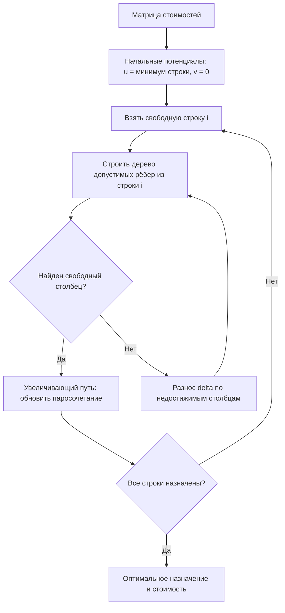

# Венгерский алгоритм (Hungarian Algorithm)

**Венгерский алгоритм** (Hungarian Algorithm) — алгоритм решения классической задачи о назначениях (Assignment Problem): среди всех взаимно однозначных соответствий элементов одного множества элементам другого найти такое, для которого суммарная стоимость минимальна. Работает за $O(n^3)$ — на порядки быстрее перебора всех $n!$ назначений.

## Подробное описание

**Постановка задачи:**
Дана квадратная матрица стоимостей $C$ размером $n \times n$, где $c_{ij}$ — стоимость назначения работника $i$ на задачу $j$. Найти перестановку $\sigma$, минимизирующую $\sum_{i=1}^{n} c_{i,\sigma(i)}$.

**Входные данные:**

- Матрица стоимостей $C$ ($n \times n$; прямоугольная приводится к квадратной добавлением фиктивных строк/столбцов с нулями)
- Режим: минимум или максимум

**Выходные данные:**

- Назначение $\sigma$ — какой работник выполняет какую задачу
- Оптимальная стоимость $C^*$

**Ключевая идея:**
Представим матрицу как взвешенный полный двудольный граф. Назначение —Perfect matching. Алгоритм поддерживает «потенциалы» (попарные метки) и ищет увеличивающий путь в чередующемся графе: пока путь есть, стоимость уменьшается на величину «разноса» (delta); когда пути нет — текущее назначение оптимально. Дополнения матрицы (вычитание минимума из строки/столбца) не меняют оптимумов, а делают часть рёбер «нулевыми» — свободными для построения паросочетания.

**Исторический контекст:**
В 1955 году Джеймс Манклер (James Munkres) опубликовал алгоритм, называемый теперь венгерским (Hungarian method) в честь вклада венгерских математиков Дьёрдя Конига и Денеша Кёнига в теорию графов. Опубликованная в 1957 году версия Карпа (Richard Karp) с $O(n^3)$ стала классикой; улучшения Жонкера — Форсайта снижают константы и дают $O(n^2 m)$ на разреженных матрицах (используется в SciPy `linear_sum_assignment`).

## Основные принципы

### Математическая формулировка

$$
C^* = \min_{\sigma \in S_n} \sum_{i=1}^{n} c_{i,\sigma(i)}
$$

Где:

- $S_n$ — множество всех перестановок $\{1, \dots, n\}$
- $\sigma(i)$ — задача, назначенная на работника $i$

**Теорема Конига — ЭгERVáRY (для задач о назначениях):** максимум паросочетания в двудольном графе равен минимуму «покрытия» вершин рёбрами. Это обосновывает корректность потенциалов.

**Шаги алгоритма (потенциальная версия):**

1. Для каждой строки $i$ и столбца $j$ ведутся потенциалы $u_i, v_j$. Попарная стоимость: $\tilde{c}_{ij} = c_{ij} - u_i - v_j \ge 0$.
2. Из свободной строки строится «дерево» допустимых рёбер ($\tilde{c}_{ij} = 0$); для недостижимых столбцов уменьшается $\min_j \tilde{c}_{ij}$ (разнос $\delta$): потенциалы строк дерева увеличиваются на $\delta$, столбцов — уменьшаются.
3. Как только дерево достигает свободного столбца — путь дополняется (паросочетание растёт на 1).
4. Когда все строки задействованы — назначение оптимально.

### Схема работы



### Сложность

$O(n^3)$: по $O(n)$ итераций паросочетания, в каждой $O(n^2)$ работ на поиск дерева и разноса. Перебор для сравнения: $O(n! \cdot n)$ — уже при $n = 12$ это ~479 млн операций против ~1728 у венгерского.

## Пример реализации на Python

Самодостаточная реализация потенциальной версии $O(n^3)$ на стандартной библиотеке (поддерживает $n \le m$), плюс перебор для проверки на маленьких размерностях.

```python
from itertools import permutations
from typing import List, Tuple

INF = float("inf")


def hungarian(cost: List[List[float]]) -> Tuple[List[int], float]:
    """Венгерский алгоритм (минимум суммарной стоимости).

    Args:
        cost: матрица стоимостей n x m, где n <= m

    Returns:
        (assignment, total): assignment[i] — индекс столбца для строки i,
                             total — суммарная стоимость назначения
    """
    n, m = len(cost), len(cost[0])
    assert 1 <= n <= m, "нужно n <= m"

    u = [0.0] * (n + 1)  # потенциалы строк (1-индексация, 0 — фиктивная)
    v = [0.0] * (m + 1)  # потенциалы столбцов
    p = [0] * (m + 1)    # p[j] = строка, назначенная на столбец j
    way = [0] * (m + 1)   # предок столбца в дереве

    for i in range(1, n + 1):
        p[0] = i
        j0 = 0  # текущий свободный столбец-корень дерева
        minv = [INF] * (m + 1)
        used = [False] * (m + 1)

        # рост чередующегося дерева до нахождения свободного столбца
        while True:
            used[j0] = True
            i0 = p[j0]
            delta = INF
            j1 = -1
            for j in range(1, m + 1):
                if not used[j]:
                    cur = cost[i0 - 1][j - 1] - u[i0] - v[j]
                    if cur < minv[j]:
                        minv[j] = cur
                        way[j] = j0
                    if minv[j] < delta:
                        delta = minv[j]
                        j1 = j
            for j in range(m + 1):
                if used[j]:
                    u[p[j]] += delta
                    v[j] -= delta
                else:
                    minv[j] -= delta
            j0 = j1
            if p[j0] == 0:
                break  # достигли свободного столбца

        # добавление найденного увеличивающего пути в паросочетание
        while True:
            j1 = way[j0]
            p[j0] = p[j1]
            j0 = j1
            if j0 == 0:
                break

    assignment = [-1] * n
    total = 0.0
    for j in range(1, m + 1):
        if p[j] != 0:
            assignment[p[j] - 1] = j - 1
            total += cost[p[j] - 1][j - 1]
    return assignment, total


def brute_force(cost: List[List[float]]) -> Tuple[List[int], float]:
    """Перебор всех перестановок — для проверки (n <= 8)."""
    n = len(cost)
    best_perm, best = None, INF
    for perm in permutations(range(n)):
        s = sum(cost[i][perm[i]] for i in range(n))
        if s < best:
            best, best_perm = s, perm
    return list(best_perm), best


if __name__ == "__main__":
    # Задача: 4 рабочих, 4 задачи, стоимость (время) в часах
    cost = [
        [9, 2, 7, 8],
        [6, 4, 3, 7],
        [5, 8, 1, 8],
        [7, 6, 9, 4],
    ]
    names = ["Аня", "Борис", "Вика", "Гоша"]
    tasks = ["сборка", "покраска", "упаковка", "доставка"]

    print("Матрица стоимостей (часы):")
    print("          " + "  ".join(f"{t:>8}" for t in tasks))
    for name, row in zip(names, cost):
        print(f"  {name:>6}: " + "  ".join(f"{c:8}" for c in row))

    assignment, total = hungarian(cost)
    print("\nОптимальное назначение (венгерский алгоритм):")
    for i, j in enumerate(assignment):
        print(f"  {names[i]:>6} -> {tasks[j]:>8} : {cost[i][j]} ч")
    print(f"Итого: {total:.0f} ч")

    # Проверка перебором
    _, bf_total = brute_force(cost)
    print(f"Перебор всех 4! = 24 назначений: {bf_total:.0f} ч")
    assert total == bf_total, "результаты должны совпадать!"
    print("Проверка пройдена: результат совпадает с полным перебором")

    # Задача о максимуме: прибыль — вычитаем из максимума или берём -C
    profit = [
        [5, 9, 1, 6],
        [8, 3, 2, 4],
        [4, 7, 6, 2],
        [3, 5, 8, 7],
    ]
    max_val = max(map(max, profit))
    neg_cost = [[max_val - p for p in row] for row in profit]
    a2, _ = hungarian(neg_cost)
    best_profit = sum(profit[i][a2[i]] for i in range(len(profit)))
    print("\nМаксимизация прибыли (венгерский алгоритм):")
    for i, j in enumerate(a2):
        print(f"  {names[i]:>6} -> {tasks[j]:>8} : {profit[i][j]} тыс.")
    print(f"Максимальная прибыль: {best_profit} тыс.")
```

## Достоинства и недостатки

**Достоинства:**

1. **Точное решение за $O(n^3)$** — вместо $n!$ перебора оптимум гарантирован и вычисляется быстро даже при $n$ в тысячи
2. **Двойственная интерпретация** — потенциалы $u, v$ дают нижнюю границу и объясняют, почему текущее назначение оптимально
3. **Универсальность** — одинаково решает минимизацию и максимизацию (через $-C$ или $C_{max} - C$), прямоугольные матрицы и повторяющиеся стоимости
4. **Инкрементальность** — при изменении одной стоимости алгоритм дополняется за $O(n^2)$ (наращивание начального паросочетания)

**Недостатки:**

1. **Только квадратичная структура** — нельзя напрямую учитывать назначение «один ко многим» (нужны дополнительные строки/столбцы или дробные варианты)
2. **Нет учёта порядка выполнения** — задачи считаются независимыми; ограничения времени/очереди требуют усложнений (задача о расписании)
3. **Чувствительность к формату данных** — при бесконечных запретах (невыполнимых назначениях) нужна аккуратная обработка INF
4. **Не решает квадратичные задачи** — если стоимость содержит произведения $x_i x_j$ (как в TSP), нужна другая формулировка

## Области применения

1. Оптимизация и планирование (назначение сотрудников на задачи, распределение оборудования, сведение пар «спрос — предложение»)
2. Логистика и управление цепочками (назначение водителей на заказы, привязка машин к маршрутам, балансировка нагрузки складов)
3. Робототехника и автономные системы (назначение манипуляторов на объекты захвата, координация групп дронов при патрулировании точек, matching в multi-robot task allocation)
