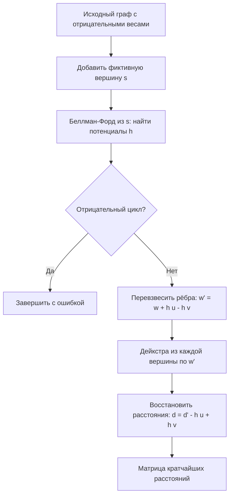

# Алгоритм Джонсона (Johnson's Algorithm)

**Алгоритм Джонсона** (Johnson's Algorithm) — алгоритм поиска кратчайших путей между всеми парами вершин (All-Pairs Shortest Paths) в ориентированном графе с возможными отрицательными весами рёбер, при условии отсутствия отрицательных циклов. Он объединяет перевзвешивание рёбер алгоритмом Беллмана–Форда и последующие запуски алгоритма Дейкстры.

## Подробное описание

**Постановка задачи:**
Дан ориентированный граф $G = (V, E)$ с функцией весов $w: E \to \mathbb{R}$, в котором есть рёбра с отрицательным весом, но нет отрицательных циклов. Найти расстояния $d(u, v)$ между всеми парами вершин.

**Входные данные:**

- Множество вершин $V$ и рёбер $E$ с весами $w(u, v)$

**Выходные данные:**

- Матрица кратчайших расстояний $d(u, v)$ для всех пар вершин (или констатация наличия отрицательного цикла)

**Ключевая идея:**
Отрицательные веса несовместимы с алгоритмом Дейкстры (жадность нарушается). Джонсон находит такие «потенциалы» $h(v)$ каждой вершины, что перевзвешенные веса $w'(u, v) = w(u, v) + h(u) - h(v)$ становятся неотрицательными, не меняя кратчайших путей. После этого от каждой вершины запускается обычная Дейкстра.

**Исторический контекст:**
Алгоритм предложил Дональд Джонсон (Donald B. Johnson) в 1977 году в статье «A note on the shortest paths problem». До этого для отрицательных весов использовали алгоритм Флойда–Уоршелла с $O(V^3)$ или $V$ запусков Беллмана–Форда с $O(V^2 E)$. Джонсон дал асимптотику $O(VE + V^2 \log V)$, что выгоднее на разреженных графах.

## Основные принципы

### Математическая формулировка

**Шаг 1 — потенциалы.** Добавляем фиктивную вершину $s$, соединённую рёбрами нулевого веса со всеми вершинами, и запускаем Беллмана–Форд из $s$. Полученные расстояния $h(v) = d(s, v)$ и есть потенциалы. Если обнаружен отрицательный цикл — алгоритм завершается с ошибкой.

**Шаг 2 — перевзвешивание:**

$$
w'(u, v) = w(u, v) + h(u) - h(v) \ge 0
$$

**Шаг 3 — сохранение путей.** Для любого пути $p = v_1 \to v_2 \to \dots \to v_k$:

$$
w'(p) = \sum_{i=1}^{k-1} \left( w(v_i, v_{i+1}) + h(v_i) - h(v_{i+1}) \right) = w(p) + h(v_1) - h(v_k)
$$

Где:

- $w(p)$ — исходный вес пути
- $h(v)$ — потенциал вершины $v$

Телескопическая сумма $h$ сокращается, поэтому для всех путей между одной парой вершин прибавка $h(u) - h(v)$ одинакова — значит, кратчайшие пути не меняются.

**Шаг 4 — Дейкстра.** Запускаем Дейкстру из каждой вершины $u$ по весам $w'$ и восстанавливаем исходные расстояния:

$$
d(u, v) = d'(u, v) - h(u) + h(v)
$$

### Схема работы алгоритма



### Сложность

| Этап | Сложность |
|---|---|
| Беллмана–Форд (один раз) | $O(VE)$ |
| $V$ запусков Дейкстры (кууча) | $O(V \cdot E \log V)$ |
| **Итого** | $O(VE + V^2 \log V)$ |

На плотных графах ($E \approx V^2$) это $O(V^3)$ — как у Флойда–Уоршелла, но с меньшей константой; на разреженных графах Джонсон заметно быстрее.

## Пример реализации на Python

Самодостаточная реализация на стандартной библиотеке: Беллмана–Форд для потенциалов, Дейкстра на `heapq` для перевзвешенного графа, плюс Флойд–Уоршелл для проверки результата.

```python
import heapq
from typing import Dict, List, Optional, Tuple

Graph = Dict[int, List[Tuple[int, float]]]  # вершина -> [(сосед, вес)]


def bellman_ford(n: int, edges: List[Tuple[int, int, float]], src: int) -> Optional[List[float]]:
    """Одиночный Беллман-Форд. Возвращает расстояния или None при отрицательном цикле."""
    dist = [float("inf")] * n
    dist[src] = 0.0
    # релаксация всех рёбер |V| - 1 раз
    for _ in range(n - 1):
        updated = False
        for u, v, w in edges:
            if dist[u] != float("inf") and dist[u] + w < dist[v]:
                dist[v] = dist[u] + w
                updated = True
        if not updated:
            break
    # проверка на отрицательный цикл
    for u, v, w in edges:
        if dist[u] != float("inf") and dist[u] + w < dist[v]:
            return None
    return dist


def dijkstra(n: int, graph: Graph, src: int) -> List[float]:
    """Дейкстра на heapq для графа с неотрицательными весами."""
    dist = [float("inf")] * n
    dist[src] = 0.0
    heap: List[Tuple[float, int]] = [(0.0, src)]
    while heap:
        d, u = heapq.heappop(heap)
        if d > dist[u]:
            continue
        for v, w in graph[u]:
            nd = d + w
            if nd < dist[v]:
                dist[v] = nd
                heapq.heappush(heap, (nd, v))
    return dist


def johnson(n: int, edges: List[Tuple[int, int, float]]) -> Optional[List[List[float]]]:
    """Алгоритм Джонсона: матрица кратчайших расстояний или None при отрицательном цикле."""
    # Шаг 1: потенциалы через Беллман-Форд из фиктивной вершины n
    extended = edges + [(n, u, 0.0) for u in range(n)]  # ребро s -> v для всех v
    h = bellman_ford(n + 1, extended, n)
    if h is None:
        return None  # в графе есть отрицательный цикл

    # Шаг 2: перевзвешенный граф (гарантированно неотрицательные веса)
    graph: Graph = {u: [] for u in range(n)}
    for u, v, w in edges:
        graph[u].append((v, w + h[u] - h[v]))

    # Шаг 3: Дейкстра из каждой вершины + восстановление исходных расстояний
    result = []
    for u in range(n):
        d_prime = dijkstra(n, graph, u)
        result.append([d - h[u] + h[v] for d, v in zip(d_prime, range(n))])
    return result


def floyd_warshall(n: int, edges: List[Tuple[int, int, float]]) -> List[List[float]]:
    """Флойд-Уоршелл — для проверки результата Джонсона."""
    INF = float("inf")
    dist = [[INF] * n for _ in range(n)]
    for i in range(n):
        dist[i][i] = 0.0
    for u, v, w in edges:
        dist[u][v] = min(dist[u][v], w)
    for k in range(n):
        for i in range(n):
            for j in range(n):
                if dist[i][k] + dist[k][j] < dist[i][j]:
                    dist[i][j] = dist[i][k] + dist[k][j]
    return dist


if __name__ == "__main__":
    # Граф с отрицательными рёбрами (отрицательных циклов нет)
    # 0 --2--> 1 --3--> 2 --1--> 3
    # |       ^        |         ^
    # 4       -1       2         |
    # v       |        v         |
    # 1 ------+--------0 --(-2)-> 3  (ребро 1->0 вес -1)
    n = 5
    edges = [
        (0, 1, 2),
        (1, 2, 3),
        (2, 3, 1),
        (0, 4, 4),
        (4, 1, -1),
        (1, 0, -1),
        (4, 2, 2),
        (2, 0, 1),
        (3, 4, 1),
    ]

    print("Рёбра графа (u, v, вес):")
    for e in edges:
        print(f"  {e[0]} -> {e[1]} : {e[2]:+.0f}")

    dist = johnson(n, edges)
    if dist is None:
        print("\nВ графе обнаружен отрицательный цикл!")
    else:
        print("\nМатрица кратчайших расстояний (Джонсон):")
        header = "     " + " ".join(f"{j:>6}" for j in range(n))
        print(header)
        for i in range(n):
            row = " ".join(f"{d:6.0f}" if d != float("inf") else "   inf" for d in dist[i])
            print(f"  {i}: {row}")

        # Сверка с Флойд-Уоршеллом
        fw = floyd_warshall(n, edges)
        max_diff = max(
            abs(a - b) for i in range(n) for a, b in zip(dist[i], fw[i])
            if a != float("inf") and b != float("inf")
        )
        print(f"\nМаксимальное расхождение с Флойдом-Уоршеллом: {max_diff:.9f}")

        print("\nКратчайший путь 4 -> 3: "
              f"расстояние = {dist[4][3]:.0f}")
```

## Достоинства и недостатки

**Достоинства:**

1. **Поддержка отрицательных весов** — в отличие от $V$ запусков Дейкстры, корректно работает с отрицательными рёбрами (но без отрицательных циклов)
2. **Выгодная асимптотика на разреженных графах** — $O(VE + V^2 \log V)$ против $O(V^3)$ у Флойда–Уоршелла при $E \ll V^2$
3. **Явное обнаружение отрицательных циклов** — шаг Беллмана–Форда возвращает ответ, если цикл существует
4. **Простая идея перевзвешивания** — потенциалы «выпрямляют» веса, сохраняя все кратчайшие пути

**Недостатки:**

1. **Сложность реализации** — три взаимодействующих алгоритма вместо одного, выше риск ошибок
2. **Неэффективен на плотных графах** — при $E \approx V^2$ выигрыш перед Флойдом–Уоршеллом исчезает
3. **Один запуск Беллмана–Форда квадратичен по памяти при неявном хранении** — на очень больших графах $O(VE)$ релаксаций дорого
4. **Не подходит для динамических графов** — при изменении весов приходится пересчитывать потенциалы целиком

## Области применения

1. Оптимизация и планирование (расчёт кратчайших путей в графах со «скидками» и отрицательными стоимостями, например кэшбэк в модели затрат)
2. Логистика и управление цепочками (маршрутизация транспорта, где отдельные участки приносят прибыль вместо затрат — отрицательные «стоимости»)
3. Графовые модели и социальные сети (анализ связей с весами-направлениями влияния, вычисление доступности вершин в взвешенных графах)
