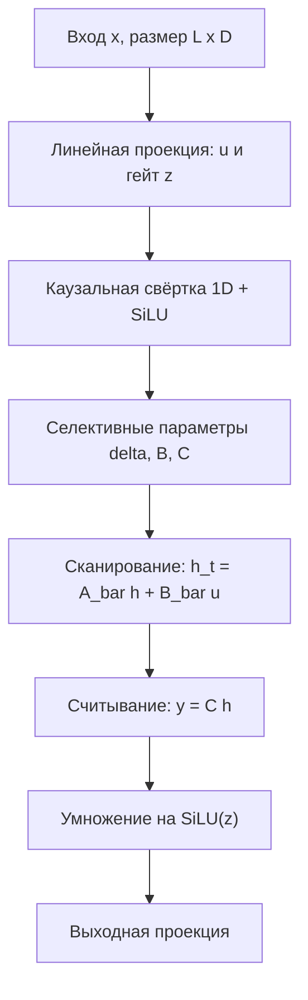

# Mamba — селективные модели пространства состояний (Selective State Space Models)

Mamba — это архитектура глубоких последовательностных сетей, построенная на *селективной модели пространства состояний* (Selective State Space Model, S6): последовательность обрабатывается линейным по длине сканированием скрытого состояния, параметры которого зависят от входа, что позволяет модели избирательно запоминать и вспоминать релевантный контекст без квадратичного механизма внимания.

## Подробное описание

**Постановка задачи:**

Дана последовательность $x_1, ..., x_L$ (токены текста, отсчёты временного ряда, события). Нужно преобразовать её в выход $y_1, ..., y_L$, учитывая контекст прошлых элементов, при сложности $O(L)$ по длине последовательности и константной по $L$ памяти при инференсе.

**Входные данные:**

- Последовательность $x_t$ размером $L \times D$ (длина $L$, признаковое измерение $D$)

**Выходные данные:**

- Последовательность $y_t$ размером $L \times D$
- Финальное скрытое состояние $h$ фиксированного размера $D \times N$, не зависящее от $L$

**Ключевая идея:**

В основе — непрерывная модель пространства состояний (SSM), дискретизированная во времени. В отличие от ранних SSM-моделей семейства S4, у которых параметры фиксированы (линейно-временная инвариантность), в Mamba дискретизация $\Delta$, проекции входа $B$ и считывания $C$ *вычисляются из текущего токена*. Это селективность: модель решает по содержанию, что запомнить в состоянии, а что — проигнорировать, подобно гейтам LSTM, но в парадигме параллельного сканирования.

**Исторический контекст:**

Линия SSM развивалась с моделей S4 (Albert Gu и соавт., 2021) через H3 к Mamba, предложенной Альбертом Гу и Три Дао в конце 2023 года. В 2024 году вышла Mamba-2 с формализацией SSD (Structured State Space Duality), установившей связь между селективными SSM и механизмом внимания. Mamba вдохновила семейство гибридных архитектур (Jamba, Zamba) и языковые модели специализированных направлений.

## Основные принципы

### Математическая формулировка

Непрерывная модель пространства состояний:

$$
h'(t) = A h(t) + B x(t), \qquad y(t) = C h(t)
$$

Дискретизация с шагом $\Delta$ (схема Эйлера):

$$
h_t = \bar{A} h_{t-1} + \bar{B} x_t, \qquad \bar{A} = \exp(\Delta A), \quad \bar{B} \approx \Delta B
$$

Селективность — параметры зависят от входа $u_t$:

$$
\Delta_t = \operatorname{softplus}(W_\Delta u_t + b_\Delta), \qquad B_t = W_B u_t, \qquad C_t = W_C u_t
$$

Итоговый проход сканирования и считывание:

$$
h_t = \exp(\Delta_t A) h_{t-1} + \Delta_t B_t u_t, \qquad y_t = C_t h_t
$$

Где:

- $h_t$ — скрытое состояние размером $D \times N$ на шаге $t$
- $A$ — диагональная матрица динамики (обычно отрицательная: состояние экспоненциально затухает)
- $B_t$, $C_t$ — входозависимые проекции записи и считывания
- $\Delta_t$ — размер шага дискретизации: большой $\Delta_t$ сильнее записывает текущий токен в состояние и «забывает» прошлое, малый — наоборот
- $u_t$ — вход блока после каузальной свёртки и активации SiLU

### Структура блока Mamba



### Сравнение парадигм

| Свойство | RNN / LSTM | Внимание (Transformer) | Mamba |
|---|---|---|---|
| Сложность прохода | $O(L)$ | $O(L^2)$ | $O(L)$ |
| Память при инференсе | $O(1)$ | $O(L)$ (KV-кэш) | $O(DN)$ (состояние) |
| Доступ к контексту | посимвольно, затухает | напрямую ко всем токенам | через компактное состояние |
| Контекстозависимость | гейтами LSTM | весами внимания | селективными $\Delta, B, C$ |

## Пример реализации на Python

```python
import time
import numpy as np


def silu(x: np.ndarray) -> np.ndarray:
    """Активация SiLU / Swish: x * sigmoid(x)."""
    return x / (1.0 + np.exp(-np.clip(x, -60.0, 60.0)))


def softplus(x: np.ndarray) -> np.ndarray:
    """Стабильная реализация softplus: log(1 + exp(x))."""
    return np.logaddexp(0.0, x)


def causal_conv1d(x: np.ndarray, weight: np.ndarray, bias: np.ndarray) -> np.ndarray:
    """Каузальная свёртка 1D: y_t = sum_k w_k * x_{t-k} (начало дополнено нулями)."""
    L, D = x.shape
    K = weight.shape[0]
    x_pad = np.vstack([np.zeros((K - 1, D)), x])
    y = np.zeros((L, D))
    for t in range(L):
        y[t] = (x_pad[t:t + K] * weight).sum(axis=0) + bias
    return y


def selective_scan(u: np.ndarray, delta: np.ndarray, A: np.ndarray,
                   B: np.ndarray, C: np.ndarray) -> tuple:
    """
    Сканирование селективной SSM (последовательный проход).
    u: (L, D), delta: (L, D), A: (D, N) — отрицательная, B и C: (L, N).
    Возвращает y: (L, D) и финальное состояние h: (D, N).
    """
    L, D = u.shape
    N = A.shape[1]
    # Дискретизация: A_bar = exp(delta * A), B_bar = delta * B
    dA = np.exp(delta[:, :, None] * A[None])    # (L, D, N)
    dB = delta[:, :, None] * B[:, None, :]      # (L, D, N)
    h = np.zeros((D, N))
    y = np.zeros((L, D))
    for t in range(L):
        h = dA[t] * h + dB[t] * u[t, :, None]   # h_t = A_bar h_{t-1} + B_bar u_t
        y[t] = h @ C[t]                          # y_t = C_t h_t
    return y, h


class MiniMambaBlock:
    """Упрощённый блок Mamba: проекция -> свёртка -> селективный SSM -> гейт."""

    def __init__(self, d_model: int, d_state: int = 8,
                 d_conv: int = 4, expand: int = 2, seed: int = 0):
        rng = np.random.default_rng(seed)
        self.d_model = d_model
        self.d_inner = expand * d_model          # расширение канального измерения
        self.d_state = d_state
        d_in, N, K = self.d_inner, d_state, d_conv

        # Входная проекция: x -> (u, z), z — гейт
        self.W_in = rng.normal(0, 1 / np.sqrt(d_model), (d_model, 2 * d_in))
        self.b_in = np.zeros(2 * d_in)
        # Каузальная свёртка по u
        self.w_conv = rng.normal(0, 1 / np.sqrt(K), (K, d_in))
        self.b_conv = np.zeros(d_in)
        # Селективные проекции
        self.W_delta = rng.normal(0, 1 / np.sqrt(d_in), (d_in, d_in))
        self.b_delta = np.linspace(-3.0, -1.0, d_in)  # малые шаги по умолчанию
        self.W_B = rng.normal(0, 1 / np.sqrt(d_in), (d_in, N))
        self.W_C = rng.normal(0, 1 / np.sqrt(d_in), (d_in, N))
        # A отрицательная (затухание): параметризуем через экспоненту
        self.A = -np.exp(np.linspace(-4.0, -1.0, d_in * N)).reshape(d_in, N)
        # Выходная проекция
        self.W_out = rng.normal(0, 1 / np.sqrt(d_in), (d_in, d_model))
        self.b_out = np.zeros(d_model)

    def __call__(self, x: np.ndarray) -> tuple:
        """Прямой проход: возвращает выход (L, D) и словарь с диагностикой."""
        L, D = x.shape
        assert D == self.d_model, f"ожидался вход (L, {self.d_model}), получен {x.shape}"

        proj = x @ self.W_in + self.b_in
        u, z = np.split(proj, 2, axis=-1)
        u = silu(causal_conv1d(u, self.w_conv, self.b_conv))

        delta = softplus(u @ self.W_delta + self.b_delta)
        B = u @ self.W_B
        C = u @ self.W_C
        y, h = selective_scan(u, delta, self.A, B, C)

        out = silu(y) * silu(z)
        return out @ self.W_out + self.b_out, {"delta": delta, "h_final": h}


def attention_forward(q: np.ndarray, k: np.ndarray, v: np.ndarray) -> np.ndarray:
    """Наивное полное внимание для сравнения сложности: O(L^2)."""
    scores = (q @ k.T) / np.sqrt(q.shape[1])
    scores -= scores.max(axis=1, keepdims=True)
    p = np.exp(scores)
    p /= p.sum(axis=1, keepdims=True)
    return p @ v


if __name__ == "__main__":
    rng = np.random.default_rng(0)
    d_model, L = 16, 12
    block = MiniMambaBlock(d_model, seed=42)

    # 1) Игрушечная последовательность «токенов»
    tokens = np.array([2, 0, 1, 1, 3, 0, 3, 2, 1, 0, 2, 3])
    x = np.eye(4, d_model)[tokens]
    y, aux = block(x)
    print(f"Вход {x.shape} -> выход {y.shape}, "
          f"состояние h {aux['h_final'].shape} (не зависит от L)")

    # 2) Селективность: сильный всплеск на позиции 5 меняет шаг delta
    x1 = rng.normal(0, 1, (L, d_model)) * 0.1
    x2 = x1.copy()
    x2[5] += 3.0
    _, a1 = block(x1)
    _, a2 = block(x2)
    print("\nМаксимальный delta (сигнал vs всплеск на поз. 5): "
          f"{a1['delta'].max():.4f} -> {a2['delta'].max():.4f}")
    print(f"Норма финального состояния: "
          f"{np.linalg.norm(a1['h_final']):.3f} -> {np.linalg.norm(a2['h_final']):.3f}")

    # 3) Сложность: скан O(L) против полного внимания O(L^2)
    def bench(fn, repeats: int = 5) -> float:
        """Лучшее время из нескольких прогонов (устойчивость к шуму)."""
        times = []
        for _ in range(repeats):
            t0 = time.perf_counter()
            fn()
            times.append(time.perf_counter() - t0)
        return min(times) * 1e3

    print("\nЛучшее время из 5 прогонов (мс):")
    print(f"{'L':>6} {'скан O(L)':>12} {'внимание O(L^2)':>18} "
          f"{'отношение':>10} {'операций скан':>14} {'операций внимание':>18}")
    for L_t in (256, 512, 1024, 2048):
        u = rng.normal(0, 1, (L_t, 64))
        delta = softplus(rng.normal(-2, 0.5, (L_t, 64)))
        A = -np.exp(rng.normal(-2, 0.5, (64, 16)))
        B = rng.normal(0, 1, (L_t, 16))
        C = rng.normal(0, 1, (L_t, 16))
        q = rng.normal(0, 1, (L_t, 64))
        k = rng.normal(0, 1, (L_t, 64))
        v = rng.normal(0, 1, (L_t, 64))

        t_scan = bench(lambda: selective_scan(u, delta, A, B, C))
        t_att = bench(lambda: attention_forward(q, k, v))
        ops_scan = L_t * 64 * 16
        ops_att = L_t * L_t

        print(f"{L_t:>6} {t_scan:>12.2f} {t_att:>18.2f} "
              f"{t_att / t_scan:>9.1f}x {ops_scan:>14,} {ops_att:>18,}")

    print("\nОпераций теоретически: скан ~ L*D*N, внимание ~ L^2; "
          "состояние скана фиксированного размера D x N.")
```

## Достоинства и недостатки

**Достоинства:**

1. **Линейная сложность** — проход по последовательности стоит $O(L)$, что делает доступными контексты в десятки и сотни тысяч токенов без квадратичного внимания
2. **Константная память инференса** — скрытое состояние $D \times N$ не растёт с длиной контекста, в отличие от KV-кэша трансформеров
3. **Селективность** — входозависимые $\Delta_t, B_t, C_t$ позволяют модели избирательно записывать и считывать контекст, преодолевая ограничение стационарных (LTI) SSM-моделей вроде S4
4. **Аппаратный параллелизм** — проход строится на ассоциативном сканировании, оптимизированном под GPU: обучение идёт параллельно, в отличие от последовательных RNN

**Недостатки:**

1. **Сложность эффективной реализации** — выигрыш зависит от продуманной раскладки памяти и фьюжн-кернелей; наивный код на Python скан проигрывает оптимизированному вниманию на коротких последовательностях
2. **Менее стандартизированные рецепты обучения** — инициализация, планировщики и гиперпараметры для SSM менее устоялись, чем у трансформеров
3. **Косвенный доступ к контексту** — далёкий токен должен быть сохранён в компактном состоянии; точечный «взгляд назад» к произвольному токену у внимания принципиально надёжнее
4. **Молодая экосистема** — готовых pretrained-весов, инструментов и обучающих рецептов существенно меньше, чем для трансформеров

## Области применения

1. Обработка естественного языка (языковые модели с длинным контекстом, обработка целых файлов кода и протоколов)
2. Машинное обучение и рекомендательные системы (длинные ленты событий и сессий пользователей, последовательности взаимодействий)
3. Научные вычисления и физическое моделирование (долгие временные ряды датчиков, моделирование динамических систем с долгой памятью)
