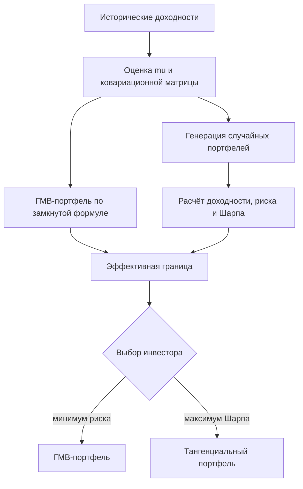

# Оптимизация портфеля по Марковицу (Markowitz Mean-Variance Optimization)

Оптимизация портфеля по Марковицу (Mean-Variance Optimization, MVO) — это метод выбора весов активов в портфеле, который представляет риск через дисперсию доходности, а доходность — через математическое ожидание, и находит компромисс между ними (эффективные портфели).

## Подробное описание

**Постановка задачи:**

Дан набор финансовых активов с оценёнными средними доходностями и ковариационной матрицей доходностей. Найти веса $w_i$ (доли капитала в каждом активе), образующие *эффективный* портфель: из всех портфелей с такой же доходностью он должен иметь минимально возможный риск, и наоборот.

**Входные данные:**

- Вектор средних доходностей активов $\mu$ размером $n$
- Ковариационная матрица доходностей $\Sigma$ размером $n \times n$
- Ограничения: обычно $\sum_i w_i = 1$, допускаются шорты ($w_i < 0$) или только длинные позиции ($w_i \ge 0$)
- Беспроцентная ставка $r_f$ (для отбора портфелей по коэффициенту Шарпа)

**Выходные данные:**

- Вектор весов портфеля $w$ размером $n$
- Ожидаемая доходность портфеля $E(r_p)$ и его риск $\sigma_p$
- Эффективная граница — множество оптимальных пар «риск — доходность»

**Ключевая идея:**

Единственной метрикой риска считается дисперсия доходности. Портфельный эффект возникает из-за ковариаций: если активы не perfectly скоррелированы, суммарный риск портфеля меньше, чем взвешенная сумма рисков отдельных активов. Это и есть количественная формулировка диверсификации.

**Исторический контекст:**

Метод предложен Гарри Марковицем в статье «Portfolio Selection» (1952). За работы по теории портфеля Марковиц получил Нобелевскую премию по экономике в 1990 году.

## Основные принципы

### Математическая формулировка

Доходность портфеля — взвешенная сумма доходностей активов:

$$
E(r_p) = w^T \mu = \sum_{i=1}^{n} w_i \mu_i
$$

Риск портфеля (дисперсия) через ковариационную матрицу:

$$
\sigma_p^2 = w^T \Sigma w = \sum_{i=1}^{n} \sum_{j=1}^{n} w_i w_j \sigma_{ij}
$$

Задача минимизации риска при заданной доходности $\mu^*$:

$$
\min_{w} \; w^T \Sigma w \quad \text{при} \quad w^T \mu = \mu^*, \; w^T \mathbf{1} = 1
$$

Аналитическое решение для портфеля с минимальной дисперсией (Global Minimum Variance, ГМВ):

$$
w_{\text{ГМВ}} = \frac{\Sigma^{-1} \mathbf{1}}{\mathbf{1}^T \Sigma^{-1} \mathbf{1}}
$$

Отбор наиболее доходного портфеля на единицу риска — по коэффициенту Шарпа:

$$
S = \frac{E(r_p) - r_f}{\sigma_p}
$$

Где:

- $w$ — вектор весов активов в портфеле
- $\mu$ — вектор средних доходностей активов
- $\Sigma$ — ковариационная матрица доходностей ($\sigma_{ij} = \text{Cov}(r_i, r_j)$)
- $\sigma_p$ — стандартное отклонение доходности портфеля (риск)
- $r_f$ — беспроцентная (безрисковая) ставка
- $\mathbf{1}$ — вектор единиц размером $n$

### Схема построения эффективной границы



## Пример реализации на Python

```python
import numpy as np


def portfolio_stats(weights: np.ndarray, mu: np.ndarray, cov: np.ndarray):
    """Ожидаемая доходность и риск портфеля."""
    ret = weights @ mu                 # E(r_p) = w^T mu
    vol = np.sqrt(weights @ cov @ weights)  # sigma_p = sqrt(w^T Sigma w)
    return ret, vol


def gmv_weights(cov: np.ndarray) -> np.ndarray:
    """Веса портфеля с минимальной дисперсией (замкнутая формула)."""
    ones = np.ones(cov.shape[0])
    inv_ones = np.linalg.solve(cov, ones)   # Sigma^{-1} * 1
    return inv_ones / inv_ones.sum()


def tangency_weights(mu: np.ndarray, cov: np.ndarray, rf: float) -> np.ndarray:
    """Тангенциальный портфель — максимум коэффициента Шарпа."""
    excess = np.linalg.solve(cov, mu - rf)  # Sigma^{-1} * (mu - rf*1)
    return excess / excess.sum()


def min_var_at_target(mu: np.ndarray, cov: np.ndarray, target: float) -> np.ndarray:
    """Минимально-рисковый портфель с заданной доходностью (задача ККТ)."""
    n = len(mu)
    kkt = np.zeros((n + 2, n + 2))
    kkt[:n, :n] = cov
    kkt[:n, n] = mu
    kkt[:n, n + 1] = 1.0
    kkt[n, :n] = mu
    kkt[n + 1, :n] = 1.0
    rhs = np.zeros(n + 2)
    rhs[n], rhs[n + 1] = target, 1.0
    return np.linalg.solve(kkt, rhs)[:n]


if __name__ == "__main__":
    rng = np.random.default_rng(42)

    # Истинные параметры четырёх активов (годовые)
    mu_true = np.array([0.04, 0.08, 0.12, 0.16])
    vol_true = np.array([0.05, 0.12, 0.20, 0.30])
    corr = np.array([
        [1.0, 0.3, 0.1, 0.0],
        [0.3, 1.0, 0.4, 0.1],
        [0.1, 0.4, 1.0, 0.5],
        [0.0, 0.1, 0.5, 1.0],
    ])
    true_cov = np.outer(vol_true, vol_true) * corr

    # Симулируем исторические дневные доходности и оцениваем mu, Sigma
    n_obs = 1000
    chol = np.linalg.cholesky(true_cov)
    daily = mu_true / 252 + (rng.standard_normal((n_obs, 4)) @ chol.T) / np.sqrt(252)
    mu = daily.mean(axis=0) * 252
    cov = np.cov(daily, rowvar=False) * 252

    rf = 0.02

    # Портфели с минимальной дисперсией и максимальным коэффициентом Шарпа
    w_gmv = gmv_weights(cov)
    w_tar = tangency_weights(mu, cov, rf)
    r_g, v_g = portfolio_stats(w_gmv, mu, cov)
    r_t, v_t = portfolio_stats(w_tar, mu, cov)

    print("ГМВ-портфель (минимум риска):")
    print(f"  веса: {np.round(w_gmv, 3)}")
    print(f"  доходность: {r_g:.3%}  риск: {v_g:.3%}  Шарп: {(r_g - rf) / v_g:.2f}")

    print("\nТангенциальный портфель (максимум Шарпа):")
    print(f"  веса: {np.round(w_tar, 3)}")
    print(f"  доходность: {r_t:.3%}  риск: {v_t:.3%}  Шарп: {(r_t - rf) / v_t:.2f}")

    # Приближение эффективной границы случайными длинными портфелями
    n_samples = 5000
    w_rand = rng.random((n_samples, 4))
    w_rand /= w_rand.sum(axis=1, keepdims=True)
    r_all = w_rand @ mu
    v_all = np.sqrt(np.einsum("ij,jk,ik->i", w_rand, cov, w_rand))
    sharpe_all = (r_all - rf) / v_all

    i_best = sharpe_all.argmax()
    i_min = v_all.argmin()
    print("\nСлучайные портфели (5000):")
    print(f"  лучший Шарп: {sharpe_all[i_best]:.2f} "
          f"(доходность {r_all[i_best]:.3%}, риск {v_all[i_best]:.3%})")
    print(f"  минимум риска: {v_all[i_min]:.3%} "
          f"(веса {np.round(w_rand[i_min], 3)})")
    print(f"  ГМВ из формулы совпадает с минимумом выборки: "
          f"{np.isclose(v_g, v_all[i_min], atol=5e-3)}")

    # Точки эффективной границы (верхняя ветвь: от ГМВ и выше)
    print("\nЭффективная граница (точки):")
    target_grid = np.linspace(r_g + 1e-3, mu.max() - 1e-3, 5)
    for target in target_grid:
        w = min_var_at_target(mu, cov, float(target))
        r_p, v_p = portfolio_stats(w, mu, cov)
        assert np.isclose(r_p, target) and np.isclose(w.sum(), 1.0)
        print(f"  доходность {r_p:.2%} -> риск {v_p:.2%}")
```

## Достоинства и недостатки

**Достоинства:**

1. **Строгая математическая база** — задача сводится к квадратичному программированию, а ГМВ-портфель находится по замкнутой формуле без итераций
2. **Количественная диверсификация** — ковариационная матрица явно учитывает, комбинация каких активов снижает суммарный риск
3. **Прозрачность решений** — веса портфеля напрямую показывают вклад каждого актива в доходность и риск
4. **Вычислительная эффективность** — для типичных чисел активов ($n \sim 10$–$100$) достаточно обращения матрицы $n \times n$, что делается за доли секунды

**Недостатки:**

1. **Чувствительность к оценке доходностей** — малая ошибка в $\mu$ резко меняет веса, поскольку задача «доходность задана точно» жёстко реагирует на вход
2. **Квадратичная модель риска** — дисперсия не различает безболезненные и катастрофические просадки, экстремальные события (хвосты распределения) не моделируются
3. **Нестабильность ковариаций** — в кризисы корреляции активов растут, историческая $\Sigma$ перестаёт описывать новое поведение рынка
4. **Приближение нормальностью** — реальные доходности имеют «тяжёлые хвосты», из-за чего риск по Марковицу систематически недооценивается

## Области применения

1. Экономика и финансы (формирование инвестиционных портфелей, стратегии пенсионных и страховых фондов)
2. Оптимизация и планирование (распределение бюджета между проектами при ограничении по уровню риска)
3. Научные вычисления и физическое моделирование (оценка ковариационных структур, численное исследование эффективной границы)
