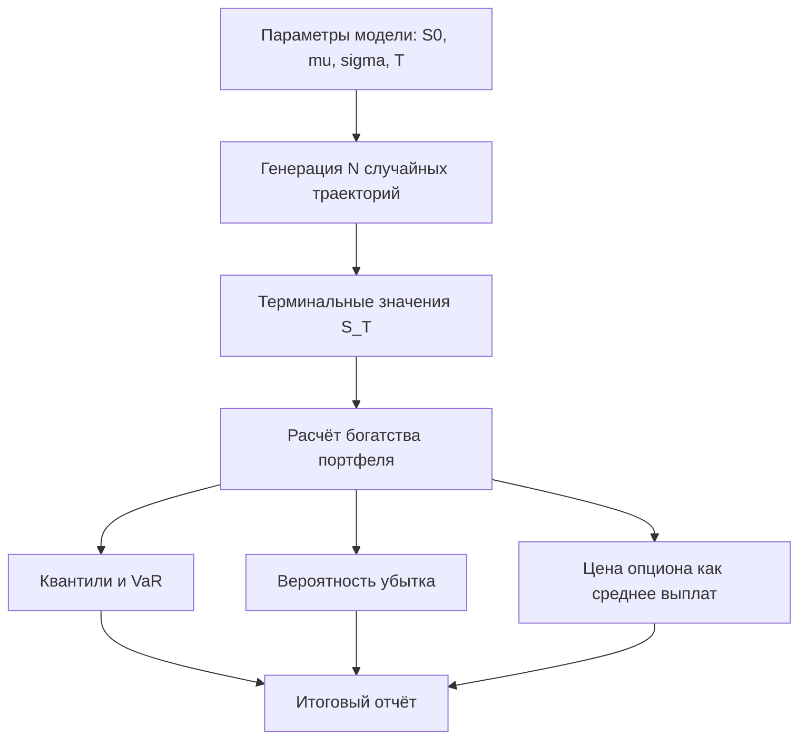

# Метод Монте-Карло (Monte Carlo Simulation)

Метод Монте-Карло (Monte Carlo Simulation) — это класс численных методов, которые оценивают искомую величину (среднее, вероятность, квантиль) большим числом случайных реализаций процесса, превращая аналитически нерешаемую задачу в статистическую выборку.

## Подробное описание

**Постановка задачи:**

Определить ожидаемое значение $E[f(X)]$, вероятность события или распределение исхода системы, когда аналитическое интегрирование невозможно: слишком много переменных, нестандартные распределения или стохастическая динамика во времени.

**Входные данные:**

- Модель системы (функция $f$ или дискретная схема эволюции)
- Распределения входных величин $X \sim p(x)$ (или параметры процесса: дрейф, волатильность)
- Число реализаций $N$ (объём выборки)

**Выходные данные:**

- Оценка $\hat{\theta} = \frac{1}{N} \sum_{i=1}^{N} f(x_i)$
- Доверительный интервал/погрешность оценки
- Эмпирическое распределение результатов (гистограмма, квантили)

**Ключевая идея:**

По закону больших чисел среднее выборки сходится к истинному ожиданию, а по центральной предельной теореме погрешность уменьшается как $O(1/\sqrt{N})$ — точность растёт предсказуемо: для разделимого пополам погрешности достаточно вчетверо больше выборок.

**Исторический контекст:**

Метод разработан в 1940-х годах в Лос-Аламосской национальной лаборатории — Джон фон Нейман, Станислав Улам, Николас Метрополис и др. моделировали нейтронные цепные реакции. Название придумал Улам в честь одноимённого казино (по легенде, так называлась игра его родственника).

## Основные принципы

### Математическая формулировка

Оценка ожидания по выборке (эмпирическое среднее):

$$
\hat{\theta} = \frac{1}{N} \sum_{i=1}^{N} f(x_i), \qquad x_i \sim p(x)
$$

Асимптотическая погрешность (центральная предельная теорема):

$$
\varepsilon \approx \frac{\sigma_f}{\sqrt{N}}, \qquad \sigma_f^2 = \text{Var}[f(X)]
$$

Модель геометрического броуновского движения (цена актива) с шагом $\Delta t$:

$$
S_{t+\Delta t} = S_t \cdot \exp\left[ \left(\mu - \frac{\sigma^2}{2}\right)\Delta t + \sigma \sqrt{\Delta t}\,\varepsilon \right], \quad \varepsilon \sim \mathcal{N}(0, 1)
$$

Оценка вероятности события $A$ и квантиля (VaR) по выборке:

$$
\hat{P}(A) = \frac{\#\{x_i \in A\}}{N}, \qquad \text{VaR}_{\alpha} = F^{-1}_{\text{эмп}}(\alpha)
$$

Где:

- $f(x)$ — функция, значение которой оценивается (доходность, цена опциона, …)
- $N$ — число случайных реализаций
- $\mu$ — дрейф (средняя доходность), $\sigma$ — волатильность процесса
- $\Delta t$ — временной шаг дискретизации
- $F^{-1}_{\text{эмп}}$ — обратная эмпирическая функция распределения (квантиль выборки)

### Схема стохастического моделирования портфеля



## Пример реализации на Python

```python
import math
import numpy as np


def gbm_paths(s0: float, mu: float, sigma: float, T: float,
              steps: int, n_paths: int, rng: np.random.Generator) -> np.ndarray:
    """Симуляция траекторий геометрического броуновского движения."""
    dt = T / steps
    drift = (mu - 0.5 * sigma ** 2) * dt          # поправка Итона
    diffusion = sigma * np.sqrt(dt)
    z = rng.standard_normal((n_paths, steps))
    log_steps = drift + diffusion * z
    log_paths = np.cumsum(log_steps, axis=1)
    # Объединяем начальную цену и приращения логарифма цены
    log_full = np.concatenate([np.zeros((n_paths, 1)), log_paths], axis=1)
    return s0 * np.exp(log_full)


def norm_cdf(x: float) -> float:
    """Кумулятивная функция нормального распределения через erf."""
    return 0.5 * (1.0 + math.erf(x / math.sqrt(2.0)))


def bs_call(s0: float, strike: float, rf: float, sigma: float, T: float) -> float:
    """Цена европейского опциона колл по формуле Блэка — Шоулза (контроль)."""
    d1 = (math.log(s0 / strike) + (rf + 0.5 * sigma ** 2) * T) / (sigma * math.sqrt(T))
    d2 = d1 - sigma * math.sqrt(T)
    return s0 * norm_cdf(d1) - strike * math.exp(-rf * T) * norm_cdf(d2)


if __name__ == "__main__":
    rng = np.random.default_rng(7)

    # Параметры модели и портфеля
    s0, mu, sigma, T = 100.0, 0.08, 0.25, 1.0
    n_paths, steps = 10_000, 52
    n_units = 100.0                      # единиц актива в портфеле
    rf = 0.03
    strike = 100.0                       # страйк европейского опциона колл

    paths = gbm_paths(s0, mu, sigma, T, steps, n_paths, rng)
    terminal = paths[:, -1]
    wealth = terminal * n_units
    w0 = s0 * n_units

    # Основные статистики терминального богатства
    print("Терминальное богатство (N = 10000):")
    print(f"  среднее:      {wealth.mean():,.0f}")
    for q in (5, 25, 50, 75, 95):
        print(f"  квантиль {q:>2}%:  {np.percentile(wealth, q):,.0f}")

    # Value at Risk 95%: сколько теряем с вероятностью 5%
    q05 = np.percentile(wealth, 5)
    var95 = w0 - q05
    cvar95 = w0 - wealth[wealth <= q05].mean()
    p_loss = (terminal < s0).mean()

    print(f"\nVaR 95% (за год):   {var95:,.0f} "
          f"({var95 / w0:.1%} от капитала)")
    print(f"CVaR 95% (хвост):   {cvar95:,.0f}")
    print(f"Вероятность убытка: {p_loss:.3%}")

    # Цена европейского опциона колл — риск-нейтральная симуляция (дрейф = rf)
    paths_rn = gbm_paths(s0, rf, sigma, T, steps, n_paths, rng)
    terminal_rn = paths_rn[:, -1]
    payoff = np.maximum(terminal_rn - strike, 0.0)
    price = np.exp(-rf * T) * payoff.mean()
    stderr = np.exp(-rf * T) * payoff.std() / np.sqrt(n_paths)
    bs = bs_call(s0, strike, rf, sigma, T)
    print(f"\nОпцион колл (K={strike:g}): цена {price:.2f} ± {1.96 * stderr:.2f} (95%), "
          f"формула Блэка — Шоулза {bs:.2f}")

    # Проверка сходимости оценки с ростом N: ошибка ~ 1/sqrt(N)
    print("\nСходимость цены опциона (N -> ошибка):")
    for n in (100, 1_000, 10_000):
        est = np.exp(-rf * T) * payoff[:n].mean()
        print(f"  N = {n:>6}: цена {est:.3f}, отклонение "
              f"{abs(est - bs):.3f}")

    # Проверка закона больших чисел на простом интеграле:
    # E[sin(X)] для X ~ U(0, pi) = 2/pi
    u = rng.uniform(0, np.pi, 1_000_000)
    mc = np.sin(u).mean()
    print(f"\nE[sin(X)], X ~ U(0, pi): Монте-Карло {mc:.6f}, "
          f"точное {2 / np.pi:.6f}")
```

## Достоинства и недостатки**

**Достоинства:**

1. **Универсальность модели** — работает там, где аналитическое решение отсутствует: сложные выплаты, многомерные распределения, траекторная динамика
2. **Предсказуемая точность** — погрешность уменьшается как $1/\sqrt{N}$, поэтому объём выборки можно подобрать под нужную статистическую значимость
3. **Естественный учёт неопределённости** — на выходе не одно число, а распределение исходов, из которого читаются квантили и вероятности убытков
4. **Простота реализации и параллелизация** — случайные траектории независимы, симуляция легко раскидывается по ядрам и ускоряется векторизацией

**Недостатки:**

1. **Вычислительная стоимость** — высокая точность требует больших $N$, а моделирование длинных траекторий множит объём вычислений
2. **Повторяемость и качество ГСЧ** — результат зависит от генератора случайных чисел и сида; плохий ГСЧ искажает оценки
3. **Ошибка модели, а не выборки** — Монте-Карло точно считает *неправильную* модель: неверные параметры $\mu$, $\sigma$ дают точно неверный результат
4. **Концентрация меры в высоких размерностях** — на редкие события (хвосты) приходится мало выборок, поэтому оценка вероятностей крайне малых исходов требует выборок с важностным сэмплированием

## Области применения

1. Научные вычисления и физическое моделирование (нейтронные транспорты, теплообход и диффузия, оценка многомерных интегралов)
2. Экономика и финансы (оценка VaR портфеля, ценообразование опционов, стресс-тестирование сценариев)
3. Игровая разработка (процедурная генерация контента, симуляция бросков костей и боевых расчётов, оценка баланса случайных партий)
