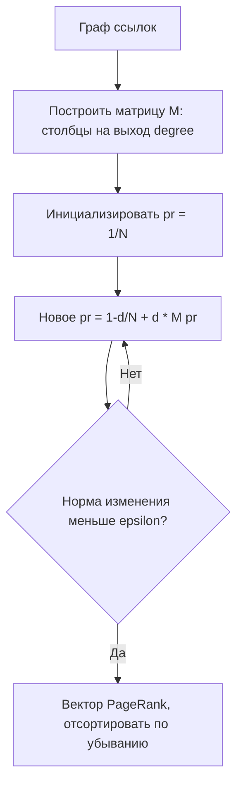

# PageRank

**PageRank** — алгоритм оценки важности (значимости) вершин в графе ссылок, разработанный Ларри Пейджем и Сергеем Брином в Стэнфорде в 1996 году. Значение каждой вершины определяется количеством и «весом» входящих ссылок, причём ссылки с более важных вершин учитываются с большим весом.

## Подробное описание

**Постановка задачи:**
Дан ориентированный граф $G = (V, E)$ — например, граф веб-страниц, где ребро $u \to v$ означает ссылку со страницы $u$ на страницу $v$. Для каждой вершины вычислить число $PR(v)$ — мера её значимости.

**Входные данные:**

- Граф ссылок (список рёбер или матрица смежности)
- Коэффициент затухания $d$ (damping factor), обычно $0.85$
- Порог точности $\varepsilon$ и максимум итераций

**Выходные данные:**

- Вектор $PR$ с ненулевой суммой $\sum_v PR(v) = 1$ (распределение вероятностей)

**Ключевая идея:**
Модель случайного блуждающего пользователя: веб-переходит по случайной ссылке с вероятностью $d$ и «забывает» текущую страницу, попадая на случайную страницу графа с вероятностью $1 - d$. PageRank — это стационарное распределение такой марковской цепи; вычисляется итерационным методом степенных итераций.

**Исторический контекст:**
Алгоритм лёг в основу поисковой системы Google; его авторы основали компанию. Патент US 6 285 999 (priority 1998) описывает метод для оценки важности документов. Идея происхождения из теории цитирования научных работ (Eugene Garfield, 1955) и случайных блуждающих обезьян (правило обезьяны).

## Основные принципы

### Математическая формулировка

Базовая рекуррентная формула:

$$
PR(v) = \frac{1 - d}{N} + d \sum_{u \in \text{In}(v)} \frac{PR(u)}{\text{out}(u)}
$$

Где:

- $N = |V|$ — число вершин графа
- $\text{In}(v)$ — множество вершин, ссылающихся на $v$
- $\text{out}(u)$ — число исходящих ссылок вершины $u$
- $d$ — коэффициент затухания (обычно $0.85$): доля блуждающего пользователя
- $\frac{1 - d}{N}$ — слагаемое «телепортации»: гарантирует неприводимость и обработку «висячих» вершин (без исходящих ссылок)

Матричная форма. Пусть $M$ — столбцово-нормированная матрица смежности ($M_{uv} = \frac{1}{\text{out}(u)}$ если есть ребро $u \to v$). Тогда:

$$
\mathbf{pr} = (1 - d) \cdot \frac{\mathbf{1}}{N} + d \cdot M \mathbf{pr}
$$

Это собственная векторная задача: $\mathbf{pr}$ — собственный вектор матрицы Google $\mathcal{G} = dM + \frac{1-d}{N}\mathbf{1}\mathbf{1}^T$ при собственном значении 1. Теорема Перрона — Фробениуса гарантирует единственность положительного решения для $d < 1$.

**Вычисление — степенные итерации:**

$$
\mathbf{pr}^{(t+1)} = (1 - d) \cdot \frac{\mathbf{1}}{N} + d \cdot M \mathbf{pr}^{(t)}, \qquad
\mathbf{pr}^{(0)} = \frac{\mathbf{1}}{N}
$$

Итерации продолжаются до $\|\mathbf{pr}^{(t+1)} - \mathbf{pr}^{(t)}\|_1 < \varepsilon$.

### Схема работы



## Пример реализации на Python

Самодостаточная реализация на стандартной библиотеке: степенные итерации, обработка висячих вершин, вывод ранжирования и проверка сходимости.

```python
from typing import Dict, List, Tuple


def pagerank(
    n: int,
    edges: List[Tuple[int, int]],
    damping: float = 0.85,
    eps: float = 1e-8,
    max_iter: int = 100,
) -> Tuple[List[float], int]:
    """Степенные итерации PageRank.

    Args:
        n: количество вершин (0..n-1)
        edges: список рёбер (u, v) — ссылка со страницы u на страницу v
        damping: коэффициент затухания d
        eps: порог сходимости по L1-норме
        max_iter: максимальное число итераций

    Returns:
        (список PR-значений, число выполненных итераций)
    """
    # Матрица смежности: out_links[u] — вершины, на которые ссылается u
    out_links: List[List[int]] = [[] for _ in range(n)]
    for u, v in edges:
        out_links[u].append(v)

    pr = [1.0 / n] * n  # равномерное начальное распределение

    for it in range(1, max_iter + 1):
        new_pr = [(1.0 - damping) / n] * n
        for u in range(n):
            if not out_links[u]:
                # «висячая» вершина: её масса распределяется равномерно
                share = damping * pr[u] / n
                for v in range(n):
                    new_pr[v] += share
            else:
                share = damping * pr[u] / len(out_links[u])
                for v in out_links[u]:
                    new_pr[v] += share
        # проверка сходимости (L1-норма изменения)
        delta = sum(abs(a - b) for a, b in zip(new_pr, pr))
        pr = new_pr
        if delta < eps:
            return pr, it
    return pr, max_iter


if __name__ == "__main__":
    # Маленький «веб»: 6 страниц и ссылки между ними
    # 0 — главная; 1,2 ссылаются на неё; 3 ссылается на 1,2;
    # 4 — «листья» со ссылками на 0; 5 — висячая (без исходящих)
    names = ["главная", "новости", "каталог", "блог", "подвал", "заглушка"]
    edges = [
        (0, 1),
        (0, 2),
        (1, 2),
        (2, 1),
        (3, 1),
        (3, 2),
        (4, 0),
        (4, 3),
        (1, 4),
        (2, 4),
    ]
    n = 6

    pr, iterations = pagerank(n, edges)

    print("Граф ссылок (u -> v):")
    for u, v in edges:
        print(f"  {names[u]:>8} -> {names[v]}")

    print(f"\nСошлось за {iterations} итераций (d = 0.85, eps = 1e-8)")
    print(f"Сумма PR = {sum(pr):.9f} (должна быть 1)\n")

    print("Ранжирование страниц:")
    for rank, (idx, value) in enumerate(
        sorted(enumerate(pr), key=lambda x: -x[1]), start=1
    ):
        print(f"  {rank}. {names[idx]:>8}: {value:.4f}")

    # Чувствительность к d: сравнение двух значений
    pr_low, _ = pagerank(n, edges, damping=0.5)
    pr_high, _ = pagerank(n, edges, damping=0.95)
    print("\nВлияние коэффициента d на главную страницу:")
    print(f"  d=0.50: {pr_low[0]:.4f},  d=0.85: {pr[0]:.4f},  d=0.95: {pr_high[0]:.4f}")
```

## Достоинства и недостатки

**Достоинства:**

1. **Интерпретируемость** — значения образуют вероятностное распределение: «доля блуждающего пользователя, находящегося на странице»
2. **Учёт качества ссылок** — ссылка с важной страницы весит больше, чем множество ссылок с малозначимых
3. **Линейная сложность** — каждая итерация $O(|E|)$; на практике сходимость наступает за десятки итераций
4. **Устойчивость** — коэффициент $d < 1$ гарантирует единственное решение даже при «висячих» вершинах и неприводимости графа

**Недостатки:**

1. **Уязвимость к манипуляциям** — ссылочные кольца (link farms) искусственно раздувают PageRank; борются фильтрами и доверенными источниками
2. **Статичность** — «мировой» PageRank пересчитывается целиком, изменения графа не отражаются онлайн
3. **Игнорирует содержимое** — оценивает только структуру ссылок, поэтому сочетается с контентными методами (TF-IDF, BERT)
4. **Сглаживание новизны** — устоявшиеся страницы держат высокий ранг, новые контенты продвигаются медленно

## Области применения

1. Графовые модели и социальные сети (выявление влиятельных пользователей и авторов, оценка центральности вершин, поиск сообществ через Personalized PageRank)
2. Обработка естественного языка (ранжирование документов и результатов поиска, определение значимости терминов в графе «слово — контекст», TextRank для ключевых слов)
3. Торговля и коммерция (ранжирование товаров маркетплейса по графу «просмотрел — купил — просмотрел», выявление влиятельных продавцов в реферальных сетях)
