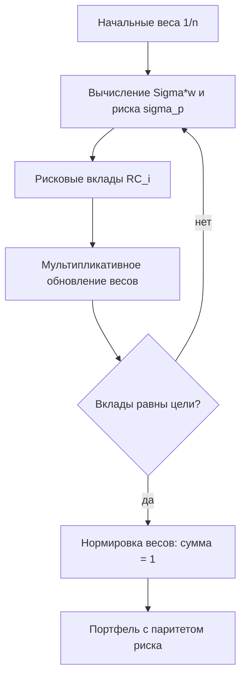

# Паритет риска (Risk Parity)

Паритет риска (Risk Parity) — это стратегия построения портфеля, при которой все активы вносят равный вклад в суммарный риск, независимо от их долей в капитале: высоковолатильные активы получают меньший вес, низковолатильные — больший.

## Подробное описание

**Постановка задачи:**

Даны активы с ковариационной матрицей $\Sigma$. Найти веса $w$ такие, что рисковые вклады всех активов в общий риск портфеля равны между собой. В отличие от равного взвешивания по капиталу ($1/n$), равенство достигается по *риск-бюджету*.

**Входные данные:**

- Ковариационная матрица доходностей $\Sigma$ размером $n \times n$
- Целевое распределение риска (по умолчанию равномерное: доля $1/n$ на актив)

**Выходные данные:**

- Вектор весов $w$, дающий равные (или заданные) рисковые вклады
- Вклады $RC_i$ каждого актива в общий риск $\sigma_p$

**Ключевая идея:**

Вклад актива в риск — это не его вес, а произведение веса на «предельный риск» актива: $RC_i = w_i (\Sigma w)_i / \sigma_p$, причём сумма вкладов равна риску портфеля: $\sum_i RC_i = \sigma_p$. Если один актив волатилен или сильно коррелирован с остальными, его доля капитала уменьшается до тех пор, пока его рисковый вклад не сравняется с чужими.

**Исторический контекст:**

Идеи равного распределения риска развивались Рэйчелом Дало (и др.) в 1990-х годах; стратегия получила широкую известность после успеха фонда All Weather фирмы Bridgewater Associates (основана Рэем Далио в 1996 году).

## Основные принципы

### Математическая формулировка

Риск портфеля:

$$
\sigma_p = \sqrt{w^T \Sigma w}
$$

Рисковый (маржинальный) вклад $i$-го актива:

$$
RC_i = \frac{w_i (\Sigma w)_i}{\sigma_p}, \qquad \sum_{i=1}^{n} RC_i = \sigma_p
$$

Условие паритета риска (равные доли риска $\alpha_i$, по умолчанию $\alpha_i = 1/n$):

$$
\frac{RC_i}{\sigma_p} = \alpha_i \quad \forall i
$$

Итерационная мультипликативная схема поиска весов (fixed-point):

$$
w_i \leftarrow w_i \cdot \frac{\sigma_p / n}{RC_i}
$$

Где:

- $w$ — вектор весов активов в портфеле
- $\Sigma$ — ковариационная матрица доходностей
- $\sigma_p$ — суммарный риск портфеля
- $RC_i$ — рисковый вклад $i$-го актива
- $\alpha_i$ — целевая доля риска $i$-го актива

### Схема итерационного поиска



## Пример реализации на Python

```python
import numpy as np


def risk_contributions(weights: np.ndarray, cov: np.ndarray) -> tuple:
    """Рисковые вклады активов и общий риск портфеля."""
    port = cov @ weights                          # Sigma * w
    sigma = np.sqrt(weights @ port)
    rc = weights * port / sigma                   # RC_i = w_i * (Sigma w)_i / sigma
    return rc, sigma


def risk_parity_weights(cov: np.ndarray, n_iter: int = 500) -> np.ndarray:
    """Поиск весов с равными рисковыми вкладами (мультипликативная итерация)."""
    n = cov.shape[0]
    w = np.ones(n) / n
    for _ in range(n_iter):
        rc, sigma = risk_contributions(w, cov)
        # Обновление: w_i <- w_i * (sigma/n) / RC_i -> фиксированная точка при RC_i = sigma/n
        w = w * (sigma / n) / rc
    return w / w.sum()


if __name__ == "__main__":
    names = ["Облигации", "Акции", "Товары", "Недвижимость"]
    vols = np.array([0.06, 0.16, 0.22, 0.18])
    corr = np.array([
        [1.00, 0.20, 0.10, 0.15],
        [0.20, 1.00, 0.35, 0.55],
        [0.10, 0.35, 1.00, 0.30],
        [0.15, 0.55, 0.30, 1.00],
    ])
    cov = np.outer(vols, vols) * corr

    n = len(names)

    # Портфель с равными весами по капиталу (1/n)
    w_eq = np.ones(n) / n
    rc_eq, sig_eq = risk_contributions(w_eq, cov)

    # Портфель с паритетом риска
    w_rp = risk_parity_weights(cov)
    rc_rp, sig_rp = risk_contributions(w_rp, cov)

    print(f"{'актив':<16} {'вес 1/n':>8} {'доля риска':>11} {'вес RP':>8} {'доля риска':>11}")
    for i, name in enumerate(names):
        print(f"{name:<16} {w_eq[i]:>8.3f} {rc_eq[i] / sig_eq:>11.3f} "
              f"{w_rp[i]:>8.3f} {rc_rp[i] / sig_rp:>11.3f}")

    print(f"\nРиск портфеля 1/n:    {sig_eq:.3%}")
    print(f"Риск RP-портфеля:     {sig_rp:.3%}")
    print(f"Макс. отклонение доли риска от 1/{n} (1/n):  "
          f"{np.max(np.abs(rc_eq / sig_eq - 1 / n)):.4f}")
    print(f"Макс. отклонение доли риска от 1/{n} (RP):   "
          f"{np.max(np.abs(rc_rp / sig_rp - 1 / n)):.4f}")
    print(f"Сумма весов RP: {w_rp.sum():.6f}")

    # Сходимость итераций: контролируем неравенство вкладов
    w = np.ones(n) / n
    checkpoints = {1, 5, 20, 100, 500}
    print("\nСходимость (макс. |доля риска - 1/n|):")
    for it in range(1, 501):
        rc, sigma = risk_contributions(w, cov)
        w = w * (sigma / n) / rc
        w /= w.sum()
        if it in checkpoints:
            rc, sigma = risk_contributions(w, cov)
            print(f"  итерация {it:>3}: {np.max(np.abs(rc / sigma - 1 / n)):.6f}")
```

## Достоинства и недостатки

**Достоинства:**

1. **Устойчивость к перекосам риска** — ни один актив не может непропорционально раздуть риск портфеля, как это бывает при равных весах $1/n$
2. **Баланс «защитных» и «рисковых» активов** — низковолатильные облигации получают больший капиталный вес и реально сглаживают просадки
3. **Простая проверяемость результата** — равенство рисковых вкладов проверяется по формулам без моделирования, итерация быстро сходится
4. **Гибкость целей** — равные вклады обобщаются на произвольные бюджеты риска $\alpha_i$

**Недостатки:**

1. **Оценка ковариаций** — как и в MVO, результат зависит от качества $\Sigma$, которая в стрессовые периоды меняется
2. **Не учитывает доходность** — паритет риска оптимизирует только риск, ожидаемые доходности активов во внимание не берутся
3. **Левередж для роста доходности** — «классический» паритет часто требует заёмного финансирования для увеличения позиций в низкорисковых активах, что добавляет кредитный риск
4. **Чувствительность к корреляциям** — при резком росте корреляций (кризис) все вклады перераспределяются, и портфель требует ребалансировки

## Области применения

1. Экономика и финансы (многопортфельное распределение, стратегии вроде «All Weather» для пенсионных фондов)
2. Оптимизация и планирование (равномерное распределение бюджета рисков между проектами и подразделениями)
3. Торговля и коммерция (плановая ребалансировка портфелей по риск-бюджетам)
