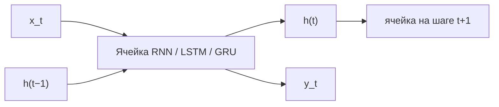

# Рекуррентные нейронные сети (RNN, LSTM, GRU)

Рекуррентная нейронная сеть (Recurrent Neural Network, RNN) — это архитектура глубокого обучения, которая обрабатывает последовательности, поддерживая скрытое состояние $h_t$ — компактную «память» обо всех предыдущих элементах. Усложнённые варианты LSTM (Long Short-Term Memory) и GRU (Gated Recurrent Unit) решают проблему затухания градиентов при обучении на длинных зависимостях.

## Подробное описание

**Постановка задачи:**  
Для последовательности элементов $x_1, x_2, ..., x_T$ (слова, отсчёты временного ряда, показания датчиков) вычислить выход $y_t$ на каждом шаге (последовательность к последовательности), на последнем шаге (последовательность к вектору) или по всем шагам (вектор к последовательности, например, генерация текста).

**Входные данные:**

- Последовательность $x_1, ..., x_T$, где $x_t \in \mathbb{R}^{d}$
- Иногда — длина последовательности (для маскирования паддинга)

**Выходные данные:**

- Последовательность скрытых состояний $h_1, ..., h_T$ или итоговый вектор $h_T$

**Ключевая идея:**  
Применить одну и ту же рекуррентную функцию $h_t = f(h_{t-1}, x_t)$ на каждом шаге. Параметры сети не зависят от длины последовательности, поэтому модель обобщается на последовательности любой длины и разделяет «веса во времени».

**Исторический контекст:**  
RNN описаны ещё в работах по динамическим системам, а обучение обратным распространением по времени (Backpropagation Through Time, BPTT) предложили Вертиниус, Румельхарт, Хинтон и Вильямс в 1980-х. LSTM предложили Хохрайтер и Шмидхубер в 1997 году; GRU — Чо и коллеги в 2014 году как упрощённая альтернатива LSTM.

## Основные принципы

### Математическая формулировка

Простейшая RNN обновляет скрытое состояние по формуле:

$$
h_t = \tanh(W_{hh} h_{t-1} + W_{xh} x_t + b_h)
$$

Выход на шаге $t$:

$$
y_t = W_{hy} h_t + b_y
$$

Где:

- $h_t \in \mathbb{R}^{n}$ — скрытое состояние на шаге $t$
- $x_t \in \mathbb{R}^{d}$ — входной элемент последовательности
- $W_{hh} \in \mathbb{R}^{n \times n}$, $W_{xh} \in \mathbb{R}^{n \times d}$, $W_{hy} \in \mathbb{R}^{m \times n}$ — обучаемые матрицы весов (разделяются между всеми шагами)
- $\tanh$ — гиперболический тангенс, удерживающий состояние в диапазоне $(-1, 1)$

При обратном распространении по времени градиент через $T$ шагов включает произведение $T$ матричных якобиан. Если их собственные значения меньше единицы, градиент экспоненциально **затухает** (vanishing gradient) — сеть не учится длинным зависимостям; если больше единицы — **взрывается** (exploding gradient).

### Механизмы LSTM и GRU

LSTM заменяет единое скрытое состояние набором **гейтов** и добавляет ячейку памяти $c_t$:

$$
\begin{aligned}
f_t &= \sigma(W_f h_{t-1} + U_f x_t + b_f) & \text{(забывающий гейт)} \\
i_t &= \sigma(W_i h_{t-1} + U_i x_t + b_i) & \text{(входной гейт)} \\
\tilde{c}_t &= \tanh(W_c h_{t-1} + U_c x_t + b_c) & \text{(кандидат в память)} \\
c_t &= f_t \odot c_{t-1} + i_t \odot \tilde{c}_t & \text{(обновление памяти)} \\
o_t &= \sigma(W_o h_{t-1} + U_o x_t + b_o) & \text{(выходной гейт)} \\
h_t &= o_t \odot \tanh(c_t) & \text{(скрытое состояние)}
\end{aligned}
$$

Где:

- $\sigma$ — сигмоида с выходом в $(0, 1)$ («открыто/закрыто»)
- $\odot$ — поэлементное произведение (произведение Адамара)
- $c_t$ — ячейка памяти: аддитивное обновление $c_t = f_t \odot c_{t-1} + \dots$ создаёт «градиентный конвейер», по которому градиент течёт почти без затухания

GRU — упрощённая версия с двумя гейтами и без отдельной ячейки:

$$
\begin{aligned}
z_t &= \sigma(W_z h_{t-1} + U_z x_t + b_z) & \text{(гейт обновления)} \\
r_t &= \sigma(W_r h_{t-1} + U_r x_t + b_r) & \text{(гейт сброса)} \\
\tilde{h}_t &= \tanh(W_h (r_t \odot h_{t-1}) + U_h x_t + b_h) \\
h_t &= (1 - z_t) \odot h_{t-1} + z_t \odot \tilde{h}_t
\end{aligned}
$$

GRU имеет меньше параметров и обычно обучается быстрее; LSTM лучше на очень длинных последовательностях.

### Схема шага рекуррентной сети



## Пример реализации на Python

Vanilla RNN с обучением BPTT на задаче суммирования последовательности, а также forward-проход LSTM и GRU на `numpy`.

```python
import numpy as np
from typing import List, Tuple


def sigmoid(z: np.ndarray) -> np.ndarray:
    """Сигмоида с устойчивой к переполнению реализацией."""
    return 1.0 / (1.0 + np.exp(-np.clip(z, -30, 30)))


class SimpleRNN:
    """Простейшая RNN: h_t = tanh(W_h h_{t-1} + W_x x_t + b)."""

    def __init__(self, input_dim: int, hidden_dim: int, seed: int = 0):
        rng = np.random.default_rng(seed)
        scale = 1.0 / np.sqrt(hidden_dim)
        self.W_h = rng.normal(0, scale, (hidden_dim, hidden_dim))
        self.W_x = rng.normal(0, scale, (hidden_dim, input_dim))
        self.b = np.zeros(hidden_dim)

    def forward(self, xs: List[np.ndarray]) -> List[np.ndarray]:
        """Прямой проход по последовательности, возвращает состояния h_t."""
        h = np.zeros(self.W_h.shape[0])
        states = []
        for x in xs:
            h = np.tanh(self.W_h @ h + self.W_x @ x + self.b)
            states.append(h.copy())
        return states

    def loss_and_grads(self, xs, targets, lr=0.05):
        """BPTT: функция потерь MSE и градиенты по весам."""
        states = self.forward(xs)
        h_prev_list = [np.zeros_like(states[0])] + states[:-1]

        loss = 0.0
        d_h = np.zeros_like(states[0])
        dW_h = np.zeros_like(self.W_h)
        dW_x = np.zeros_like(self.W_x)
        d_b = np.zeros_like(self.b)

        # Обратный проход по времени
        for t in reversed(range(len(xs))):
            error = states[t] - targets[t]  # градиент MSE по выходу (= h_t)
            d_h = error + d_h  # сквозной градиент по h_t
            dz = d_h * (1 - states[t] ** 2)  # производная tanh
            dW_h += np.outer(dz, h_prev_list[t])
            dW_x += np.outer(dz, xs[t])
            d_b += dz
            d_h = self.W_h.T @ dz  # градиент к предыдущему состоянию

        loss = sum(np.sum((s - t_) ** 2) for s, t_ in zip(states, targets))
        # Шаг градиентного спуска (усечённые градиенты по норме)
        norm = np.sqrt(np.sum(dW_h**2) + np.sum(dW_x**2) + np.sum(d_b**2) + 1e-12)
        scale = min(1.0, 5.0 / norm)
        self.W_h -= lr * scale * dW_h
        self.W_x -= lr * scale * dW_x
        self.b -= lr * scale * d_b
        return loss


class LSTMCell:
    """Одна LSTM-ячейка: полный forward-проход с четырьмя гейтами."""

    def __init__(self, input_dim: int, hidden_dim: int, seed: int = 0):
        rng = np.random.default_rng(seed)
        s = 1.0 / np.sqrt(hidden_dim)
        # Объединённые веса гейтов: [f, i, o, c~]
        self.W = rng.normal(0, s, (4 * hidden_dim, hidden_dim))
        self.U = rng.normal(0, s, (4 * hidden_dim, input_dim))
        self.b = np.zeros(4 * hidden_dim)
        self.hidden_dim = hidden_dim

    def step(self, x: np.ndarray, h_prev: np.ndarray, c_prev: np.ndarray):
        """Один шаг: возвращает (h_t, c_t)."""
        n = self.hidden_dim
        z = self.W @ h_prev + self.U @ x + self.b
        f = sigmoid(z[:n])            # forget gate
        i = sigmoid(z[n : 2 * n])     # input gate
        o = sigmoid(z[2 * n : 3 * n]) # output gate
        c_tilde = np.tanh(z[3 * n :]) # candidate
        c_t = f * c_prev + i * c_tilde
        h_t = o * np.tanh(c_t)
        return h_t, c_t


class GRUCell:
    """Одна GRU-ячейка: два гейта, скрытое состояние без отдельной памяти."""

    def __init__(self, input_dim: int, hidden_dim: int, seed: int = 0):
        rng = np.random.default_rng(seed)
        s = 1.0 / np.sqrt(hidden_dim)
        self.Wz = rng.normal(0, s, (hidden_dim, hidden_dim))
        self.Uz = rng.normal(0, s, (hidden_dim, input_dim))
        self.Wr = rng.normal(0, s, (hidden_dim, hidden_dim))
        self.Ur = rng.normal(0, s, (hidden_dim, input_dim))
        self.Wh = rng.normal(0, s, (hidden_dim, hidden_dim))
        self.Uh = rng.normal(0, s, (hidden_dim, input_dim))
        self.b = np.zeros(hidden_dim)

    def step(self, x: np.ndarray, h_prev: np.ndarray) -> np.ndarray:
        """Один шаг: возвращает h_t."""
        z = sigmoid(self.Wz @ h_prev + self.Uz @ x + self.b)   # update
        r = sigmoid(self.Wr @ h_prev + self.Ur @ x + self.b)   # reset
        h_tilde = np.tanh(self.Wh @ (r * h_prev) + self.Uh @ x + self.b)
        return (1 - z) * h_prev + z * h_tilde


if __name__ == "__main__":
    # Задача: предсказать последовательность 1^T — 2^T (простая арифметика в памяти)
    T = 10
    rng = np.random.default_rng(1)
    xs = [np.array([1.0, 0.0]) for _ in range(T)] + [np.array([0.0, 1.0]) for _ in range(T)]
    targets = [np.array([1.0]) for _ in range(T)] + [np.array([-1.0]) for _ in range(T)]

    rnn = SimpleRNN(input_dim=2, hidden_dim=16, seed=42)
    print("Обучение SimpleRNN (задача удержания сигнала):")
    for epoch in range(2001):
        loss = rnn.loss_and_grads(xs, targets, lr=0.1)
        if epoch % 500 == 0:
            print(f"  эпоха {epoch:4d}, loss = {loss:.6f}")

    states = rnn.forward(xs)
    print(f"  итоговое состояние h_T: {np.round(states[-1], 3)}")

    # Демонстрация LSTM и GRU
    print("\nШаги LSTM и GRU на одном входе x = [1.0, 0.0]:")
    x0 = np.array([1.0, 0.0])
    lstm = LSTMCell(2, 8, seed=7)
    gru = GRUCell(2, 8, seed=7)
    h, c = np.zeros(8), np.zeros(8)
    hg = np.zeros(8)
    for t in range(3):
        h, c = lstm.step(x0, h, c)
        hg = gru.step(x0, hg)
        print(f"  t={t+1}: |h_LSTM|={np.linalg.norm(h):.3f}, c_LSTM={np.round(c[:3], 3)}, |h_GRU|={np.linalg.norm(hg):.3f}")
```

## Достоинства и недостатки

**Достоинства:**

1. **Обработка последовательностей переменной длины** — одна модель принимает вход любой длины, разделяя веса между шагами.
2. **Учёт контекста** — скрытое состояние несёт информацию о предыдущих элементах, что критично для языка и временных рядов.
3. **LSTM/GRU решают проблему затухания градиентов** — гейтовая архитектура позволяет переносить информацию на сотни шагов вперёд.
4. **Компактность** — размер модели не растёт с длиной последовательности, в отличие от трансформеров с квадратичной вниманием.

**Недостатки:**

1. **Последовательные вычисления** — шаги нельзя распараллелить по времени, что ограничивает скорость обучения на длинных последовательностях.
2. **Долгая зависимость всё ещё труднодостижима** — даже LSTM уступает механизмам внимания на задачах с очень далёкими связями.
3. **Чувствительность к настройке** — качество сильно зависит от размера скрытого слоя, скорости обучения и усечения градиентов (gradient clipping).

## Области применения

1. Обработка естественного языка (классификация текстов, распознавание намерений, машинный перевод до появления трансформеров)
2. Экономика и финансы (прогнозирование котировок и временных рядов, моделирование сезонности спроса)
3. Машинное обучение и рекомендательные системы (обработка последовательностей кликов в сессии, модели GRU4Rec для session-based рекомендаций)
