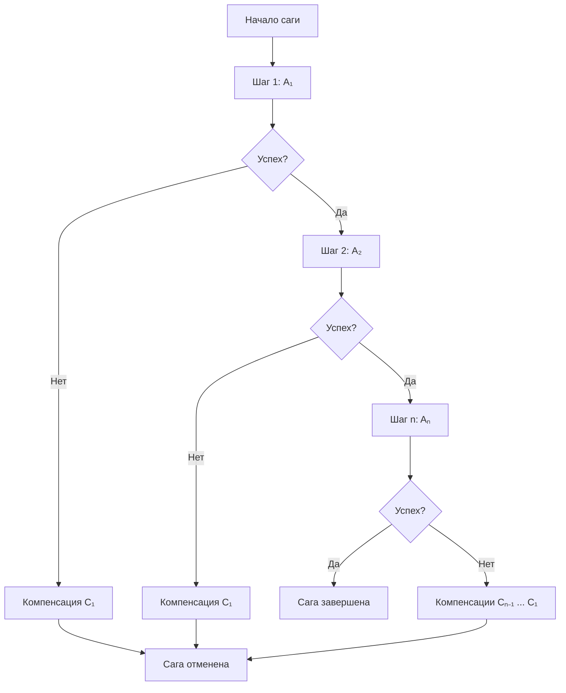

# Сага (Saga Pattern)

Сага (англ. Saga Pattern, произносится как «сага») — это архитектурный паттерн управления распределёнными транзакциями в микросервисной архитектуре: последовательность локальных транзакций, при неудаче которой запускаются компенсирующие операции для отката уже завершённых шагов.

**Постановка задачи:** как выполнить бизнес-процесс, затрагивающий несколько сервисов, каждый со своей базой данных, и гарантировать согласованность данных, если любой из участников завершился неудачей? В монолитной архитектуре согласованность обеспечивается ACID-транзакциями в рамках одной базы данных, но в микросервисной архитектуре локальные транзакции внутри каждого сервиса недостаточны для обеспечения согласованности всей системы.

**Входные данные:** бизнес-процесс, требующий выполнения операций в нескольких сервисах (например, оформление заказа, бронирование поездки).

**Выходные данные:** либо успешное завершение всех шагов, либо откат всех выполненных шагов через компенсации.

**Ключевая идея:** вместо блокирующего протокола двухфазной фиксации (2PC) сага использует принцип конечной согласованности (Eventual Consistency), жертвуя строгой изоляцией ради доступности и масштабируемости. Сага разбивает распределённую транзакцию на цепочку локальных транзакций, каждая из которых атомарна в границах своего сервиса. Если какой-либо шаг завершается неудачей, выполняются компенсирующие транзакции, отменяющие эффекты уже завершённых действий. Компенсация должна быть идемпотентной и семантически эквивалентной обратной операции исходной транзакции (например, действию «Списать средства» соответствует «Вернуть средства»).

**Исторический контекст:** паттерн впервые описан Гектором Гарсиа-Молиной (Hector Garcia-Molina) и Кеннетом Салемом (Kenneth Salem) в 1987 году для управления долгоживущими транзакциями в базах данных. Позднее он был адаптирован для микросервисной архитектуры.

## Основные принципы

### Математическая формулировка

Пусть распределённая транзакция представлена последовательностью локальных шагов:

$$
S = \{s_1, s_2, \ldots, s_n\}
$$

где каждый шаг $s_i$ имеет прямое действие $A_i$ и компенсирующее действие $C_i$:

$$
A_i : \text{Data}_i \to \text{Data}_{i+1}
$$

$$
C_i : \text{Data}_{i+1} \to \text{Data}_i
$$

При успешном выполнении всех шагов состояние системы переходит в $\text{Data}_{n+1}$. При неудаче на шаге $s_k$ запускается последовательность компенсаций в обратном порядке:

$$
C_{k-1}, C_{k-2}, \ldots, C_1
$$

Где:
- $n$ — количество шагов в саге
- $A_i$ — прямое действие шага $i$
- $C_i$ — компенсирующее действие шага $i$
- $k$ — индекс шага, на котором произошла ошибка

### Блок-схема выполнения



### Два варианта реализации

**Хореография (Choreography):** децентрализованный подход, при котором каждый сервис публикует события, а другие сервисы подписываются на них и реагируют. Подходит для простых сценариев с малым числом участников (2–4 сервиса). Недостаток — сложность отладки при росте числа участников.

**Оркестрация (Orchestration):** централизованный подход с оркестратором, который управляет всеми шагами саги: отправляет команды сервисам, обрабатывает ответы и инициирует компенсации при ошибках. Подходит для сложных бизнес-процессов с множеством участников. Недостаток — оркестратор может стать единой точкой отказа.

## Пример реализации на Python

Ниже представлена упрощённая реализация оркестрационного варианта Saga Pattern на чистом Python без внешних зависимостей.

```python
from typing import Callable, Any, List, Optional
from dataclasses import dataclass, field
from enum import Enum


class SagaStatus(Enum):
    PENDING = "pending"
    COMPLETED = "completed"
    COMPENSATING = "compensating"
    FAILED = "failed"


@dataclass
class SagaStep:
    """Шаг саги: прямое действие и компенсирующее действие."""
    name: str
    action: Callable[..., Any]
    compensation: Optional[Callable[..., Any]] = None


@dataclass
class SagaResult:
    """Результат выполнения саги."""
    status: SagaStatus
    data: Any = None
    failed_step: Optional[str] = None
    error: Optional[Exception] = None
    completed_steps: List[str] = field(default_factory=list)


class Saga:
    """Оркестратор саги: управляет последовательностью шагов и компенсациями."""

    def __init__(self, steps: List[SagaStep]):
        self.steps = steps
        self._completed: List[tuple] = []  # (шаг, результат) для компенсации

    def _execute_step(self, step: SagaStep, context: Any) -> Any:
        """Выполняет прямое действие шага."""
        return step.action(context)

    def _compensate_step(self, step: SagaStep, context: Any) -> None:
        """Выполняет компенсирующее действие шага."""
        if step.compensation:
            step.compensation(context)

    def run(self, initial_context: Any = None) -> SagaResult:
        """Запускает сагу: выполняет шаги, при ошибке — компенсации в обратном порядке."""
        context = initial_context
        completed_names: List[str] = []

        # Фаза выполнения: последовательное выполнение шагов
        for step in self.steps:
            try:
                result = self._execute_step(step, context)
                self._completed.append((step, result))
                completed_names.append(step.name)
                context = result  # передаём результат следующему шагу
            except Exception as e:
                # Ошибка на текущем шаге: запускаем компенсации
                self._run_compensations()
                return SagaResult(
                    status=SagaStatus.FAILED,
                    failed_step=step.name,
                    error=e,
                    completed_steps=completed_names
                )

        return SagaResult(
            status=SagaStatus.COMPLETED,
            data=context,
            completed_steps=completed_names
        )

    def _run_compensations(self) -> None:
        """Выполняет компенсации для всех завершённых шагов в обратном порядке."""
        # Обходим завершённые шаги в обратном порядке (LIFO)
        for step, result in reversed(self._completed):
            try:
                self._compensate_step(step, result)
            except Exception:
                # Ошибки компенсации логируются, но не прерывают процесс
                pass
        self._completed.clear()


# ==================== Пример использования: оформление заказа ====================

class OrderContext:
    """Контекст бизнес-процесса оформления заказа."""
    def __init__(self, order_id: str, product_id: str, amount: float):
        self.order_id = order_id
        self.product_id = product_id
        self.amount = amount
        self.inventory_reserved = False
        self.payment_charged = False
        self.shipment_scheduled = False


def create_order(ctx: OrderContext) -> OrderContext:
    """Шаг 1: создание заказа."""
    print(f"[Order] Создание заказа {ctx.order_id}")
    return ctx


def cancel_order(ctx: OrderContext) -> None:
    """Компенсация шага 1."""
    print(f"[Order] Отмена заказа {ctx.order_id}")


def reserve_inventory(ctx: OrderContext) -> OrderContext:
    """Шаг 2: резервирование товара."""
    print(f"[Inventory] Резервирование товара {ctx.product_id}")
    ctx.inventory_reserved = True
    return ctx


def release_inventory(ctx: OrderContext) -> None:
    """Компенсация шага 2."""
    if ctx.inventory_reserved:
        print(f"[Inventory] Освобождение товара {ctx.product_id}")
        ctx.inventory_reserved = False


def charge_payment(ctx: OrderContext) -> OrderContext:
    """Шаг 3: списание средств (здесь симулируем ошибку)."""
    print(f"[Payment] Списание {ctx.amount} руб.")
    # Симуляция ошибки платежа (например, недостаточно средств)
    raise Exception("Недостаточно средств на карте")


def refund_payment(ctx: OrderContext) -> None:
    """Компенсация шага 3."""
    if ctx.payment_charged:
        print(f"[Payment] Возврат {ctx.amount} руб.")
        ctx.payment_charged = False


if __name__ == "__main__":
    # Создаём сагу с тремя шагами
    saga = Saga([
        SagaStep("create_order", create_order, cancel_order),
        SagaStep("reserve_inventory", reserve_inventory, release_inventory),
        SagaStep("charge_payment", charge_payment, refund_payment),
    ])

    # Запускаем с контекстом заказа
    context = OrderContext("ORDER-123", "PRODUCT-456", 99.99)
    result = saga.run(context)

    print(f"\nРезультат: {result.status.value}")
    if result.status == SagaStatus.FAILED:
        print(f"Ошибка на шаге: {result.failed_step}")
        print(f"Причина: {result.error}")
        print(f"Выполненные шаги: {result.completed_steps}")
        # Компенсации выполнены в обратном порядке
```

**Пример вывода:**

```
[Order] Создание заказа ORDER-123
[Inventory] Резервирование товара PRODUCT-456
[Payment] Списание 99.99 руб.
[Inventory] Освобождение товара PRODUCT-456
[Order] Отмена заказа ORDER-123

Результат: failed
Ошибка на шаге: charge_payment
Причина: Недостаточно средств на карте
Выполненные шаги: ['create_order', 'reserve_inventory']
```

## Достоинства и недостатки

**Достоинства:**

1. **Отсутствие длительных блокировок.** В отличие от 2PC, сага не удерживает блокировки на ресурсах на протяжении всей транзакции, что повышает пропускную способность системы.
2. **Высокая масштабируемость.** Асинхронная природа саг позволяет горизонтально масштабировать сервисы-участники независимо друг от друга.
3. **Отказоустойчивость.** При отказе инфраструктуры возможна прямая компенсация (повтор), при бизнес-ошибке — обратная компенсация (откат), что обеспечивает гибкость обработки сбоев.
4. **Слабая связанность.** В хореографическом варианте сервисы взаимодействуют через события, не зная о внутреннем устройстве друг друга.

**Недостатки:**

1. **Отсутствие изоляции.** Промежуточные состояния саги видны другим транзакциям, что может приводить к аномалиям данных (грязное чтение, фантомы). Требуются семантические блокировки или оптимистичные версии.
2. **Сложность реализации компенсаций.** Каждая компенсация должна быть идемпотентной и семантически корректной; проектирование таких операций требует дополнительных усилий.
3. **Единая точка отказа (при оркестрации).** Оркестратор контролирует весь процесс, и его отказ останавливает все саги.
4. **Сложность отладки.** Распределённый характер саг затрудняет трассировку и мониторинг по сравнению с монолитными транзакциями.

## Области применения

1. Паттерны проектирования (замена двухфазной фиксации: оркестрация и хореография бизнес-процессов в распределённых системах)
2. Торговля и коммерция (оформление заказа: создание заказа → резервирование товара → списание средств → подтверждение, с откатом при сбое любого этапа)
3. Экономика и финансы (переводы средств между счетами и списания с компенсирующим возвратом при ошибке зачисления)
4. Логистика и управление цепочками (оркестрация доставки: резервирование слота → назначение курьера → подтверждение доставки)
