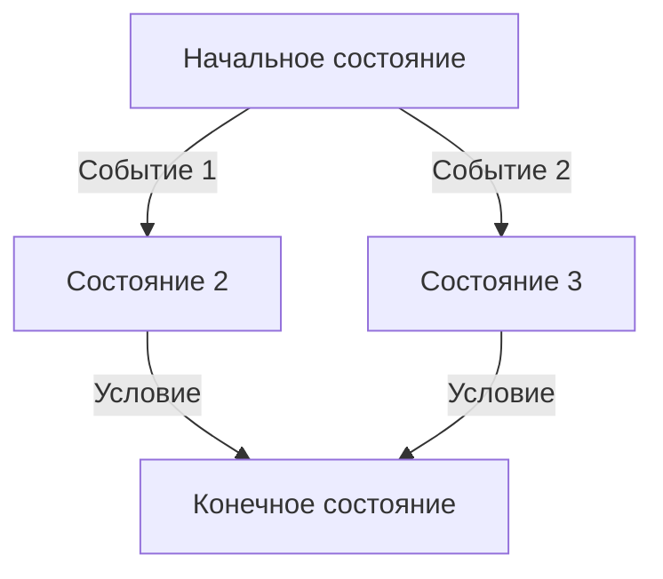

# Конечный автомат (State Machine)

Конечный автомат (англ. Finite State Machine, FSM, буквально «конечное состояние машины») — это математическая модель вычислений, описывающая поведение системы через конечное множество состояний и правила перехода между ними.

**Постановка задачи:** нужно описать дискретное поведение системы, которая переключается между ограниченным набором режимов работы (робот ищет стену и едет вдоль неё, соединение находится в состоянии ожидания/установлено/разорвано, персонаж в игре idle/бег/прыжок). Логику такого поведения требуется сформулировать явно, чтобы оно было предсказуемым, легко проверяемым и отделённым от остального кода.

**Входные данные:** события (символы) из конечного входного алфавита, поступающие в систему по одному за шаг.

**Выходные данные:** текущее состояние системы после обработки всех событий; для автоматов Мура и Мили — также выходной сигнал на каждом шаге.

**Ключевая идея:** поведение системы разбивается на дискретные состояния, а логика работы описывается через переходы между ними: в любой момент времени система находится ровно в одном состоянии, а смена состояния происходит при наступлении определённого события или условия. Это позволяет декомпозировать сложное поведение на управляемые компоненты.

**Исторический контекст:** формализация конечных автоматов была развита в работах Эдварда Мура (Edward Moore) и Джорджа Мили (George Mealy) конца 1950-х годов; именно ими названы два основных типа выходных автоматов — автоматы Мура и автоматы Мили.

## Основные принципы

### Математическая формулировка

Конечный автомат формально определяется как кортеж из пяти элементов:

$$
M = (Q, \Sigma, \delta, q_0, F)
$$

Где:
- $Q$ — конечное множество состояний
- $\Sigma$ — конечный входной алфавит (множество допустимых событий)
- $\delta$ — функция переходов $\delta: Q \times \Sigma \rightarrow Q$
- $q_0$ — начальное состояние
- $F$ — множество принимающих (конечных) состояний

Различают два типа автоматов по способу формирования выходных сигналов: автоматы Мура (выход зависит только от состояния) и автоматы Мили (выход зависит от состояния и входа).

### Блок-схема переходов



## Пример реализации на Python

Ниже реализован конечный автомат робота, который сначала ищет стену, а затем движется вдоль неё.

```python
from enum import Enum


class State(Enum):
    """Состояния конечного автомата"""
    SEEK = "поиск"
    TRACK = "движение"


class Event(Enum):
    """Входные события"""
    WALL_DETECTED = "обнаружена стена"
    NO_WALL = "стены нет"


class WallHuggingRobot:
    """Конечный автомат для робота, следующего вдоль стены"""

    def __init__(self):
        # Начальное состояние — поиск стены
        self.state: State = State.SEEK
        # Флаг наличия стены справа (эмуляция датчика)
        self.wall_right: bool = False
        self.wall_ahead: bool = False

    def _transition_seek(self, event: Event) -> State:
        """Логика переходов из состояния SEEK"""
        if event == Event.WALL_DETECTED:
            # Стена найдена — переходим к движению вдоль неё
            return State.TRACK
        # Стены нет — остаёмся в поиске
        return State.SEEK

    def _transition_track(self, event: Event) -> State:
        """Логика переходов из состояния TRACK"""
        if event == Event.NO_WALL:
            # Потеряли стену — возвращаемся к поиску
            return State.SEEK
        # Стена на месте — продолжаем движение
        return State.TRACK

    def process_event(self, event: Event) -> None:
        """Обработка события и переход в новое состояние"""
        # Выбор функции переходов в зависимости от текущего состояния
        if self.state == State.SEEK:
            new_state = self._transition_seek(event)
        else:
            new_state = self._transition_track(event)

        # Логирование перехода
        if new_state != self.state:
            print(f"Переход: {self.state.value} -> {new_state.value}")
            self.state = new_state

        # Выполнение действий, связанных с состоянием
        self._execute_state_action()

    def _execute_state_action(self) -> None:
        """Выполнение действий текущего состояния"""
        if self.state == State.SEEK:
            print("Действие: движение вперёд в поисках стены")
        elif self.state == State.TRACK:
            print("Действие: движение вдоль стены")


if __name__ == "__main__":
    # Демонстрация работы конечного автомата
    robot = WallHuggingRobot()

    # Симуляция последовательности событий
    events = [
        Event.NO_WALL,           # робот ищет, стены нет
        Event.WALL_DETECTED,     # обнаружена стена
        Event.WALL_DETECTED,     # продолжаем движение
        Event.NO_WALL,           # потеряли стену
        Event.WALL_DETECTED,     # снова нашли
    ]

    print("=== Симуляция работы робота ===")
    for event in events:
        print(f"\nСобытие: {event.value}")
        robot.process_event(event)
        print(f"Текущее состояние: {robot.state.value}")
```

## Достоинства и недостатки

**Достоинства:**

1. **Простота и наглядность** — состояния и переходы легко визуализируются в виде графа, что упрощает понимание и проектирование логики.
2. **Предсказуемость** — система всегда находится ровно в одном состоянии, что делает поведение детерминированным и легко тестируемым.
3. **Декомпозиция** — сложное поведение разбивается на управляемые независимые блоки, что улучшает поддерживаемость кода.
4. **Эффективность для чётко определённых сценариев** — идеально подходит для задач с ограниченным набором дискретных состояний.

**Недостатки:**

1. **Негибкость при усложнении** — при росте числа состояний количество переходов растёт комбинаторно, что делает автомат громоздким и трудным в поддержке.
2. **Сложность обработки непрерывных процессов** — автоматы плохо подходят для задач, требующих плавных изменений или учёта множества факторов одновременно.
3. **Ограниченная выразительность** — конечные автоматы не могут распознавать языки, требующие неограниченной памяти (например, вложенные структуры).

## Области применения

1. Робототехника и автономные системы (планирование поведения роботов и манипуляторов, встраиваемые контроллеры бытовой техники и промышленной автоматизации)
2. Игровая разработка (управление анимациями персонажей, поведение NPC, состояния игрового меню)
3. Обработка естественного языка (лексический анализ, распознавание регулярных языков)
4. IoT и сетевые технологии (управление состояниями сетевых соединений и протоколов передачи данных)
