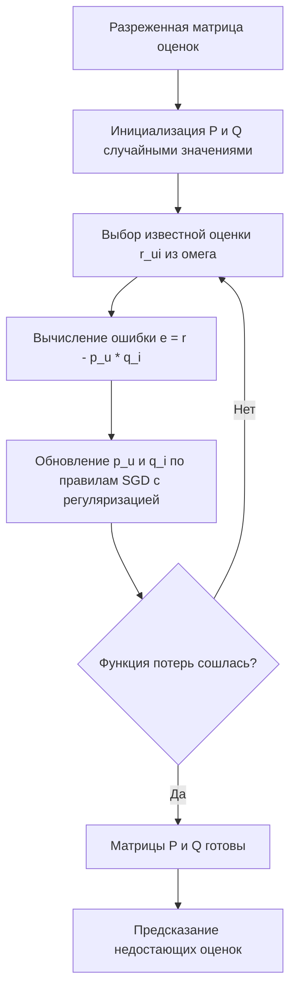

# SVD для рекомендательных систем (Singular Value Decomposition)

**SVD** (Singular Value Decomposition, сингулярное разложение) в рекомендательных системах — это семейство методов матричной факторизации (Matrix Factorization), которые приближают разреженную матрицу «пользователи × товары» произведением двух низкоразмерных матриц латентных факторов. Недостающие оценки заполняются предсказаниями $\hat{r}_{ui} = p_u \cdot q_i$ — скалярным произведением латентных векторов пользователя и товара.

## Подробное описание

**Постановка задачи:**
Дана разреженная матрица оценок $R$ размером $m \times n$. Найти латентные вектора пользователей $p_u \in \mathbb{R}^k$ и товаров $q_i \in \mathbb{R}^k$ ($k \ll \min(m, n)$), таких что предсказание $\hat{r}_{ui}$ максимально приближает известные оценки.

**Входные данные:**

- Матрица взаимодействий $R$ (известны только часть элементов)
- Ранг факторизации $k$ — размерность латентного пространства

**Выходные данные:**

- Матрицы $P$ ($m \times k$) и $Q$ ($n \times k$)
- Предсказанные оценки $\hat{r}_{ui} = p_u^T q_i$

**Ключевая идея:**
Латентные факторы — это невидимые «вкусы» (жанры, стили, уровни ценности), совместно объясняющие все оценки. Классическое сингулярное разложение требует плотной матрицы, поэтому для рекомендаций используют модификации: FunkSVD (обучение только по известным оценкам через SGD), SVD++ (с учётом неявных предпочтений) и ALS-вариант (см. статью [ALS](als.md)).

**Исторический контекст:**
В 2006 году Саймон Фанк (Simon Funk) на соревновании Netflix Prize описал обучение SVD-подобной модели методом градиентного спуска, показав, что латентные факторы можно восстанавливать по неполной матрице. Модель SVD++ Яхьи Кирмена (2009) добавила учёт неявных сигналов (просмотры без оценок). Команды BellKor’s Pragmatic Chaos довели точность модели на основе факторизации до победы в 2009 году.

## Основные принципы

### Математическая формулировка

Классическое сингулярное разложение плотной матрицы $R$:

$$
R \approx U \Sigma V^T
$$

Для рекомендаций используется усечённая аппроксимация ранга $k$ и обучение только по известным парам $(u, i) \in \Omega$. Целевая функция FunkSVD с регуляризацией:

$$
L = \sum_{(u,i) \in \Omega} (r_{ui} - p_u^T q_i)^2 + \lambda \left( \|p_u\|^2 + \|q_i\|^2 \right)
$$

Где:

- $p_u \in \mathbb{R}^k$ — латентный вектор пользователя $u$
- $q_i \in \mathbb{R}^k$ — латентный вектор товара $i$
- $\Omega$ — множество известных оценок
- $\lambda$ — коэффициент регуляризации (борется с переобучением на разреженных данных)
- $k$ — число латентных факторов (типично 20–200 в промышленных системах)

Обновление параметров градиентным спуском (по одной паре за шаг):

$$
e_{ui} = r_{ui} - p_u^T q_i
$$

$$
p_u \leftarrow p_u + \eta \left( e_{ui} \cdot q_i - \lambda p_u \right)
$$

$$
q_i \leftarrow q_i + \eta \left( e_{ui} \cdot p_u - \lambda q_i \right)
$$

Где:

- $\eta$ — шаг обучения (learning rate)
- $e_{ui}$ — ошибка предсказания на известной оценке

Практические реализации дополняют модель глобальным средним $\mu$ и смещениями $b_u$, $b_i$, которые обновляются тем же правилом:

$$
\hat{r}_{ui} = \mu + b_u + b_i + p_u^T q_i
$$

$$
b_u \leftarrow b_u + \eta \left( e_{ui} - \lambda b_u \right), \quad
b_i \leftarrow b_i + \eta \left( e_{ui} - \lambda b_i \right)
$$

Где:

- $b_u$ — «щедрость» пользователя $u$ (насколько он в среднем оценивает выше/ниже других)
- $b_i$ — смещение товара $i$ (популярность или непопулярность товара)

Вариант SVD++ расширяет модель смещениями и учётом неявных предпочтений $N(u)$ (товары, с которыми пользователь взаимодействовал без оценки):

$$
\hat{r}_{ui} = \mu + b_u + b_i + \left( p_u + \frac{1}{\sqrt{|N(u)|}} \sum_{j \in N(u)} y_j \right)^T q_i
$$

Где:

- $\mu$ — глобальное среднее всех оценок
- $b_u, b_i$ — смещения пользователя и товара (склонность оценивать высоко/низко, «популярность» товара)
- $y_j$ — вектор неявного предпочтения товара $j$

### Схема обучения FunkSVD



## Пример реализации на Python

Самодостаточная реализация на `numpy`: классическое SVD по плотной матрице (для сравнения) и FunkSVD с обучением по известным оценкам через SGD, с метрикой RMSE на отложенной выборке.

```python
import numpy as np
from typing import Tuple


def svd_full(R: np.ndarray, k: int) -> np.ndarray:
    """Усечённое классическое SVD плотной матрицы (baseline, требует заполнения нулей)."""
    # Заполняем отсутствующие оценки (0) средним, чтобы получить плотную матрицу
    mask = R != 0
    global_mean = R[mask].mean() if mask.any() else 0.0
    R_filled = np.where(mask, R, global_mean)
    U, s, Vt = np.linalg.svd(R_filled, full_matrices=False)
    # Усечение до ранга k
    return U[:, :k] @ np.diag(s[:k]) @ Vt[:k, :]


class FunkSVD:
    """FunkSVD: матричная факторизация r_hat = mu + b_u + b_i + p_u * q_i (SGD только по известным оценкам)."""

    def __init__(self, k: int = 3, lr: float = 0.01, reg: float = 0.02, epochs: int = 200, seed: int = 42):
        self.k = k
        self.lr = lr
        self.reg = reg
        self.epochs = epochs
        self.seed = seed
        self.P: np.ndarray | None = None
        self.Q: np.ndarray | None = None
        self.b_u: np.ndarray | None = None  # смещения пользователей
        self.b_i: np.ndarray | None = None  # смещения товаров
        self.global_mean: float = 0.0

    def fit(self, R: np.ndarray) -> "FunkSVD":
        """Обучение по всем известным парам (u, i), где r_ui != 0."""
        rng = np.random.default_rng(self.seed)
        m, n = R.shape
        self.global_mean = R[R != 0].mean()
        self.P = rng.normal(0, 0.1, (m, self.k))
        self.Q = rng.normal(0, 0.1, (n, self.k))
        self.b_u = np.zeros(m)
        self.b_i = np.zeros(n)
        u_idx, i_idx = np.nonzero(R)

        for epoch in range(self.epochs):
            order = rng.permutation(len(u_idx))  # перемешивание выборки
            total_err = 0.0
            for t in order:
                u, i = u_idx[t], i_idx[t]
                r_ui = R[u, i]
                pred = self.global_mean + self.b_u[u] + self.b_i[i] + self.P[u] @ self.Q[i]
                err = r_ui - pred
                # Обновление факторов с регуляризацией
                p_old = self.P[u].copy()
                self.P[u] += self.lr * (err * self.Q[i] - self.reg * self.P[u])
                self.Q[i] += self.lr * (err * p_old - self.reg * self.Q[i])
                # Обновление смещений пользователя и товара
                self.b_u[u] += self.lr * (err - self.reg * self.b_u[u])
                self.b_i[i] += self.lr * (err - self.reg * self.b_i[i])
                total_err += err ** 2
            if (epoch + 1) % 50 == 0:
                rmse = np.sqrt(total_err / len(u_idx))
                print(f"    эпоха {epoch + 1}: RMSE на обучении = {rmse:.4f}")
        return self

    def predict(self, u: int, i: int) -> float:
        """Предсказание оценки пользователя u товару i."""
        return float(self.global_mean + self.b_u[u] + self.b_i[i] + self.P[u] @ self.Q[i])

    def reconstruct(self) -> np.ndarray:
        """Полная аппроксимированная матрица оценок mu + b_u + b_i + P @ Q^T."""
        return self.global_mean + self.b_u[:, None] + self.b_i[None, :] + self.P @ self.Q.T


if __name__ == "__main__":
    # Тестовая матрица: 6 пользователей x 8 товаров, скрытая структура на 3 латентных факторах
    R = np.array([
        [5, 4, 0, 0, 1, 0, 0, 0],
        [4, 5, 0, 0, 1, 0, 0, 0],
        [0, 0, 5, 4, 0, 0, 1, 0],
        [0, 0, 4, 5, 0, 0, 1, 0],
        [1, 0, 0, 0, 5, 4, 0, 0],
        [0, 0, 0, 1, 4, 5, 0, 4],
    ], dtype=float)

    print("Исходная матрица оценок:")
    print(R.astype(int))
    print(f"Заполнено: {(R != 0).sum()} из {R.size} ({(R != 0).mean():.0%})\n")

    # --- FunkSVD (основной метод) ---
    print("Обучение FunkSVD (k=3):")
    model = FunkSVD(k=3, lr=0.01, reg=0.02, epochs=200).fit(R)

    print("\nАппроксимированная матрица mu + b_u + b_i + P @ Q^T:")
    R_hat = model.reconstruct()
    print(np.round(R_hat, 2))

    print("\nПредсказания для отсутствующих оценок:")
    for u, i in [(0, 2), (0, 3), (2, 0), (4, 2), (5, 0)]:
        print(f"  r[{u}, {i}]: факт = {R[u, i]:.0f}, предсказание = {model.predict(u, i):.2f}")

    # Рекомендации: топ-2 непросмотренных товара для пользователя 0
    unseen = np.where(R[0] == 0)[0]
    scores = sorted(((i, model.predict(0, i)) for i in unseen), key=lambda x: -x[1])
    print(f"\nТоп-2 рекомендации для пользователя 0: "
          + ", ".join(f"товар {i} ({s:.2f})" for i, s in scores[:2]))

    # --- Классическое SVD как baseline ---
    print("\nКлассическое усечённое SVD (k=3) для сравнения:")
    R_svd = svd_full(R, k=3)
    print(np.round(R_svd, 2))

    # --- RMSE на скрытой оценке ---
    test_cases = [(0, 2), (1, 2), (2, 0), (3, 0), (4, 2), (5, 0)]
    errors = []
    for u, i in test_cases:
        if R[u, i] != 0:
            errors.append((model.predict(u, i) - R[u, i]) ** 2)
    # оцениваем качество на заполненной части
    mask = R != 0
    residuals = (model.reconstruct()[mask] - R[mask]) ** 2
    print(f"\nRMSE FunkSVD на известных оценках: {np.sqrt(residuals.mean()):.4f}")
```

## Достоинства и недостатки

**Достоинства:**

1. **Плотное представление разреженных данных** — факторизация заполняет недостающие оценки, восстанавливая скрытую структуру «вкусов»
2. **Сжатие и кэширование** — вместо хранения $m \times n$ оценок хранятся $k(m+n)$ параметров, что на порядки меньше при $k=50$–$100$
3. **Учёт смещений** — расширения (bias, SVD++) отделяют личные предпочтения от «строгости» пользователя и «популярности» товара, заметно повышая точность
4. **Хорошая обобщающая способность** — латентные факторы улавливают скрытые признаки (жанр, уровень), которых нет в метаданных

**Недостатки:**

1. **Холодный старт** — новый пользователь или товар без оценок не имеет латентного вектора; требуются эвристики или контентные признаки
2. **Статичность модели** — обучение офлайн, новые оценки не учитываются до переобучения (решается онлайн-вариантами ALS и латентным семейством моделей)
3. **Чувствительность к гиперпараметрам** — размерность $k$, регуляризация $\lambda$ и шаг $\eta$ подбираются кросс-валидацией; плохие значения ведут к переобучению или недообучению
4. **Квадратичная сложность полного SVD** — классическое разложение $O(\min(mn^2, m^2n))$ неприменимо к большим матрицам, поэтому на практике используют SGD/ALS и разреженные структуры данных

## Области применения

1. Машинное обучение и рекомендательные системы (персонализация каталога, предсказание рейтингов фильмов и товаров — классическая задача Netflix Prize)
2. Торговля и коммерция (ранжирование товаров в выдаче маркетплейса, выявление скрытых сегментов вкусов, cross-selling)
3. Аналитика данных и базы данных (сжатие разреженных матриц взаимодействий, снижение размерности больших таблиц «пользователи × признаки»)
