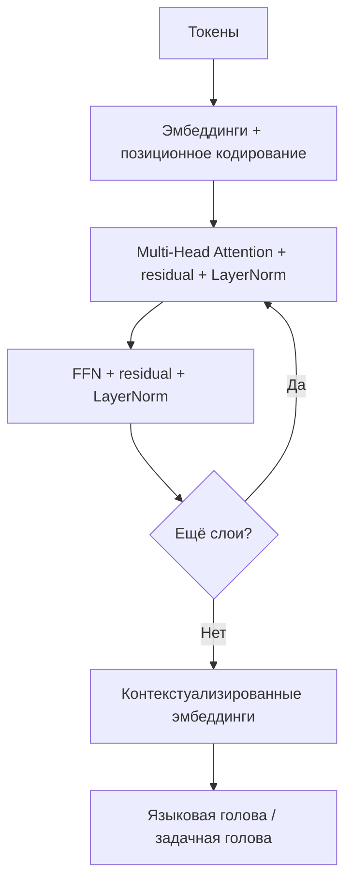

# Трансформеры (Transformers, BERT, GPT)

Трансформер (Transformer) — архитектура глубокого обучения, полностью основанная на механизме **внимания (attention)**, без рекуррентных и свёрточных связей. На ней построены языковые модели BERT (кодировщик с маскированным языковым моделированием) и GPT (декодировщик с авторегрессионным языковым моделированием).

## Подробное описание

**Постановка задачи:**  
Обрабатывать последовательности (прежде всего текст) параллельно и эффективно учитывать связи между любыми позициями независимо от расстояния между ними.

**Входные данные:**

- Последовательность токенов $x_1, ..., x_T$, преобразованная в векторные представления (эмбеддинги) размером $d$
- Для BERT — маскированные позиции; для GPT — смещённая на позицию последовательность

**Выходные данные:**

- Контекстуализированные эмбеддинги $z_1, ..., z_T$ (для дообучения / fine-tuning)
- Логиты словаря (для языкового моделирования) или задачная голова (классификация и т.д.)

**Ключевая идея:**  
Внимание позволяет каждому токену «смотреть» на все остальные токены последовательности и взвешенно собирать из них контекст. Матричные операции внимания полностью параллелизуются по длине последовательности, в отличие от пошаговой рекуррентности RNN.

**Исторический контекст:**  
Архитектура представлена в статье «Attention Is All You Need» (Васвани и коллеги, Google, 2017). BERT (Google, 2018) показал рекорды на понимании языка, GPT (OpenAI, 2018–2020) продемонстрировал масштабируемость авторегрессионных моделей вплоть до современных LLM.

## Основные принципы

### Математическая формулировка

Механизм масштабированного произведения внимания (scaled dot-product attention):

$$
\text{Attention}(Q, K, V) = \text{softmax}\left(\frac{Q K^\top}{\sqrt{d_k}}\right) V
$$

Где:

- $Q, K, V \in \mathbb{R}^{T \times d_k}$ — матрицы запросов (queries), ключей (keys) и значений (values), полученные из эмбеддингов линейными проекциями
- $\sqrt{d_k}$ — масштабирующий множитель: без него скалярные произведения при больших $d_k$ «перегревают» softmax, делая распределение близким к жёсткому argmax
- $\text{softmax}$ применяется по строке, то есть каждый запрос получает взвешенную сумму всех значений с весами-вниманием

**Многоголовое внимание (Multi-Head Attention):**

$$
\text{MultiHead}(Q, K, V) = \text{Concat}(\text{head}_1, ..., \text{head}_h) W^O,
\quad \text{head}_i = \text{Attention}(Q W_i^Q, K W_i^K, V W_i^V)
$$

Каждое «голово» внимания может специализироваться на своём типе связи (синтаксис, референсы, близость слов).

**Позиционное кодирование (positional encoding)** — обязательное дополнение: без рекуррентности трансформер не знает порядок токенов:

$$
PE_{(pos, 2i)} = \sin\left(\frac{pos}{10000^{2i/d}}\right), \quad
PE_{(pos, 2i+1)} = \cos\left(\frac{pos}{10000^{2i/d}}\right)
$$

**Блок энкодера (одна итерация):**

$$
\text{out} = \text{LayerNorm}(x + \text{MultiHeadAttention}(x, x, x)), \quad
\text{final} = \text{LayerNorm}(\text{out} + \text{FFN}(\text{out}))
$$

где FFN — позиционно-связная полносвязная сеть, применяемая к каждой позиции независимо.

### BERT и GPT

| | BERT | GPT |
|---|---|---|
| Архитектура | только энкодер | только декодир (каузальный) |
| Внимание | двустороннее | маска «смотрим только назад» |
| Обучение | masked language modeling (MLM): предсказание замаскированных токенов | авторегрессионное LM: предсказание следующего токена |
| Сильные стороны | понимание текста, классификация, NER, QA | генерация текста, диалоги, код |

### Схема стека трансформера



## Пример реализации на Python

Самовнимание, многоголовое внимание и позиционное кодирование на `numpy`, включая каузальную маску GPT и маску `[MASK]` в духе BERT.

```python
import numpy as np
from typing import List


def softmax_rows(z: np.ndarray) -> np.ndarray:
    """Softmax по каждой строке матрицы."""
    e = np.exp(z - z.max(axis=-1, keepdims=True))
    return e / e.sum(axis=-1, keepdims=True)


def scaled_dot_product_attention(Q, K, V, mask=None):
    """Масштабированное произведение внимания."""
    d_k = Q.shape[-1]
    scores = Q @ K.T / np.sqrt(d_k)  # (T, T)
    if mask is not None:
        # В запрещённых позициях ставим -inf (после softmax станет 0)
        scores = np.where(mask, scores, -1e9)
    weights = softmax_rows(scores)
    return weights @ V, weights


def multi_head_attention(x: np.ndarray, n_heads: int, seed: int = 0, causal: bool = False):
    """Многоголовое внимание по строкам матрицы x (T, d)."""
    T, d = x.shape
    assert d % n_heads == 0
    rng = np.random.default_rng(seed)
    d_head = d // n_heads
    heads = []
    # Каузальная маска для GPT: смотрим только на предыдущие позиции
    mask = np.tril(np.ones((T, T), dtype=bool)) if causal else None
    for _ in range(n_heads):
        # Случайные проекции Q, K, V в пространство головы (в реальной сети — обучаемые параметры)
        W_q = rng.normal(0, 1 / np.sqrt(d), (d, d_head))
        W_k = rng.normal(0, 1 / np.sqrt(d), (d, d_head))
        W_v = rng.normal(0, 1 / np.sqrt(d), (d, d_head))
        out, _ = scaled_dot_product_attention(x @ W_q, x @ W_k, x @ W_v, mask)
        heads.append(out)
    # Конкатенация голов и выходная проекция
    concat = np.concatenate(heads, axis=-1)
    W_o = rng.normal(0, 1 / np.sqrt(d), (d, d))
    return concat @ W_o


def sinusoidal_positional_encoding(seq_len: int, d_model: int) -> np.ndarray:
    """Позиционное кодирование по формуле из статьи Attention Is All You Need."""
    pos = np.arange(seq_len)[:, None]
    i = np.arange(d_model)[None, :]
    angle = pos / np.power(10000, (2 * (i // 2)) / d_model)
    pe = np.zeros((seq_len, d_model))
    pe[:, 0::2] = np.sin(angle[:, 0::2])
    pe[:, 1::2] = np.cos(angle[:, 1::2])
    return pe


def bert_style_mask_token(x: np.ndarray, mask_pos: int) -> np.ndarray:
    """Пространственная замена эмбеддинга маскированного токена (идея MLM)."""
    x = x.copy()
    x[mask_pos] = x.mean(axis=0)  # вместо [MASK] — усреднённый эмбеддинг
    return x


if __name__ == "__main__":
    # Мини-демо: «токены» = случайные эмбеддинги, d=8, T=5
    rng = np.random.default_rng(0)
    T, d, n_heads = 5, 8, 2
    x = rng.normal(0, 1, (T, d))

    # Позиционное кодирование добавляется к эмбеддингам
    x_pos = x + sinusoidal_positional_encoding(T, d)

    # Двустороннее внимание (BERT-стиль)
    out_bert = multi_head_attention(x_pos, n_heads, seed=1, causal=False)
    print("Выход двустороннего внимания (BERT):")
    print(np.round(out_bert, 3))

    # Каузальное внимание (GPT-стиль): маска не даёт «смотреть в будущее»
    out_gpt = multi_head_attention(x_pos, n_heads, seed=1, causal=True)
    _, weights = scaled_dot_product_attention(
        x_pos, x_pos, x_pos, mask=np.tril(np.ones((T, T), dtype=bool))
    )
    print("\nМатрица весов внимания с каузальной маской (GPT):")
    print(np.round(weights, 3))
    print("Нижний треугольник: позиция t видит только 0..t")

    # MLM-подобная маскировка: заменяем эмбеддинг 2-го токена
    x_masked = bert_style_mask_token(x_pos, mask_pos=2)
    out_masked = multi_head_attention(x_masked, n_heads, seed=1, causal=False)
    print("\nРазница выходов из-за маскировки токена 2 (BERT MLM):")
    print(np.round(np.linalg.norm(out_masked - out_bert, axis=1), 4))
```

## Достоинства и недостатки

**Достоинства:**

1. **Полный параллелизм по длине последовательности** — все позиции обрабатываются одновременно, обучение на GPU/TPU масштабируется эффективнее, чем у RNN.
2. **Прямые связи между любыми позициями** — внимание собирает контекст за один слой, поэтому дальние зависимости усваиваются легче, чем в рекуррентных сетях.
3. **Универсальность** — одна и та же архитектура работает для перевода, суммаризации, QA, генерации кода; BERT и GPT — лишь разные способы предобучения.
4. **Масштабируемость** — качество предобучения закономерно растёт с размером модели и корпуса (закон масштабирования), что подтвердили современные LLM.

**Недостатки:**

1. **Квадратичная сложность внимания по длине последовательности** — $O(T^2)$ вычислений и памяти ограничивают контекст (решается линейным и разреженным вниманием, FlashAttention).
2. **Огромные затраты на предобучение** — модели уровня GPT-3/4 обучаются на тысячах GPU в течение недель, что доступно лишь крупным лабораториям.
3. **Нет встроенного знания о порядке вдали от позиционного кодирования** — без позиционных эмбеддингов перестановка токенов не меняла бы выход.

## Области применения

1. Обработка естественного языка (поисковые ранжирование, суммаризация, машинный перевод, чат-боты и ассистенты на LLM)
2. Биотехнологии и медицинская информатика (предсказание структуры белков через трансформеры вроде ESM, извлечение знаний из медкарт)
3. Машинное обучение и рекомендательные системы (модели последовательностей SASRec/BERT4Rec, генерация описаний товаров)
