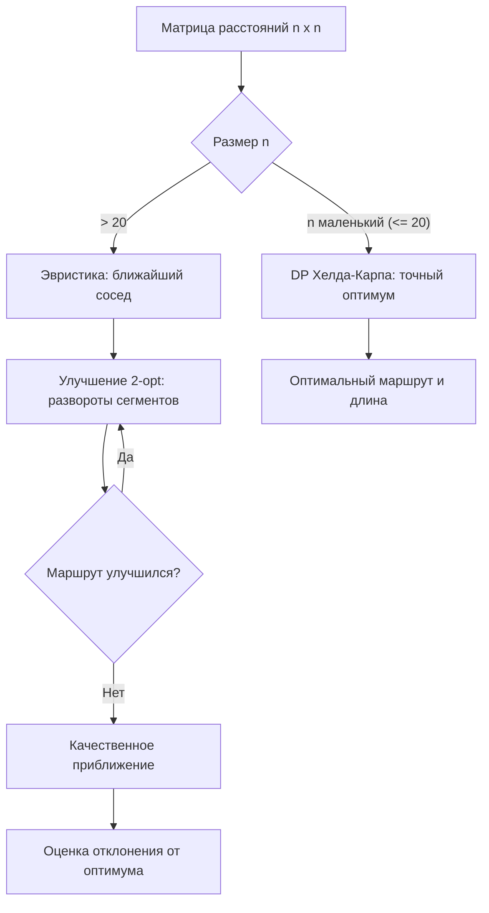

# Задача о коммивояжёре (Travelling Salesman Problem, TSP)

**Задача о коммивояжёре** (Travelling Salesman Problem, TSP) — найти кратчайший гамильтонов цикл в полном взвешенном графе: маршрут, проходящий через все города ровно один раз и возвращающийся в начальный. Задача NP-трудная, поэтому на практике применяют точные алгоритмы для малых размерностей и приближённые эвристики для больших.

## Подробное описание

**Постановка задачи:**
Дан набор городов $V = \{1, \dots, n\}$ и матрица расстояний $d_{ij}$. Найти перестановцию $\pi$ циклического вида, минимизирующую полную длину маршрута:

**Входные данные:**

- Число городов $n$ и матрица расстояний $d_{ij}$ (часто — симметричная, выполнена неравенство треугольника)

**Выходные данные:**

- Порядок обхода городов и длина кратчайшего маршрута $L^*$

**Ключевая идея:**
Число маршрутов $(n-1)!/2$ растёт факториально: уже при $n = 20$ это ~$6 \times 10^{16}$. Поэтому применяют:

- **точные** алгоритмы — динамическое программирование Хелда–Карпа ($O(n^2 2^n)$), ветви и границы (до $n \approx 60$–$100$);
- **приближённые** — эвристики (ближайший сосед, 2-opt, репликация) и алгоритмы с гарантией качества (Христидес — не хуже $1.5$ от оптимума для метрических TSP).

**Исторический контекст:**
Формулировка появилась в 1832 году как задача для курьерских маршрутов. В 1859 году Уильям Гамильтон предложил «игру Икосиан» — нахождение цикла на додекаэдре (эквивалент TSP для 20 вершин). Порог «решаемости» точными методами раздвинули Керниган (1970, ветви и границы) и Хелд–Карп (1962, DP). В 2013 году точный оптимум найден для задачи со 190 471 городом (Кук и др., решение заняло годы процессорного времени).

## Основные принципы

### Математическая формулировка

$$
L^* = \min_{\pi \in S_{n-1}} \left( d_{1, \pi_1} + \sum_{k=1}^{n-2} d_{\pi_k, \pi_{k+1}} + d_{\pi_{n-1}, 1} \right)
$$

Где:

- $\pi$ — перестановция городов $2 \dots n$ (город 1 — фиксированное начало, симметрия)
- $d_{ij}$ — расстояние между городами $i$ и $j$

**Динамическое программирование Хелда–Карпа.** Пусть $DP[S][j]$ — длина кратчайшего пути, начинающегося в городе 1, посещающего ровно множество $S$ городов и оканчивающегося в городе $j$:

$$
DP[S \cup \{j\}][j] = \min_{i \in S} \left( DP[S][i] + d_{ij} \right), \qquad DP[\{1\}][1] = 0
$$

Ответ: $\min_{j} \left( DP[V][j] + d_{j1} \right)$.

Где:

- $S$ — подмножество посещённых городов, кодируется битовой маской длины $n$
- число состояний $O(n 2^n)$, переходы из каждого — $O(n)$: итого $O(n^2 2^n)$

**Эвристика ближайшего соседа:** из текущего города выбирать ближайший непосещённый. Локальная оптимизация 2-opt: удалить два ребра $(a,b)$ и $(c,d)$, вставить $(a,c)$ и $(b,d)$, пока длина маршрута уменьшается.

### Схема работы



## Пример реализации на Python

Самодостаточная реализация на стандартной библиотеке: точное DP Хелда–Карпа, эвристика ближайшего соседа с улучшением 2-opt и полный перебор для контроля.

```python
import math
from itertools import permutations
from typing import List, Tuple


def held_karp(dist: List[List[float]]) -> Tuple[List[int], float]:
    """Точное решение TSP динамическим программированием Хелда-Карпа: O(n^2 * 2^n)."""
    n = len(dist)
    full = 1 << n
    # dp[S][j] — длина пути из города 0 через множество S, оканчивающегося в j
    dp = [[float("inf")] * n for _ in range(full)]
    parent = [[-1] * n for _ in range(full)]
    dp[1][0] = 0.0  # начали в городе 0

    for S in range(full):
        for j in range(n):
            if dp[S][j] == float("inf") or not (S >> j) & 1:
                continue
            for k in range(n):
                if (S >> k) & 1:
                    continue  # город k уже посещён
                newS = S | (1 << k)
                nd = dp[S][j] + dist[j][k]
                if nd < dp[newS][k]:
                    dp[newS][k] = nd
                    parent[newS][k] = j

    # замыкаем маршрут в 0
    best, last = float("inf"), -1
    for j in range(1, n):
        cand = dp[full - 1][j] + dist[j][0]
        if cand < best:
            best, last = cand, j

    # восстановление маршрута
    route = []
    S = full - 1
    while last != -1:
        route.append(last)
        prev = parent[S][last]
        S ^= 1 << last
        last = prev
    route.reverse()
    return route, best


def nearest_neighbor(dist: List[List[float]], start: int = 0) -> Tuple[List[int], float]:
    """Эвристика «ближайший сосед»: O(n^2)."""
    n = len(dist)
    unvisited = set(range(n))
    route = [start]
    unvisited.remove(start)
    while unvisited:
        cur = route[-1]
        nxt = min(unvisited, key=lambda j: dist[cur][j])
        route.append(nxt)
        unvisited.remove(nxt)
    length = sum(dist[route[i]][route[(i + 1) % n]] for i in range(n))
    return route, length


def tour_length(dist: List[List[float]], route: List[int]) -> float:
    """Полная длина замкнутого маршрута."""
    n = len(route)
    return sum(dist[route[i]][route[(i + 1) % n]] for i in range(n))


def two_opt(dist: List[List[float]], route: List[int]) -> Tuple[List[int], float]:
    """Улучшение маршрута разворотами сегментов, пока длина уменьшается: O(n^2) за проход."""
    n = len(route)
    route = route[:]
    improved = True
    while improved:
        improved = False
        for i in range(1, n - 1):
            for j in range(i + 1, n):
                # старые рёбра (a,b) и (c,d); новые (a,c) и (b,d)
                a, b = route[i - 1], route[i]
                c, d = route[j], route[(j + 1) % n]
                delta = dist[a][c] + dist[b][d] - dist[a][b] - dist[c][d]
                if delta < -1e-12:
                    route[i : j + 1] = reversed(route[i : j + 1])
                    improved = True
    return route, tour_length(dist, route)


def brute_force(dist: List[List[float]]) -> Tuple[List[int], float]:
    """Полный перебор (n-1)! маршрутов — контроль для малых n."""
    n = len(dist)
    best, best_len = None, float("inf")
    for perm in permutations(range(1, n)):
        route = [0] + list(perm)
        L = tour_length(dist, route)
        if L < best_len:
            best, best_len = route, L
    return best, best_len


if __name__ == "__main__":
    # 8 городов на плоскости (симметричная матрица, неравенство треугольника выполнено)
    cities = [
        (0, 0),   # 0 — склад (старт)
        (4, 3),   # 1
        (7, 1),   # 2
        (9, 6),   # 3
        (6, 9),   # 4
        (2, 8),   # 5
        (-1, 6),  # 6
        (-2, 2),  # 7
    ]
    n = len(cities)
    dist = [
        [((x1 - x2) ** 2 + (y1 - y2) ** 2) ** 0.5 for x2, y2 in cities]
        for x1, y1 in cities
    ]

    print(f"Города: {n}, возможных маршрутов: {math.factorial(n - 1) // 2}")

    # Точное решение
    opt_route, opt_len = held_karp(dist)
    print(f"\nОптимальный маршрут (Хелд-Карп): {opt_route}")
    print(f"Длина: {opt_len:.2f}")

    # Контроль полным перебором
    _, bf_len = brute_force(dist)
    assert abs(opt_len - bf_len) < 1e-9, "DP и перебор должны совпадать"
    print(f"Перебором (7!): {bf_len:.2f} — совпадает")

    # Эвристика ближайшего соседа
    nn_route, nn_len = nearest_neighbor(dist)
    print(f"\nБлижайший сосед: {nn_route}, длина {nn_len:.2f}, "
          f"отклонение +{(nn_len / opt_len - 1) * 100:.1f}%")

    # Улучшение 2-opt
    opt2_route, opt2_len = two_opt(dist, nn_route)
    print(f"Ближайший сосед + 2-opt: {opt2_route}, длина {opt2_len:.2f}, "
          f"отклонение +{(opt2_len / opt_len - 1) * 100:.1f}%")
```

## Достоинства и недостатки

**Точные алгоритмы (DP Хелда–Карпа, ветви и границы):**

1. **Гарантированный оптимум** — единственный способ узнать истинную минимальную длину маршрута и оценивать качество эвристик
2. **DP за $O(n^2 2^n)$** — решает практические задачи до $n \approx 20$–$25$ за секунды
3. **Ветви и границы** — на практике решает метрические задачы до сотен городов при удачных эвристиках отсечения

**Приближённые алгоритмы (NN, 2-opt, Christofides):**

1. **Скорость** — ближайший сосед и 2-opt считаются за секунды даже для миллионов городов
2. **Гарантии качества** — у метрического TSP Christofides даёт не хуже $1.5 L^*$, у NN при выполнении неравенства треугольника — не хуже $(\lceil n/2 \rceil - 1) L^*$
3. **Простота реализации** — 2-opt и NN помещаются в десятки строк кода

**Недостатки:**

1. **NP-трудность** — полиномиального точного алгоритма не существует (иначе P = NP)
2. **Эвристики не гарантируют оптимум** — 2-opt застревает в локальных минимумах; нужны случайные перезапуски, simulated annealing, генетические алгоритмы
3. **Разреженные и асимметричные варианты (ATSP)** — неравенство треугольника нарушается, гарантии разрушаются, точные методы становятся дороже

## Области применения

1. Оптимизация и планирование (построение календарей, маршрутов обслуживания оборудования, расстановка станков на заводе)
2. Логистика и управление цепочками (маршрутизация доставки заказов курьерами, обход магазинов сетью, планирование выездных бригад)
3. Биотехнологии и медицинская информатика (расшифровка ДНК: построение маршрута покрытия олигонуклеотидов, кластеризация последовательностей, планирование лучевой терапии — обход зон облучения)
