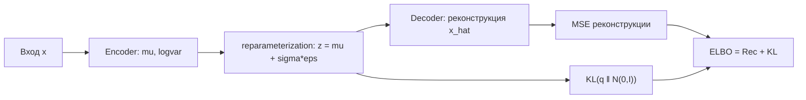

# Вариационные автоэнкодеры (VAE)

Вариационный автоэнкодер (Variational Autoencoder, VAE) — генеративная модель глубокого обучения, которая обучает encoder/decoder не для точечного сжатия, а для аппроксимации апостериорного распределения латентных переменных; генерация новых данных производится сэмплированием из латентного пространства.

## Подробное описание

**Постановка задачи:**  
Построить вероятностную генеративную модель $p_\theta(x)$, которая учится на неразмеченных данных и позволяет сэмплировать новые правдоподобные примеры.

**Входные данные:**

- Неразмеченные объекты $x_1, ..., x_n \sim p_{\text{data}}$
- Размерность латентного пространства $m$ (обычно 2–128; для 2D удобно визуализировать)

**Выходные данные:**

- Encoder $q_\phi(z \mid x)$ — параметры распределения (μ, log σ²) латентной переменной
- Decoder $p_\theta(x \mid z)$ — параметры распределения восстановленного объекта
- Генератор: $z \sim p(z) = \mathcal{N}(0, I)$, затем $x \sim p_\theta(x \mid z)$

**Ключевая идея:**  
Вместо одной точки $z$ encoder выдаёт параметры гауссианы. При обучении объект может «сидеть» в разных местах латентного пространства, что делает его непрерывным и заполненным — а значит, сэмплирование из него порождает осмысленные новые данные. Согласованность распределений обеспечивает дивергенция KL.

**Исторический контекст:**  
VAE предложили Кингма и Веллинг в 2013 году (авторы опубликовали статью под псевдонимами Kingma и Welling; метод известен как автоэнкодер с вариационным выводом). Работа заложила основу стохастического латентного моделирования наряду с GAN.

## Основные принципы

### Математическая формулировка

Модель порождает данные так: $z \sim p(z) = \mathcal{N}(0, I)$, затем $x \sim p_\theta(x \mid z)$. Цель — максимизировать логарифм правдоподобия:

$$
\log p_\theta(x) \ge \mathbb{E}_{q_\phi(z|x)}\left[\log p_\theta(x|z)\right] - D_{KL}\left(q_\phi(z|x) \,\|\, p(z)\right) = \text{ELBO}
$$

Где:

- $q_\phi(z|x) = \mathcal{N}(\mu_\phi(x), \operatorname{diag}(\sigma^2_\phi(x)))$ — аппроксимация апостериора encoder'ом
- $p(z) = \mathcal{N}(0, I)$ — априорное латентное распределение
- $D_{KL}$ — дивергенция Кульбака–Лейблера, штрафует расхождение апостериора с априором
- ELBO (evidence lower bound) — нижняя граница логарифма правдоподобия; её максимизация эквивалентна обучению

Первое слагаемое — ошибка реконструкции (при гауссиане на $x$ сводится к MSE), второе — «регуляризатор», сжимающий латентные распределения к стандартному нормальному.

**Приём репараметризации (reparameterization trick):** сэмпл $z = \mu + \sigma \odot \epsilon$, $\epsilon \sim \mathcal{N}(0, I)$ переносит стохастичность из графа параметров $\phi$ в отдельную переменную $\epsilon$, делая градиенты по $\mu, \sigma$ дифференцируемыми обычным backprop.

Формула KL для независимых гауссиан (поэлементно):

$$
D_{KL} = -\frac{1}{2} \sum_{j=1}^{m} \left(1 + \log \sigma_j^2 - \mu_j^2 - \sigma_j^2\right)
$$

### Схема обучения



## Пример реализации на Python

Полноценный VAE на `numpy`: encoder/decoder — MLP, ELBO с приёмом репараметризации, обучение на смеси гауссиан; после обучения сэмплируем новые точки из латентного априора. На игрушечном примере KL-вес $\beta$ сознательно мал (0.01), чтобы избежать posterior collapse — в β-VAE $\beta$ регулирует баланс между реконструкцией и «упорядоченностью» латентного пространства.

```python
import numpy as np


def relu(z):
    """ReLU."""
    return np.maximum(0, z)


def sigmoid(z):
    """Сигмоида с ограничением аргумента."""
    return 1.0 / (1.0 + np.exp(-np.clip(z, -30, 30)))


class Layer:
    """Полносвязный слой с обратным проходом."""

    def __init__(self, in_dim, out_dim, rng, act="relu"):
        self.W = rng.normal(0, np.sqrt(2.0 / in_dim), (in_dim, out_dim))
        self.b = np.zeros(out_dim)
        self.act = act

    def forward(self, x):
        self.x = x
        z = x @ self.W + self.b
        if self.act == "relu":
            self.a = relu(z)
        elif self.act == "sigmoid":
            self.a = sigmoid(z)
        else:
            self.a = z
        return self.a

    def backward(self, d_out, lr):
        if self.act == "relu":
            d_out = d_out * (self.a > 0)
        elif self.act == "sigmoid":
            d_out = d_out * self.a * (1 - self.a)
        dW = self.x.T @ d_out
        db = d_out.sum(axis=0)
        d_x = d_out @ self.W.T
        self.W -= lr * dW
        self.b -= lr * db
        return d_x


class VAE:
    """Вариационный автоэнкодер: 2 -> 16 -> (mu, logvar) -> z -> 16 -> 2."""

    def __init__(self, input_dim=2, latent_dim=2, hidden=16, seed=0, beta=0.01):
        rng = np.random.default_rng(seed)
        self.latent_dim = latent_dim
        self.beta = beta  # вес KL-члена (beta-VAE)
        # Encoder
        self.e1 = Layer(input_dim, hidden, rng, "relu")
        self.e_mu = Layer(hidden, latent_dim, rng, "linear")
        self.e_lv = Layer(hidden, latent_dim, rng, "linear")
        self.e_lv.b -= 1.0  # стартовый logvar ≈ -1 (sigma ≈ 0.4), против преждевременного схлопывания
        # Decoder
        self.d1 = Layer(latent_dim, hidden, rng, "relu")
        self.d_out = Layer(hidden, input_dim, rng, "sigmoid")

    def encode(self, x):
        h = self.e1.forward(x)
        # Обрезаем logvar, чтобы экспонента не взрывалась и не «схлопывала» KL
        return self.e_mu.forward(h), np.clip(self.e_lv.forward(h), -4.0, 2.0)

    def reparameterize(self, mu, logvar, rng):
        """Приём репараметризации: z = mu + sigma * eps, eps ~ N(0, I)."""
        self.sigma = np.exp(0.5 * logvar)
        self.eps = rng.normal(0, 1, mu.shape)
        return mu + self.sigma * self.eps

    def decode(self, z):
        h = self.d1.forward(z)
        return self.d_out.forward(h)

    def train_step(self, x, lr=0.05, rng=None):
        """Один шаг: градиент ELBO (MSE + beta * KL)."""
        mu, logvar = self.encode(x)
        z = self.reparameterize(mu, logvar, rng)
        x_hat = self.decode(z)

        n = x.shape[0]
        # Реконструкция (MSE)
        rec = np.mean((x_hat - x) ** 2)
        d_rec = 2.0 * (x_hat - x) / (n * x.shape[1])

        # KL (аналитически для гауссиан)
        kl = -0.5 * np.mean(np.sum(1 + logvar - mu**2 - np.exp(logvar), axis=1))

        # Обратный проход декодера до z
        d = self.d_out.backward(d_rec, lr)
        d = self.d1.backward(d, lr)  # dL/dz

        # Производная KL по mu и logvar
        d_mu_kl = mu / n
        d_lv_kl = 0.5 * (np.exp(logvar) - 1) / n

        # Производная reparameterize: z = mu + exp(0.5*lv)*eps
        d_mu = d + self.beta * d_mu_kl
        d_lv = d * self.eps * 0.5 * np.exp(0.5 * logvar) + self.beta * d_lv_kl

        # Обратный проход encoder'а (две головы mu и logvar)
        h = self.e1.a
        # Голова mu
        dW = h.T @ d_mu
        d_h = d_mu @ self.e_mu.W.T
        self.e_mu.W -= lr * dW
        self.e_mu.b -= lr * d_mu.sum(axis=0)
        # Голова logvar
        dW = h.T @ d_lv
        d_h += d_lv @ self.e_lv.W.T
        self.e_lv.W -= lr * dW
        self.e_lv.b -= lr * d_lv.sum(axis=0)
        # Скрытый слой encoder'а
        self.e1.backward(d_h, lr)

        return float(rec + self.beta * kl), float(rec), float(kl)

    def sample(self, n, rng):
        """Генерация: z ~ N(0, I), затем декодер."""
        z = rng.normal(0, 1, (n, self.latent_dim))
        return self.decode(z)


def make_blobs(n=300, seed=0):
    """Три «облака» в 2D — проверка, что VAE разнесёт их в латенте."""
    rng = np.random.default_rng(seed)
    centers = np.array([[0.2, 0.2], [0.8, 0.3], [0.5, 0.8]])
    labels = rng.integers(0, 3, n)
    data = centers[labels] + rng.normal(0, 0.05, (n, 2))
    return np.clip(data, 0, 1), labels


if __name__ == "__main__":
    data, labels = make_blobs(n=600, seed=1)
    vae = VAE(input_dim=2, latent_dim=2, hidden=16, seed=42, beta=0.01)
    rng = np.random.default_rng(0)

    print("Обучение VAE (ELBO = MSE + beta * KL):")
    for epoch in range(3000):
        loss, rec, kl = vae.train_step(data, lr=0.05, rng=rng)
        if epoch % 1000 == 0:
            print(f"  эпоха {epoch:4d}: ELBO-лосс={loss:.4f}, rec={rec:.4f}, KL={kl:.4f}")

    # Генерация новых точек из априора N(0, I)
    generated = vae.sample(300, rng)
    print(f"\nСгенерированные точки: mean={generated.mean(axis=0).round(3)}, "
          f"std={generated.std(axis=0).round(3)}")
    print(f"Реальные данные:      mean={data.mean(axis=0).round(3)}, "
          f"std={data.std(axis=0).round(3)}")

    # Латентные центры кластеров разнесены — признак осмысленного пространства
    mu, _ = vae.encode(data)
    for c in range(3):
        z_c = mu[labels == c]
        print(f"  кластер {c}: латентный центр = {z_c.mean(axis=0).round(3)}")

    # Интерполяция между двумя латентными точками
    z1, z2 = mu[labels == 0][0], mu[labels == 2][0]
    alphas = np.linspace(0, 1, 5)[:, None]
    interp = vae.decode((1 - alphas) * z1 + alphas * z2)
    print("\nИнтерполяция кластер 0 -> кластер 2:")
    print(np.round(interp, 3))
```

## Достоинства и недостатки

**Достоинства:**

1. **Стабильное обучение** — оптимизация обычным SGD по ELBO, без соревновательной динамики GAN и её режимов коллапса.
2. **Полноценная вероятностная модель** — явное априор $p(z)$, оценка логарифма правдоподобия (ELBO), когерентное латентное пространство.
3. **Генерация и интерполяция** — новые данные сэмплируются из априора, а интерполяции в латенте дают плавные переходы между объектами.
4. **Обучение без учителя + дообучение** — VAE предобучает репрезентации, которые затем используются в задачах с учителем.

**Недостатки:**

1. **Нечёткие сгенерации** — MSE-реконструкция «размывает» детали (особенно изображения); современные работы используют perceptual loss и LSGAN-стиль.
2. **Слабое использование латентного пространства** — KL-штраф может «схлопывать» неиспользуемые измерения (posterior collapse, решается free bits и β-VAE).
3. **Сложность теоретической базы** — вариационный вывод и ELBO требуют понимания вероятностных моделей, что повышает порог входа.

## Области применения

1. Машинное обучение и рекомендательные системы (генеративные эмбеддинги пользователей, VAE для восстановления предпочтений, синтез данных)
2. Игровая разработка (генерация текстур, ландшафтов и ассетов, вариативное наполнение процедурных миров)
3. Научные вычисления и физическое моделирование (генерация синтетических траекторий динамических систем, сжатие поля состояний, поиск новых молекулярных структур)
